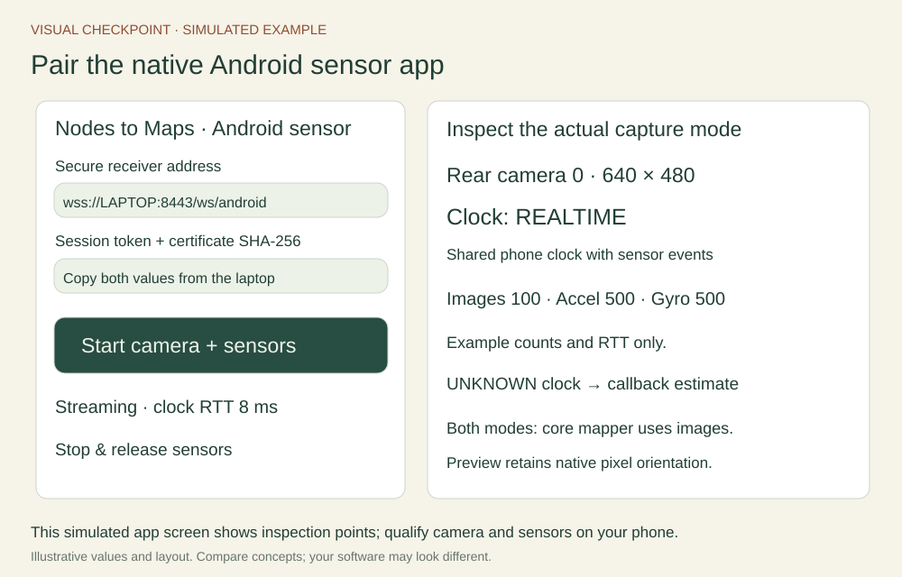

# Annex A: develop the Android sensor app

The native Android app is the sensor client for this course, with wired USB and wireless connection options. Camera2 provides camera stream configuration and timestamp metadata; SensorManager supplies individually timestamped motion events. This gives us a clearer measurement contract for teaching and future research. Each phone still needs a practical qualification run.

## One app, two connection options

| Capability | Native Android app |
| --- | --- |
| Installation | Supplied classroom APK on Android 8.0+ |
| Image acquisition | Camera2, fixed camera ID and native YUV size |
| Camera time | Camera timestamp when REALTIME; labelled callback estimate for UNKNOWN |
| Motion time | Individual SensorEvent timestamps for accelerometer and gyroscope |
| Connection | Wired USB with ADB reverse, or wireless over the phone hotspot |
| Receiver trust | Exact server certificate SHA-256 and a fresh session token |
| Core mapping result | Sparse monocular reconstruction from camera images |

The native APIs improve access and observability. They do not by themselves solve lens calibration, camera–IMU mounting, timing validation, rolling shutter, noise or bias. The supplied mapper uses camera images. The IMU exercises prepare students to understand a later fusion project.

Official background: [Camera2 overview](https://developer.android.com/media/camera/camera2), [camera timestamp source](https://developer.android.com/reference/android/hardware/camera2/CameraCharacteristics#SENSOR_INFO_TIMESTAMP_SOURCE), and [SensorEvent timestamp and axes](https://developer.android.com/reference/android/hardware/SensorEvent).

## Install and pair the classroom APK

Download the [Android classroom test APK](../../downloads/nodes-to-maps-sensor-debug.apk) and [SHA-256 checksum](../../downloads/nodes-to-maps-sensor-debug.apk.sha256). On Android, open the APK and follow the device’s installation prompt. If Android requests permission to install from your browser or file manager, allow that source for the installation and turn the allowance off afterward. The supplied APK uses a classroom development signature. An instructor should rehearse it on the intended phones before distribution.

Start the updated phone_bridge on Ubuntu. Its terminal prints a session token and **ANDROID SERVER CERTIFICATE SHA-256**. Enter three values in the app: the wss:// endpoint ending in /ws/android, the token and that 64-digit fingerprint. Tap **Start camera + sensors**. Grant camera permission if requested, then tap Start again. Sensor support is reported after connection. Keep this screen visible during the run.



For wireless, use the laptop’s IPv4 address on the phone hotspot. For wired USB, establish adb reverse and enter wss://127.0.0.1:8443/ws/android. [Annex E](../annexes/android-connections.md) gives both options on native Ubuntu, with [Annex F](../annexes/wsl-capstone.md) covering WSL. Stop releases capture; switching away from the app also stops the session.

## Read the small project

The [Android source ZIP](../../downloads/android-sensor-source.zip) contains an Android Studio project with three Java classes:

| File | What to trace |
| --- | --- |
| MainActivity.java | Permission, connection state, seven clock exchanges, motion callbacks, counters and cleanup |
| CameraFeed.java | Camera selection, YUV dimensions, timestamp source, capture request and JPEG conversion |
| SensorSocket.java | Pinned TLS, WebSocket upgrade, bounded outgoing queue, masked client frames and closure |
| AndroidManifest.xml | CAMERA/INTERNET permissions, minimum SDK and foreground activity |

Open the project in Android Studio with JDK 17 and Android SDK 35. The supplied Gradle configuration uses Android Gradle plugin 8.7.3 with Gradle 8.9. Use the included Gradle wrapper (`./gradlew :app:assembleDebug`, or gradlew.bat on Windows) to build the debug APK and inspect app/build/outputs/apk/debug/app-debug.apk. A direct Windows compiler script is also supplied in the source ZIP; its README lists the required tool directories. The [Android build guide](https://developer.android.com/build/building-cmdline) and [app signing guide](https://developer.android.com/studio/publish/app-signing) explain reproducible builds and release signing.

For your public course release, retain your own protected signing key so later APK versions can update the same application. Distribute the APK and its checksum. If your rebuilt APK uses a different signer, uninstall the classroom build before installing yours. Signing keys stay outside the downloadable source. A successful build and signature check establish package integrity; device tests establish camera and sensor behavior.

## Follow a camera image

CameraFeed selects a rear Camera2 ID, preferring a REALTIME timestamp source, then the largest supported even YUV dimensions with each edge at most 640 pixels. It displays those choices. ImageReader acquires the latest available frame. The app samples at a 10 fps send target and converts the plane buffers into NV21, respecting row stride and pixel stride, before JPEG encoding.

```java
long sampleNs = realtime ? image.getTimestamp()
                         : SystemClock.elapsedRealtimeNanos();
```

For REALTIME cameras, the image timestamp is in the elapsed-realtime clock domain shared by Android sensor events. For UNKNOWN cameras, the app labels camera timing as a callback estimate and keeps the exercise camera-only. The timestamp-source field is visible in the app and receiver diagnostics. Image timestamps describe capture timing; exposure duration and rolling shutter still affect the scene represented by each frame.

The transmitted pixels retain their native sensor orientation: no rotation, mirroring or resize is applied. The preview shows those same pixels. A portrait phone can therefore show a landscape-oriented image. Calibrate the dimensions and axes visible in ROS. Stabilization is requested off; focus is continuous-video when supported. Validate the selected phone’s processing and focus behavior on fresh target views.

## Preserve each inertial sample’s timestamp

Accelerometer and gyroscope events arrive independently. The app sends each event as its own packet, using SensorEvent.timestamp. Accelerometer values use m/s²; gyroscope values already use rad/s. Android device axes are x toward the device’s right, y toward its top and z out of its screen in the device’s natural orientation. They stay tied to the device when the UI rotates; use the official sensor-axis diagrams when checking a particular device.

```json
{"type":"accel","seq":0,"t_ms":12345.0,"values":[0.0,0.0,9.8]}
```

The receiver publishes /phone/imu/accelerometer and /phone/imu/gyroscope under phone_android_device. Each message marks the other measurement and orientation unavailable. There is no artificial combined sample with two different acquisition times hidden behind one header. A later fusion adapter must define its interpolation/alignment policy for an estimator expecting a combined IMU message.

The app requests events at 50 Hz per sensor and limits sends to that rate; actual rates depend on hardware and scheduling. A shared send budget limits bursts, and events delivered over 250 ms late are skipped. The bounded socket queue also drops work under pressure. These controls help preserve a fresh inspection stream within the receiver’s traffic limit. Compare observed topic rates and timestamps with the requested rates.

## Authenticate and stop cleanly

SensorSocket validates the TLS leaf certificate’s validity dates and its exact SHA-256 fingerprint. Copying that fingerprint from the intended laptop binds the app to that receiver. The app uses its own scoped pin check, so no phone-wide development CA installation is needed. A different or renewed certificate needs a new fingerprint. The session token then authorizes one phone connection.

The app uses protocol version 2 on /ws/android for both USB and wireless. The receiver permits one paired phone at a time. Stop capture before changing the connection route. The Android app stops capture in onPause, closes the socket and releases the screen-awake flag. Pairing fields remain only in process memory and are excluded from Android saved state and backup.

## Test a change and prepare a classroom release

First run the supplied transport and protocol tests. Then check a real phone: install, deny/grant camera permission, wrong/right certificate pin, wrong/right token, Start/Stop, backgrounding, reconnect, image dimensions, timestamp-source display, sensor rates and camera calibration. Record the phone/OS, app checksum, camera ID and backend versions with a short bag. Finish with the live/reference monocular mapping exercise.
