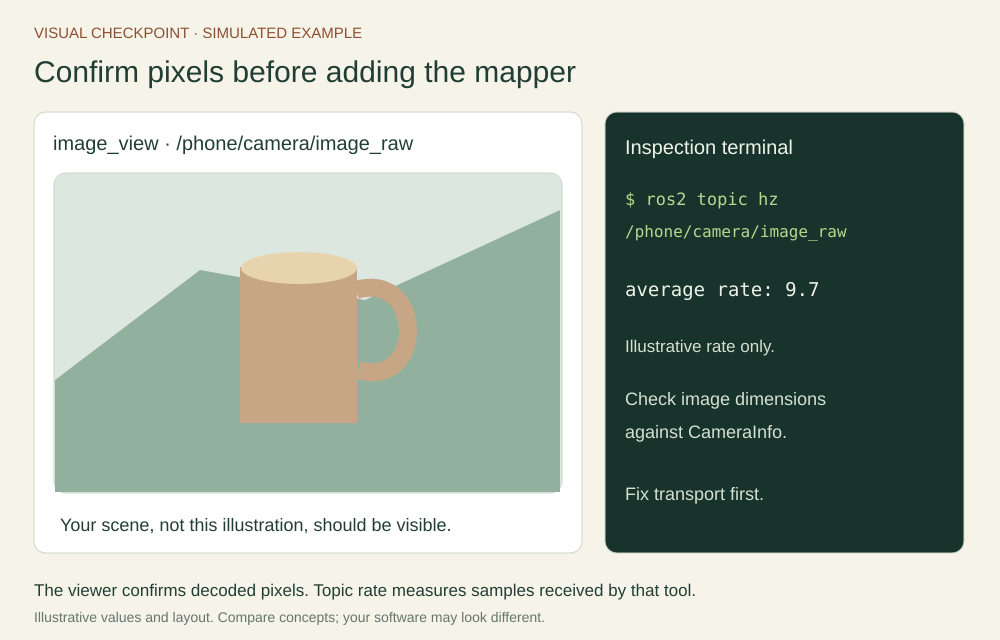

# Annex B: build and understand the ROS receiver

Allow 60–90 minutes after lectures 2 and 3. This tour follows the actual Python node in the workspace ZIP. A **ROS node** is a program participant in the ROS graph; it is separate from Node.js. This receiver uses Python, aiohttp, rclpy and OpenCV.

## Locate the complete implementation

In Resources, download the workspace or use the source-file selector. Read ros/workspace/src/ros2_course_py/ros2_course_py/phone_protocol.py first, then phone_bridge.py. setup.py installs phone_bridge as a console executable. package.xml declares its ROS and Python dependencies. The receiver needs no phone webpage or static web assets.

| Component | Job | Why it is separate |
| --- | --- | --- |
| Session in phone_protocol.py | Validate packet fields, sequences and clock conversion | Can be tested without ROS or a phone |
| create_app in phone_bridge.py | Handle native /ws/android WSS sessions over USB or wireless | Can use a fake publication sink in tests |
| RosSink | Decode JPEG and publish ROS messages | Owns ROS-specific dependencies and publishers |
| main | Parse options, create TLS context and spin ROS | Connects the server and ROS executor lifetimes |


## Follow one packet across the boundary

The Android app checks the receiver certificate pin and sends a version-2 hello to /ws/android. The server checks its client type and token. Only one phone can be paired at a time. USB and wireless use the same endpoint path and version-2 protocol. The receiver replies ready, answers sync requests and accepts a clock conversion. Each sensor stream carries its own increasing sequence number and phone-relative timestamp. Session converts it into laptop time and rejects nonfinite values, stale times and invalid sizes before RosSink is called.

```json
{"type":"accel","seq":0,"t_ms":12345.0,"values":[0.0,0.0,9.8]}
```

These are illustrative values, not a calibration or a packet to replay into an arbitrary live session. The timestamp must fit that session’s measured offset. The image, accelerometer and gyroscope sequences advance independently. Observe their validators in phone_protocol.py, then predict which check rejects a repeated sequence number.

The aiohttp event loop receives web traffic while a separate ROS executor thread processes ROS work. This keeps the transport logic out of a blocking subscription callback. A production system would also need a deployment-specific load and security review; the supplied server is scoped to paired classroom devices.

## Decode pixels and publish a standard message

For an image, the sink base64-decodes the payload, uses cv2.imdecode, checks the real dimensions, then constructs a bgr8 Image. The following excerpt shows the central conversion; the complete code includes validation, timestamps, CameraInfo and compressed publication.

```python
# Concept excerpt inside a ROS node with a CvBridge and Image publisher.
pixels = cv2.imdecode(np.frombuffer(jpeg_bytes, dtype=np.uint8), cv2.IMREAD_COLOR)
msg = bridge.cv2_to_imgmsg(pixels, encoding='bgr8')
msg.header.stamp = stamp
msg.header.frame_id = 'phone_camera_optical_frame'
image_publisher.publish(msg)
```

The image header records time and coordinate meaning. The matching CameraInfo header is copied from it. A measured ROS camera YAML supplies K, D, R and P; before calibration, zero intrinsics explicitly indicate an uncalibrated camera. These matrices describe projection, while TF describes relative frame geometry. Read the official [Image definition](https://docs.ros.org/en/jazzy/p/sensor_msgs/msg/Image.html), [CameraInfo definition](https://docs.ros.org/en/jazzy/p/sensor_msgs/msg/CameraInfo.html) and [cv_bridge source](https://github.com/ros-perception/vision_opencv) to understand the fields.

## Publish IMU data with an honest contract

RosSink publishes Android component events under phone_android_device. An accel packet creates an Imu on /phone/imu/accelerometer; a gyro packet creates one on /phone/imu/gyroscope. The other component is marked unavailable by setting its covariance[0] to -1. Orientation is also unavailable, so orientation_covariance[0] is -1 as specified by the [Imu message definition](https://docs.ros.org/en/jazzy/p/sensor_msgs/msg/Imu.html). An all-zero covariance for an available component means unknown uncertainty. Estimate it from qualified data before configuring fusion. A future estimator adapter must define how independent native events are aligned into its expected input format.

The sink uses sensor-data QoS, which favors timely sensor delivery. Inspect offered policies with ros2 topic info --verbose and choose compatible consumers. The phone-to-laptop WebSocket is ordered and reliable; the ROS publication has a separate QoS contract. Changing the ROS queue cannot remove delay already accumulated in image encoding or network buffers.

## Run and verify one stage at a time

Follow Phone lab setup for the certificate and phone trust steps. In a sourced Ubuntu terminal:

```bash
ros2 run ros2_course_py phone_bridge \
  --cert ~/phone-lab/laptop.pem --key ~/phone-lab/laptop-key.pem
```

Pair from the phone, then open another sourced terminal:

```bash
ros2 node info /phone_bridge
ros2 topic info /phone/camera/image_raw --verbose
ros2 topic hz /phone/camera/image_raw
ros2 topic echo /phone/camera/camera_info --once --qos-reliability best_effort
ros2 run image_view image_view --ros-args -r image:=/phone/camera/image_raw
```

Expect your scene in image_view, plausible dimensions, and increasing received counts. With no calibration, K starts with zero. After restarting with --calibration, compare the dimensions and matrix with the measured YAML. A small received rate compared with the send target suggests you should inspect image size, network load and processing before adding SLAM.




## Make one controlled change

As an exercise, add a diagnostic counter for accepted images and print a once-per-second summary so diagnostics stay readable at higher image rates. Explain where malformed packets are rejected and where decoded dimensions are checked. Keep sensor timestamps attached to the original samples when adding processing stages.

Use maintenance/tests/test_phone.py for protocol and fake-sink integration checks, then rebuild and repeat the actual phone test. Passing protocol tests establishes packet behavior; the device run establishes camera decoding, native certificate pinning and ROS publication. For later extensions, consider [image_transport](https://docs.ros.org/en/jazzy/p/image_transport/) for ROS image transport plugins and [ROS executors](https://docs.ros.org/en/jazzy/Concepts/Intermediate/About-Executors.html) for callback scheduling.
