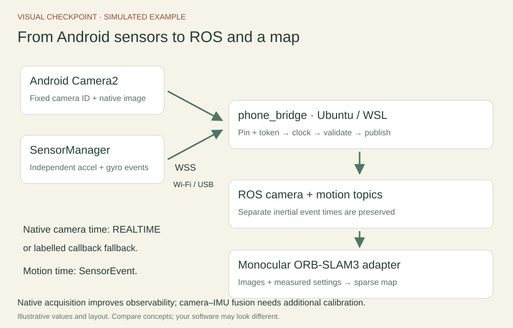
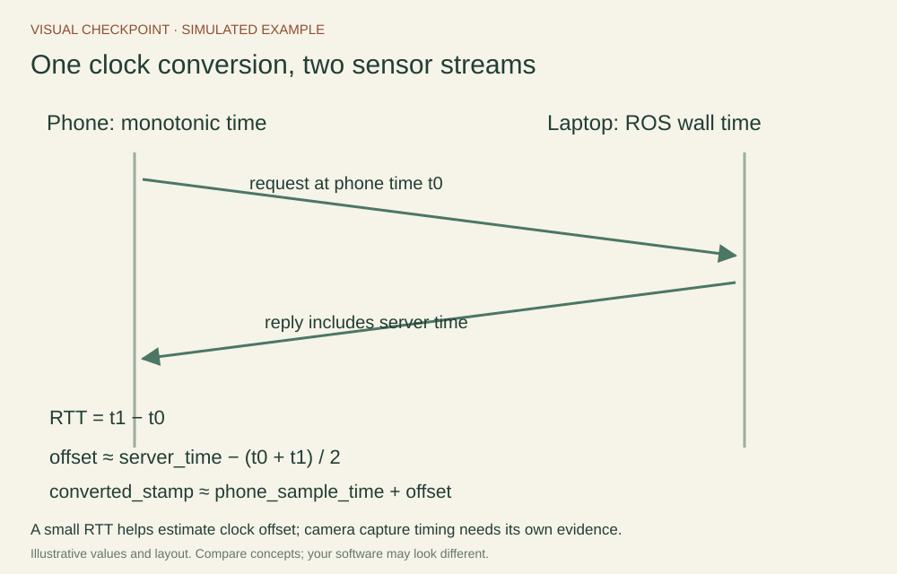

# How the Android app and ROS receiver work

The native Android APK sends camera and motion data to the laptop receiver using either wired USB or wireless. Both options publish the same ROS topics for inspection and monocular mapping. [Annex E](../annexes/android-connections.md) explains the connection setup.

## Assign a job to each component

The phone client reads sensors, records their time/frame meaning, encodes small images and manages a bounded send queue. The laptop’s phone_bridge validates packets, maps phone times to ROS time, decodes JPEGs and publishes messages. The optional phone_mono adapter feeds images into the external ORB-SLAM3 engine. Website hosting distributes instructions and software; the receiver and mapper run on each laptop.

## Qualify the Android capture mode

Android uses Camera2 and SensorManager. The app displays the camera ID, dimensions, focus mode and timestamp source. A REALTIME source shares its clock domain with SensorEvent; UNKNOWN uses a labelled image callback estimate. Android accelerometer and gyroscope events retain their independent timestamps. The app stops capture when it leaves the foreground.

The app sends directly to the configured laptop endpoint, keeps the token in memory and releases capture on Stop. USB carries the connection through ADB reverse; wireless reaches the laptop over the phone hotspot. Test your selected route on the actual device before class. See [Annex A](../annexes/android-development.md) for the native implementation.

## Pair and establish time

The native endpoint is /ws/android with protocol version 2 and client android-camera2. The server accepts a native connection without a browser Origin header and checks its version and session token. The APK checks the exact TLS leaf certificate fingerprint copied from the receiver terminal, including certificate validity dates. This scopes trust to that one server connection.

The receiver reserves one paired-phone slot. Stop capture before changing from USB to wireless or pairing a different phone. Both routes use the same version-2 protocol.

Seven sync request/reply exchanges estimate offset to laptop ROS wall time. A clock packet establishes the selected conversion before sensors are accepted. Each stream has its own increasing sequence and timestamp. The receiver rejects invalid sizes/numbers, malformed JPEGs, old/future timestamps and duplicate sequences. Its rate limit is 150 messages per second.

## Read the published sensor topics

| Topic | Meaning |
| --- | --- |
| /phone/camera/image_raw | Decoded bgr8 Image, with capture/callback time converted to ROS time |
| /phone/camera/image_raw/compressed | The transmitted JPEG as CompressedImage |
| /phone/camera/camera_info | CameraInfo from measured calibration, or zero intrinsics before calibration |
| /phone/imu/accelerometer | Android acceleration component, m/s², individual SensorEvent timestamp |
| /phone/imu/gyroscope | Android angular-rate component, rad/s, individual SensorEvent timestamp |
| /phone/diagnostics | Session, camera metadata and clock-estimate information |

Android component messages use phone_android_device. Each marks the missing component and orientation unavailable with covariance[0] = -1. Unknown covariance remains unknown. The image frame phone_camera_optical_frame describes the transmitted pixels: x right, y down, z forward. CameraInfo describes projection; measured relative geometry belongs in TF.

## Interpret the mapper and its outputs

The supplied adapter uses only images in ORB-SLAM3 MONOCULAR mode. Pangolin shows the engine’s optimized sparse landmarks and keyframes. The ROS camera_pose, currently tracked_points and bounded path are diagnostic views in phone_slam_world, whose scale and gravity direction are not established. Normal shutdown exports a keyframe trajectory.

A native source makes timing and capture choices more inspectable. An inertial estimator additionally needs stable intrinsics, camera–IMU extrinsics, time validation, noise/bias characterization and an adapter that handles the separate motion streams. Annex C describes that further project. The provided monocular exercise remains a practical way to learn the full sensor-to-ROS-to-mapping path.
