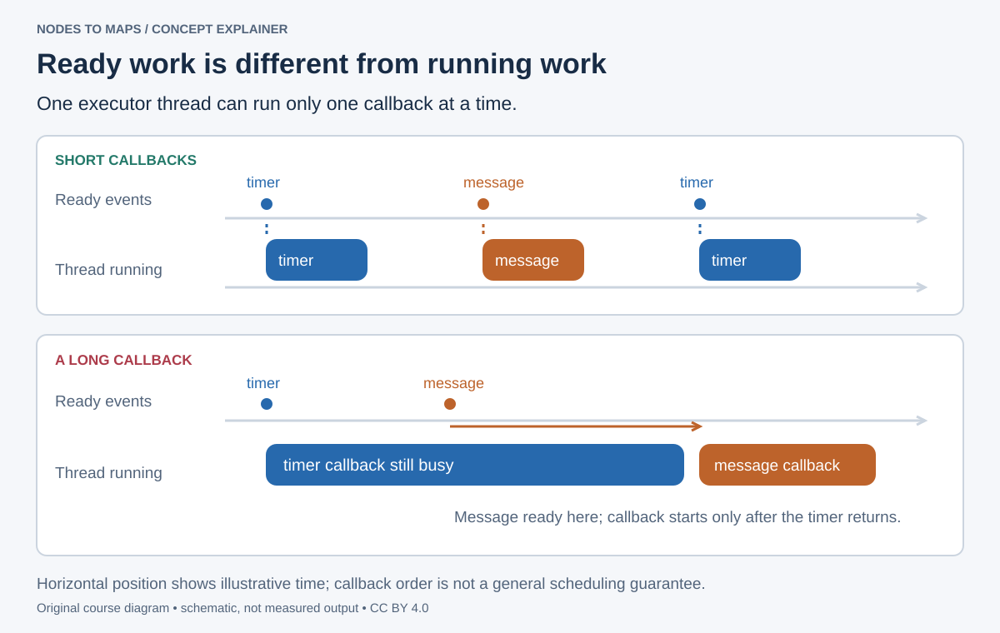
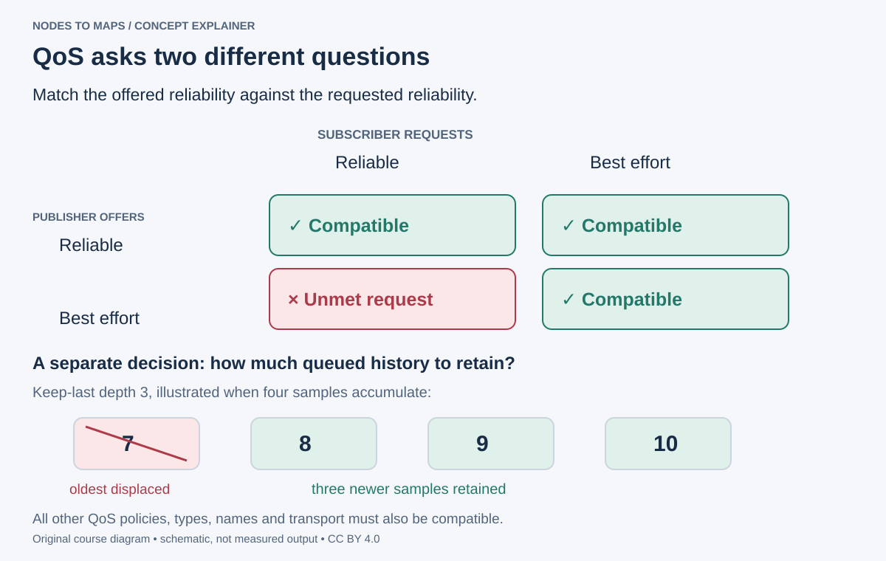
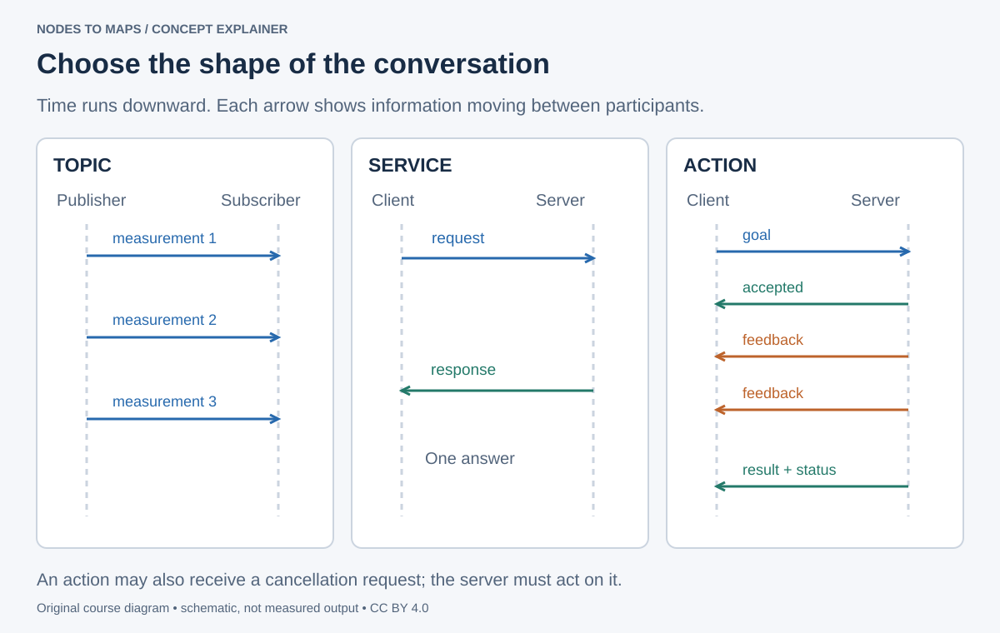
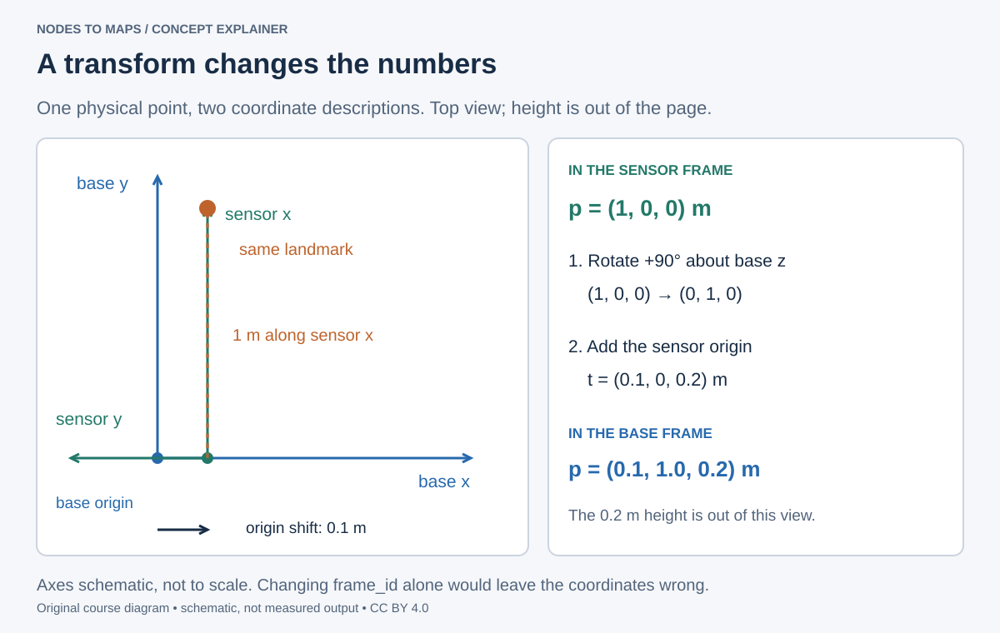
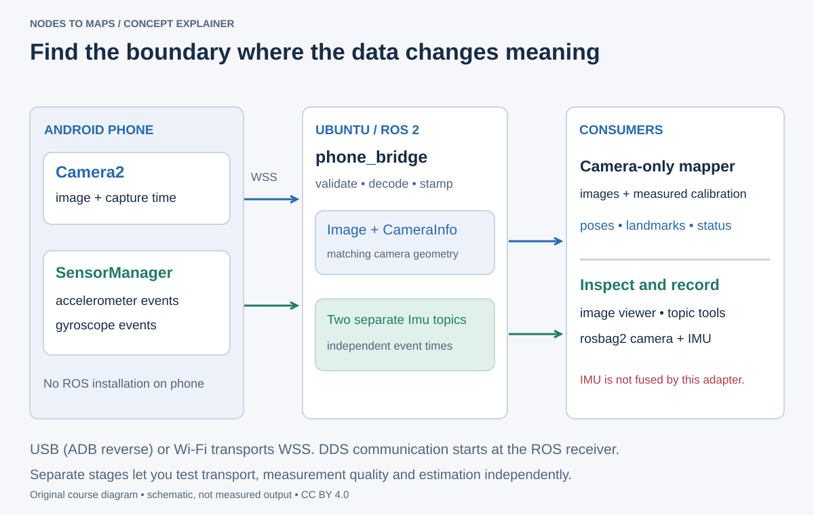
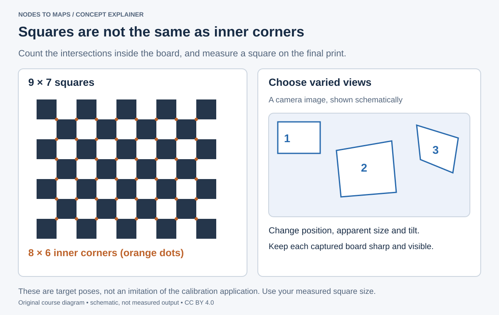
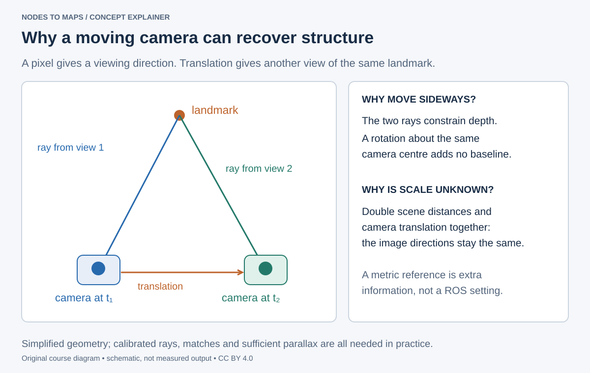

# Read the diagrams, then test the claim

These diagrams explain relationships that are harder to see in a terminal: scheduling, communication over time, coordinate geometry and sensor-data boundaries. Command results are written beside commands in the lessons. A diagram is not evidence that your own program worked. Image provenance and licences are recorded in [Visual sources](visual-sources.md).

## When does a callback actually run?

Locate the message-arrival dot, then its callback bar. The gap is waiting time. Explain why adding a sleep to a timer callback can delay a subscription in the same single-threaded executor. The diagram does not promise a particular scheduling order among all ready callbacks. Try the counter exercise in [lecture 2](../lessons/02-lecture2-python-nodes.md).

## Which communication policy fits the job?

Read a row as the publisher's offer and a column as the subscriber's request. Then look at the sample strip: depth and reliability solve different problems. Predict the failing combination before performing [lecture 3's experiment](../lessons/03-lecture3-cpp-nodes.md).

Count the messages in each conversation. Which pattern can express progress and cancellation? Which is suitable for a camera stream? Apply the distinction to the area and counting examples in [lecture 4](../lessons/04-lecture4-services-actions-tf.md).

## How can one point have two sets of coordinates?

The orange landmark never moves. Its coordinates change because the origin and axes change. Check the rotation before adding the translation; the height is out of the top view. Reproduce the separate demo-frame exercise in the [Frames appendix](frames.md).

## Where does phone data become ROS data?

Cover the mapper box. The image viewer and recorder can still work. Now follow the motion stream: no arrow enters the course's camera-only mapper. This makes the distinction between transporting IMU data and actually fusing it explicit. See [lecture 5](../lessons/05-lecture5-sensors-slam.md).

## Why do calibration and camera movement matter?

Count a row of orange corners. Measure a printed square, then use those quantities in [Annex C](calibration.md). The three target poses explain useful coverage; they are not screenshots of the calibration application.

Imagine sliding the two camera centres together: the triangulation baseline disappears. Next scale the camera translation and scene together: image directions remain unchanged. Explain why a blank wall, pure rotation and unknown metric scale are three different limitations.

## Capture evidence from your own run

Save actual viewer screenshots when they establish a fact: the live scene, tracked landmarks or a frame graph. Pair each with the command, relevant topic/type, timestamp or recording, and a sentence explaining what it demonstrates. For terminal evidence, paste the relevant output into your lab notes instead of turning short text into an image.
