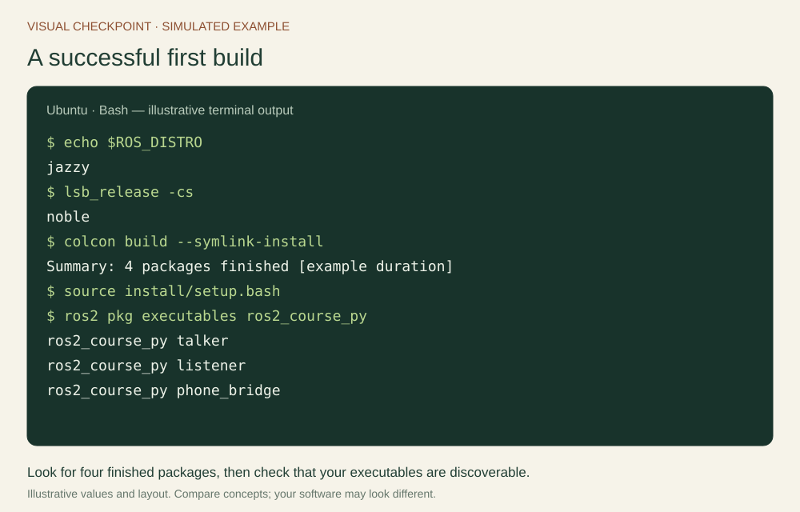
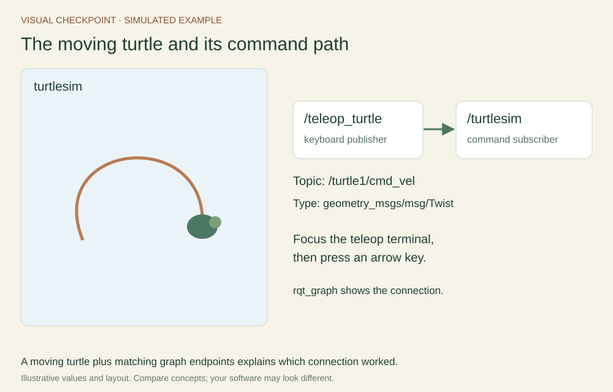
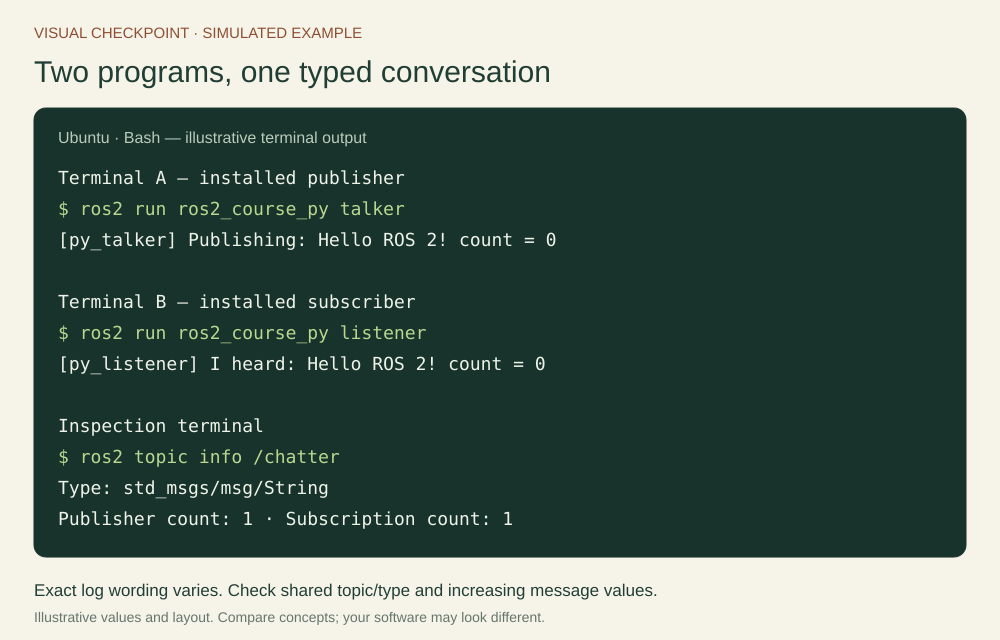
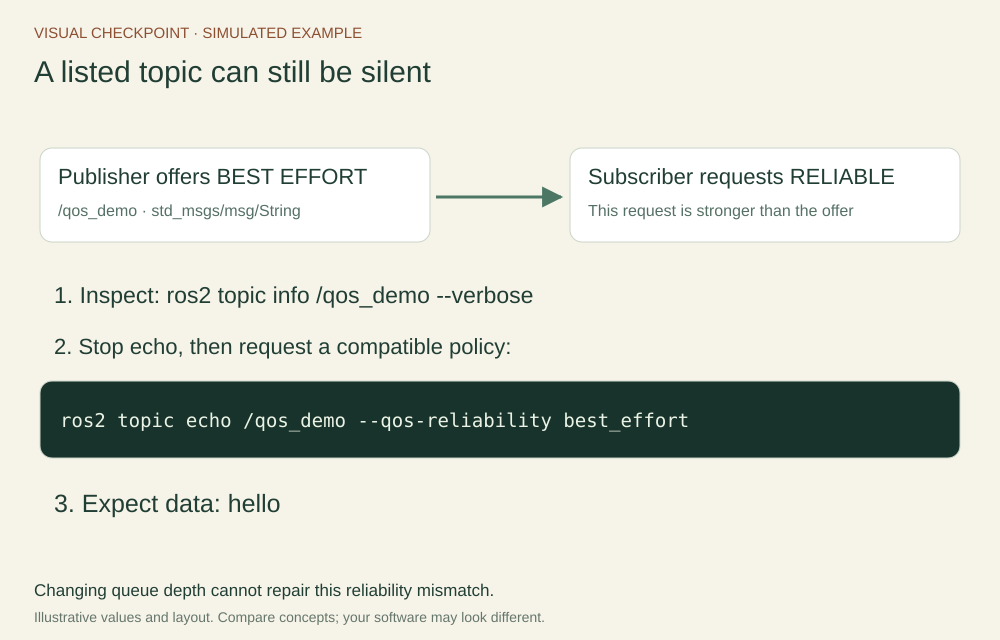
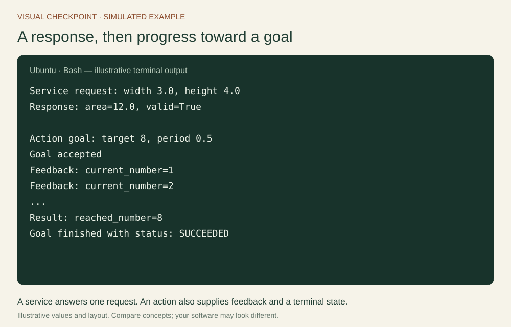
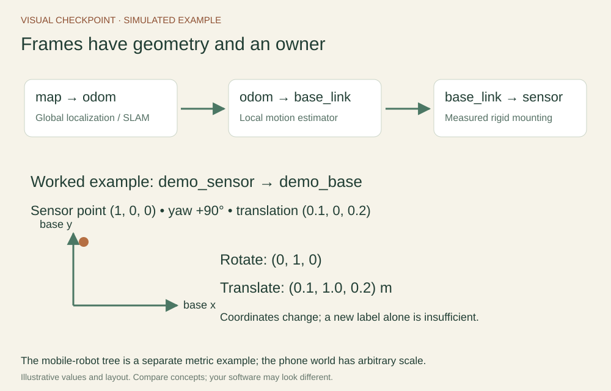
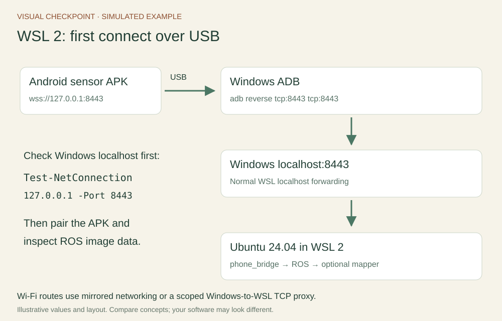
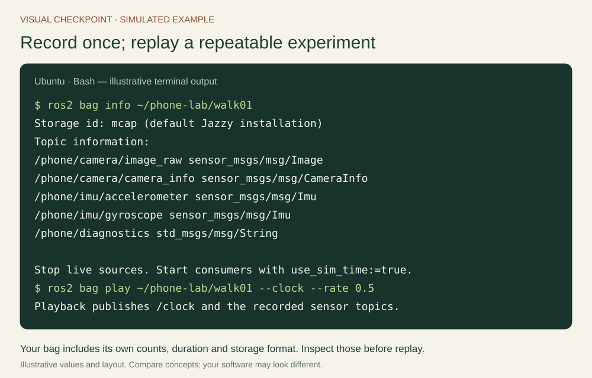

# Visual checkpoints: what should I see?

Use this gallery when you are unsure what a command or tool is meant to reveal. Each software view is a **simulated teaching example**, with illustrative values and simplified layout. Compare the named fields and relationships with your own output. Open a picture for full resolution. The figures also appear next to the corresponding course steps.

## Setup and the graph

Check ROS_DISTRO and Ubuntu codename first. After the workspace builds, verify that executables are installed and visible in the current sourced terminal.

Drive the turtle with the teleop terminal focused. A moving turtle shows behavior; the graph explains the publisher, topic and subscriber behind it.

## Programs and interaction patterns

Keep the publisher and listener running in separate terminals. Increasing message values and a shared topic show data flow. The logger prefix identifies the node that printed the line.

## Frames and sensor transport

The metric mobile-robot chain teaches transform ownership. The phone’s monocular world is a separate arbitrary-scale visualization frame.

## Calibration, timing and mapping

Use measured target dimensions and varied camera views. Timing exchanges estimate the phone-to-laptop clock relation. Inspect the native camera’s timestamp source and measure camera–IMU alignment separately.

## USB and wireless connection routes

### WSL connection route

## Recording and reproducibility

Inspect the recording’s actual topic counts, storage format and duration. Stop live publishers, then use the replay clock consistently in consumers.

For a lab report, replace these examples with your own screenshots and the commands that produced them. Record what a viewer establishes: transport, image quality, tracking state and reconstruction are distinct observations.
