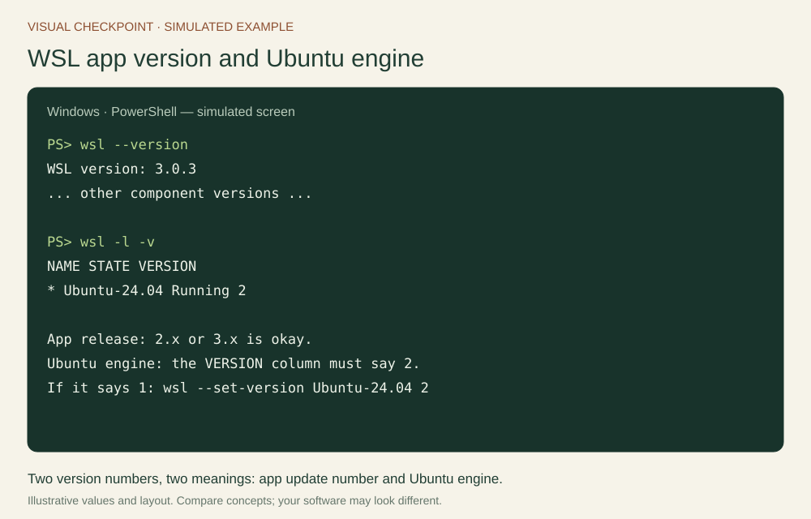
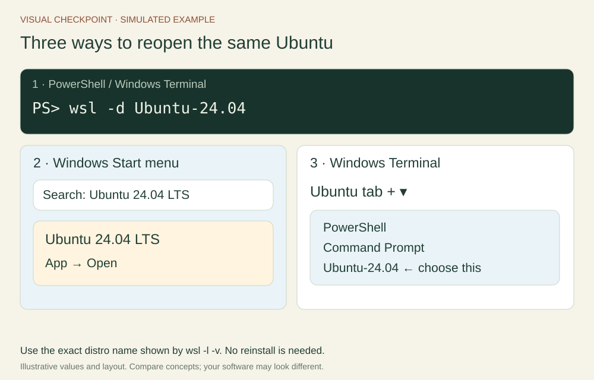
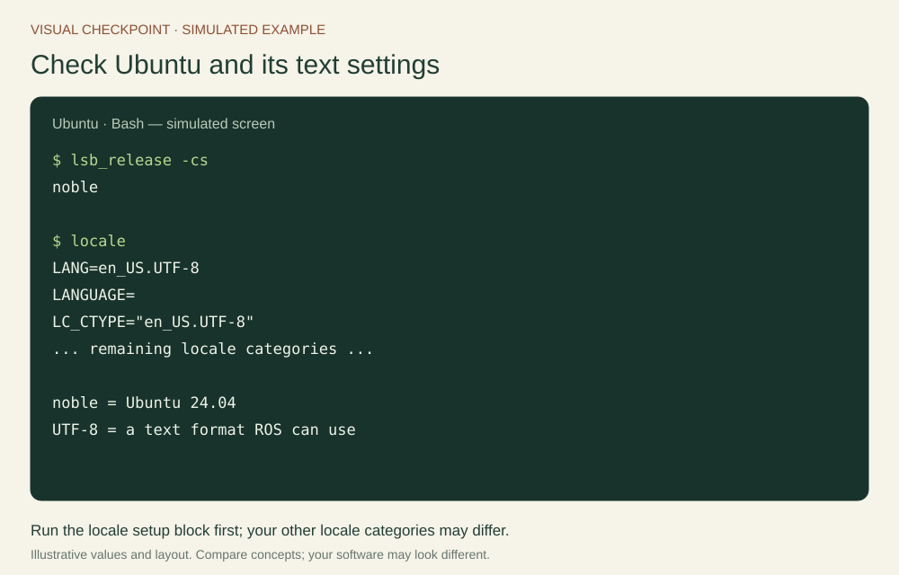
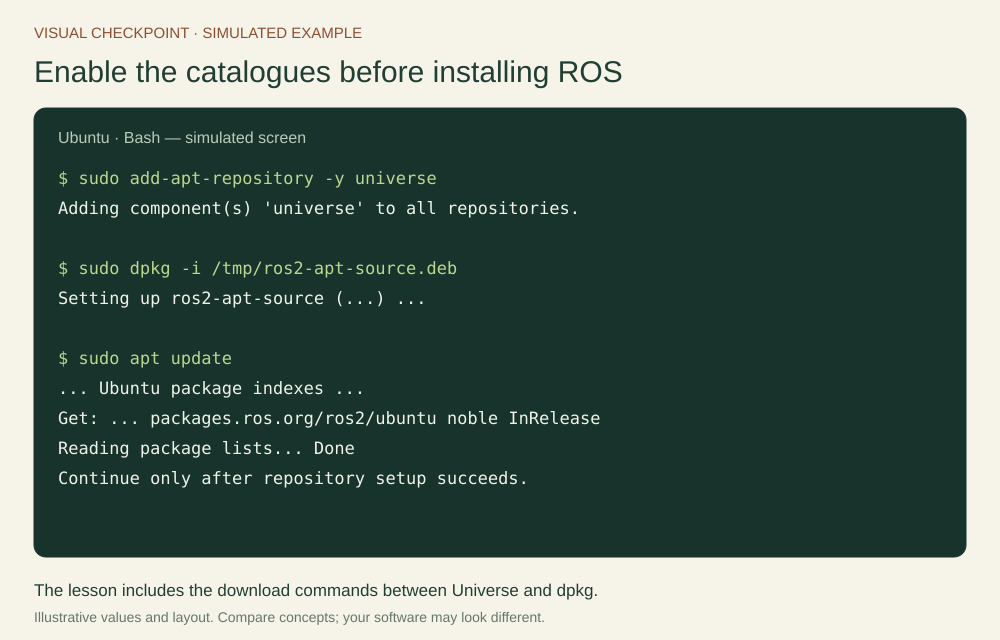
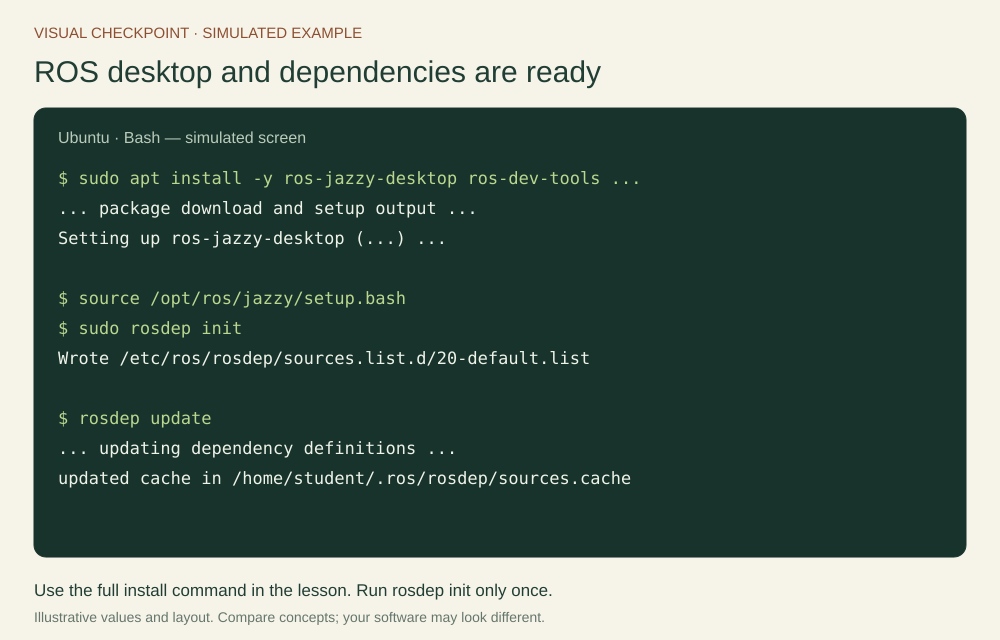
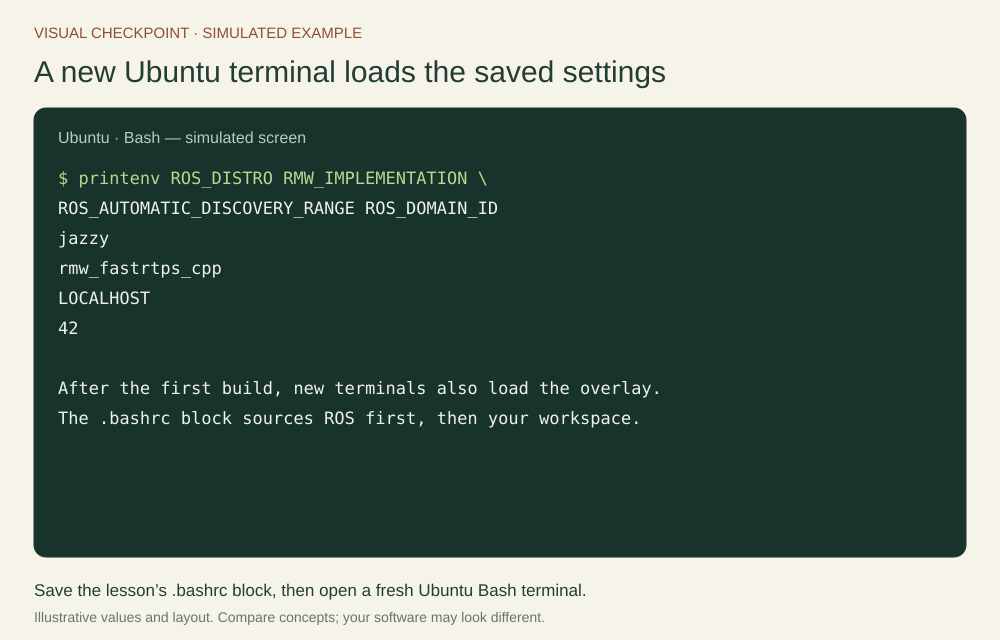
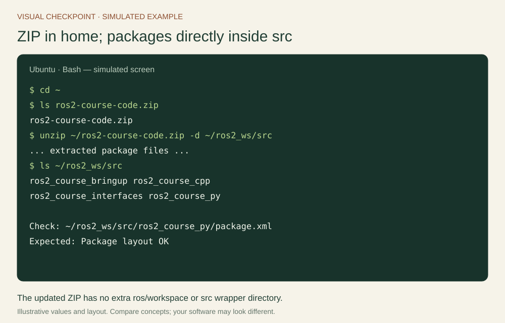
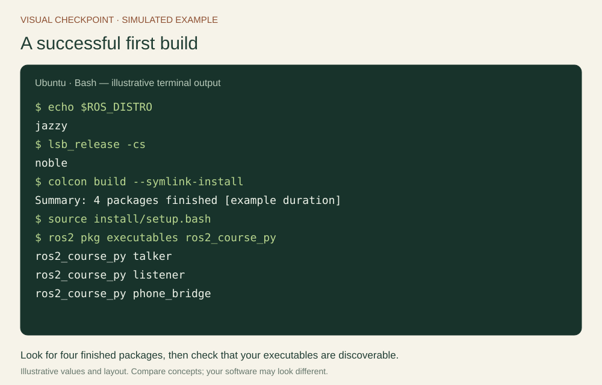
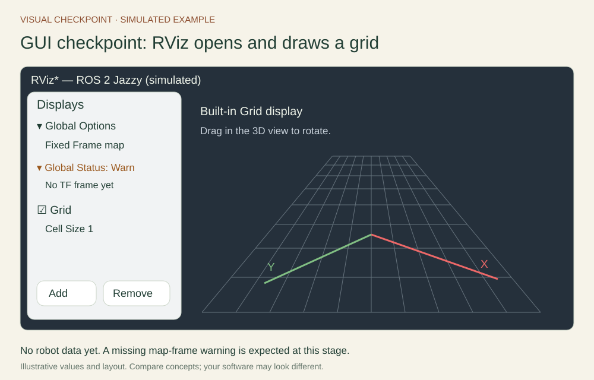
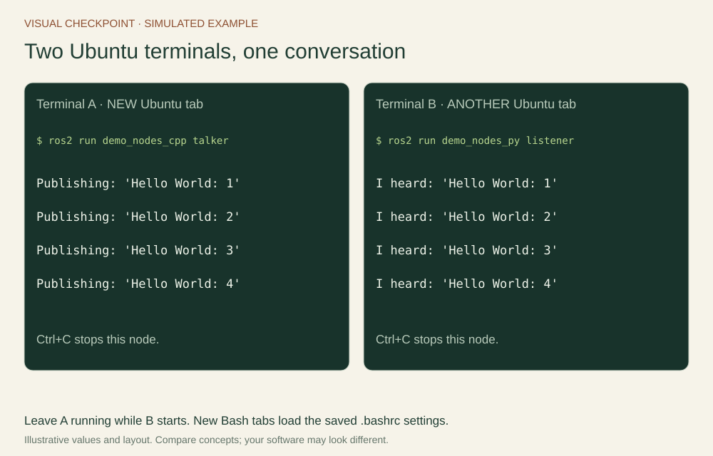

# Your robotics workbench

Install Jazzy, learn the terminal, and prepare your phone as a sensor.

## What you need before starting

Use **ROS 2 Jazzy Jalisco on Ubuntu 24.04 LTS (Noble)** with Bash. Jazzy is a long-term-support release supported until May 2029. This operating-system and ROS pairing is used throughout the guide, so the installation commands and examples fit together.

You need basic Python variables, functions and classes. Robotics knowledge is not assumed. C++ classes and templates help with lecture 3, where a complete scaffold is supplied. A node is a ROS participant, a package is a unit of software, and a workspace is the directory where packages are built. The first lecture explains these ideas through experiments.

Allow 1–2 hours for setup and a separate capstone rehearsal. A laptop with 16 GB RAM and 30 GB free disk is comfortable. The project device is an Android 8.0+ phone with a rear camera and preferably accelerometer/gyroscope sensors. A native APK is supplied. The mapper uses camera images; unsupported motion sensors can be documented without blocking that part of the project.

The website has two reading modes. **Self-study** shows the full guide with exercises and model explanations. **Lecture** shows one section at a time with presentation controls and a timer. Your progress, notes and written answers are saved in this browser; export them from Resources before changing computers. The interactive labs illustrate concepts, while commands marked Ubuntu · Bash run in your Linux terminal.

## Native Ubuntu or Windows with WSL

Native Ubuntu and Ubuntu 24.04 inside WSL 2 can host the receiver. WSL adds a Windows-to-Ubuntu network boundary. [Annex F](../annexes/wsl-capstone.md) gives a USB route using Windows ADB and two Wi-Fi routes, with explicit checks at each boundary.

For Windows, run in administrator PowerShell, restart when requested, and create a Linux account:

```powershell
wsl --update
wsl --install -d Ubuntu-24.04
wsl --version
wsl -l -v
```

**Two different version numbers:** `wsl --version` reports the WSL app version. The latest stable release checked on 30 October 2026 is **3.0.3**; an app version beginning with **2 or 3 is okay** for this guide. `wsl -l -v` shows how Ubuntu runs: its **VERSION column must say 2**. Think of the app version as the tool's update number, and VERSION 2 as the engine Ubuntu uses. **We do not want WSL 1**: this course uses WSL 2's Linux and graphical-app support. There is no need to look for VERSION 3 in that column. See [Microsoft's WSL releases](https://github.com/microsoft/WSL/releases) and [command reference](https://learn.microsoft.com/en-us/windows/wsl/basic-commands).

If Ubuntu's VERSION column says 1, run `wsl --set-version Ubuntu-24.04 2` in PowerShell, wait for conversion, then check `wsl -l -v` again.



### Open Ubuntu again after installation

On later visits, open PowerShell or Windows Terminal and run:

```powershell
wsl -d Ubuntu-24.04
```

The name is **Ubuntu-24.04**, including the hyphen and decimal point. If yours differs, copy the exact name shown by `wsl -l -v`. You do not need to reinstall Ubuntu each time.

Alternatively, open the Windows **Start menu**, search for **Ubuntu 24.04 LTS**, and open it. In Windows Terminal, you can also use the **down-arrow menu beside the + button → Ubuntu-24.04**, if that profile is listed. Each new Ubuntu tab/window is another terminal in the same Linux installation.



From now on, run the course's Bash commands **inside Ubuntu**, not PowerShell. An Ubuntu prompt typically looks like `student@laptop:~$`. Run `cd ~` to reach your Linux home directory. Store the workspace there, where Linux file permissions and build tools work consistently. We will test graphical apps below. Rehearse the WSL connection before class. Keep a reference bag or a prepared teaching laptop available if a student machine needs more setup time.

## Install the correct ROS distribution

Run these commands **inside Ubuntu** in the order shown. First run `lsb_release -cs`; expect `noble` (Ubuntu 24.04). Stop if a different release appears. These steps follow the official [Jazzy Ubuntu installation](https://docs.ros.org/en/jazzy/Installation/Ubuntu-Install-Debs.html).

### Set a UTF-8 locale

The locale tells programs how to display text. Set a UTF-8 locale so ROS can handle text correctly:

```bash
sudo apt update
sudo apt install -y locales
sudo locale-gen en_US en_US.UTF-8
sudo update-locale LC_ALL=en_US.UTF-8 LANG=en_US.UTF-8
export LANG=en_US.UTF-8
locale
```

Check that `LANG` says `en_US.UTF-8`. When `sudo` asks for your Linux password, typing shows no characters; type it and press Enter. The `-y` option automatically answers yes to package-installation prompts; it does not bypass the password.



### Enable required repositories — before installing ROS

A repository is a software catalogue. Ubuntu needs both its **Universe** catalogue and the **ROS 2** catalogue to find all the packages below. Copy this entire block; the long download command is one line:

```bash
sudo apt update
sudo apt install -y software-properties-common curl
sudo add-apt-repository -y universe
export ROS_APT_SOURCE_VERSION=$(curl -fsSL https://api.github.com/repos/ros-infrastructure/ros-apt-source/releases/latest | grep -F '"tag_name"' | cut -d '"' -f 4)
curl -fL -o /tmp/ros2-apt-source.deb "https://github.com/ros-infrastructure/ros-apt-source/releases/download/${ROS_APT_SOURCE_VERSION}/ros2-apt-source_${ROS_APT_SOURCE_VERSION}.$(. /etc/os-release && echo ${UBUNTU_CODENAME:-${VERSION_CODENAME}})_all.deb"
sudo dpkg -i /tmp/ros2-apt-source.deb
sudo apt update
```

The `ros2-apt-source` package sets up the ROS repository and its signing keys for you. If a download or repository command fails, resolve that error before continuing. Check the official [Enable required repositories section](https://docs.ros.org/en/jazzy/Installation/Ubuntu-Install-Debs.html#enable-required-repositories) if the upstream setup changes.



Before installing, update Ubuntu's existing packages:

```bash
sudo apt upgrade -y
```

If Ubuntu requests a restart, restart before continuing and reopen Ubuntu. If installation reports conflicts involving `ros-dev-tools`, follow the official page's development-tools note: check `grep Suites /etc/apt/sources.list.d/ubuntu.sources`. The main Ubuntu entry should include `Suites: noble noble-updates noble-backports`; the security entry remains separate. Correct missing suites before retrying the update and installation.

### Install ROS and the course tools

```bash
sudo apt update
sudo apt install -y ros-jazzy-desktop ros-dev-tools \
  ros-jazzy-turtlesim ros-jazzy-rqt-graph ros-jazzy-tf2-tools \
  ros-jazzy-cv-bridge ros-jazzy-image-view \
  ros-jazzy-camera-calibration python3-aiohttp python3-opencv \
  python3-numpy python3-yaml unzip
source /opt/ros/jazzy/setup.bash
sudo rosdep init
rosdep update
```

Run rosdep init once only; if an existing configuration is reported, continue with update. Use the Ubuntu system Python that matches ROS. The base course does not require Gazebo, RTAB-Map or ORB-SLAM3 to be compiled. ORB-SLAM3 is a separately prepared optional backend for the final live demonstration, not an apt package supplied by this course.



## Use the terminal and source your environment

`pwd` prints your current directory; `ls` lists files; `cd` changes directory; `mkdir -p` creates a directory and missing parents. Tab completes paths, the up arrow recalls a command, and Ctrl+C stops a foreground program. A terminal running a node is busy; open another terminal for inspection commands.

The ROS installation is your **underlay**. Your built workspace supplies an **overlay** containing your own packages. Source the underlay in every terminal, then the overlay after a successful build. Keep ROS discovery local while the phone uses a WebSocket connection to just one ROS receiver:

```bash
source /opt/ros/jazzy/setup.bash
unset ROS_LOCALHOST_ONLY
export ROS_AUTOMATIC_DISCOVERY_RANGE=LOCALHOST
export ROS_DOMAIN_ID=42
mkdir -p ~/ros2_ws/src
cd ~/ros2_ws
```

Use the same values in every lab terminal. ROS_DOMAIN_ID separates graphs; it is not authentication. ROS_AUTOMATIC_DISCOVERY_RANGE affects ROS discovery, not the separate HTTPS/WSS server. A phone does not need DDS or ROS installed. For a physical ROS robot on another machine, deliberately reconfigure discovery and networking.

### Save ROS sourcing and DDS settings in .bashrc

Run this **inside Ubuntu as your normal Linux user**. It appends one labelled block only once. The underlay loads first; the overlay loads only when its build exists. Jazzy's default Fast DDS implementation is selected explicitly so all course terminals use the same middleware. No separate DDS XML file is supplied or required for this local lab.

```bash
if ! grep -q '^# BEGIN ROS2 COURSE$' ~/.bashrc; then
  cat >> ~/.bashrc <<'EOF'

# BEGIN ROS2 COURSE
source /opt/ros/jazzy/setup.bash
export RMW_IMPLEMENTATION=rmw_fastrtps_cpp
unset ROS_LOCALHOST_ONLY
unset ROS_STATIC_PEERS
export ROS_AUTOMATIC_DISCOVERY_RANGE=LOCALHOST
export ROS_DOMAIN_ID=42
if [ -f "$HOME/ros2_ws/install/setup.bash" ]; then
  source "$HOME/ros2_ws/install/setup.bash"
fi
# END ROS2 COURSE
EOF
fi
source ~/.bashrc
printenv ROS_DISTRO RMW_IMPLEMENTATION ROS_AUTOMATIC_DISCOVERY_RANGE ROS_DOMAIN_ID
```

Expected, on separate lines: jazzy, rmw_fastrtps_cpp, LOCALHOST, 42. Open a fresh Ubuntu terminal and repeat the printenv check. After the first successful workspace build, source ~/ros2_ws/install/setup.bash in existing terminals; new interactive Bash terminals load it automatically. Keep optional SLAM overlays explicit, after the course overlay. If changing middleware or domain during diagnosis, stop lab nodes and run `ros2 daemon stop`, then reopen terminals with consistent settings. Jazzy warns that ROS_LOCALHOST_ONLY is deprecated. Unset that legacy variable and use ROS_AUTOMATIC_DISCOVERY_RANGE=LOCALHOST consistently; do not combine conflicting discovery profiles or DDS XML settings from another lab.



## Build and verify the supplied packages

### Download to home, then extract into src

Download **ros2-course-code.zip** from Resources and save it in your **Ubuntu home directory** (`~`), before extracting. To reach that directory from Windows File Explorer, run `cd ~` then `explorer.exe .` inside Ubuntu and move the downloaded ZIP into the folder that opens. On native Ubuntu, use Files → Home. If your browser saved it in Windows Downloads, move it to Ubuntu home first.

The ZIP now contains the **four package directories directly at its top level**. Extract them into `~/ros2_ws/src`, then check the layout:

```bash
cd ~
ls ros2-course-code.zip
mkdir -p ~/ros2_ws/src
unzip ~/ros2-course-code.zip -d ~/ros2_ws/src
ls ~/ros2_ws/src
test -f ~/ros2_ws/src/ros2_course_py/package.xml && echo "Package layout OK"
```

Expect `ros2_course_bringup`, `ros2_course_cpp`, `ros2_course_interfaces` and `ros2_course_py` side by side. For example, `~/ros2_ws/src/ros2_course_py/package.xml` must exist. If `ls` cannot find the ZIP, finish moving it to home before unzipping. If you have an older download containing `ros/workspace/src`, download the updated ZIP from Resources to match these commands.



### Build and check the result

```bash
cd ~/ros2_ws
rosdep install --from-paths src --ignore-src -r -y
colcon build --symlink-install
source install/setup.bash
ros2 pkg executables ros2_course_py
```

Expected: four packages finish and the executable list includes talker, listener and phone_bridge. Resolve the first dependency/compiler error before continuing. Rebuild after changing interfaces, package metadata, Python entry points or C++ code. Symlink installation does not remove all rebuild requirements.



### GUI check: open RViz before the two-terminal test

In the same Ubuntu terminal, run:

```bash
rviz2
```

A separate **RViz 3D window** should open. For a simple built-in view, expand **Global Options**, set **Fixed Frame** to `map`, and use **Add → By display type → rviz_default_plugins → Grid → OK** if Grid is not already listed. Expect a perspective grid you can rotate by dragging with the left mouse button. This is a display check; no robot or sensor is connected yet. A “Fixed Frame [map] does not exist” warning is expected without a running TF publisher; it does not by itself mean installation failed.



Close RViz to get your prompt back. If no window opens on WSL, check `echo "$DISPLAY"` inside Ubuntu. For a missing display or a window that fails to open, run `wsl --update` in PowerShell, then `wsl --shutdown` (this closes running WSL sessions), reopen Ubuntu and retry. Use Microsoft's [WSLg GUI-app guide](https://learn.microsoft.com/en-us/windows/wsl/tutorials/gui-apps) if the problem persists. Do not continue past a failed build just because RViz opens: RViz is preinstalled software, while the four-package build checks your course workspace.

### Two-terminal communication check

Open **Terminal A — a new, separate Ubuntu terminal/tab**, and run the command below. **Because we already saved the source commands in `.bashrc`, a new Ubuntu Bash terminal loads both ROS and the built workspace automatically. You do not need to separately run `source /opt/ros/jazzy/setup.bash` or `source ~/ros2_ws/install/setup.bash` here.** The explicit source after the first build above was needed only to update that already-open build terminal.

```bash
ros2 run demo_nodes_cpp talker
```

Leave Terminal A running. Open **Terminal B — another separate Ubuntu terminal/tab** with the same saved environment, and run:

```bash
ros2 run demo_nodes_py listener
```

Expected: Terminal A prints `Publishing` and Terminal B prints `I heard` with matching, increasing message numbers. Press **Ctrl+C in each terminal** to stop both nodes before starting the lecture exercises. If a new terminal cannot find ROS or the course packages, recheck the `.bashrc` block and the successful build above.



All screenshots in this lecture are **labelled simulations of expected screens**, not recordings of your machine. Log wording, timing and window appearance may differ.

## Prepare the phone project before lecture five

Read [Phone lab setup](../annexes/dataset-guide.md) first. [Annex A](../annexes/android-development.md) explains the Android app, [Annex B](../annexes/bridge-development.md) traces the ROS receiver and [Annex C](../annexes/calibration.md) walks through calibration. WSL users should complete [Annex F](../annexes/wsl-capstone.md). The [visual guide](../annexes/visual-guide.md) collects expected-output illustrations.

Install the supplied classroom test APK on Android. Pair using the receiver’s endpoint, session token and certificate SHA-256. Test the chosen Wi-Fi or USB route, camera mode, timestamp source, sensor availability and Stop behavior before class. Keep ROS discovery local to the laptop. [Annex E](../annexes/android-connections.md) gives the two connection options: wired USB and wireless over the phone hotspot.

For mapping, prepare the optional ORB-SLAM3 backend, measure camera calibration in the exact transmitted image mode and rehearse initialization. The baseline result is a sparse monocular reconstruction with arbitrary scale. Native inertial streams are available for inspection and further development. Supply a consented, qualified reference bag and matching calibration for learners whose phone cannot complete the live exercise.

Official references: [Jazzy installation](https://docs.ros.org/en/jazzy/Installation/Ubuntu-Install-Debs.html), [Android Camera2](https://developer.android.com/media/camera/camera2), [WSL networking](https://learn.microsoft.com/en-us/windows/wsl/networking), and [WSLg](https://learn.microsoft.com/en-us/windows/wsl/tutorials/gui-apps).
