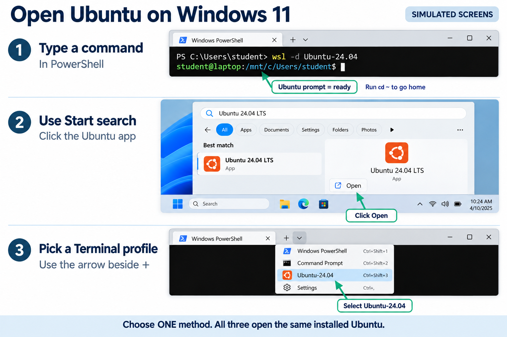
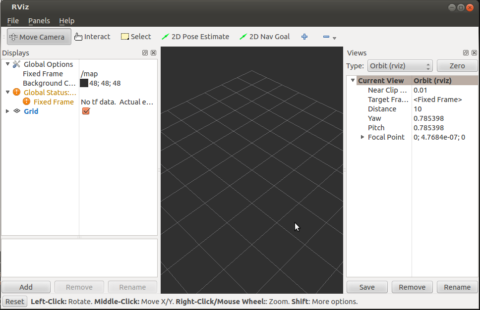
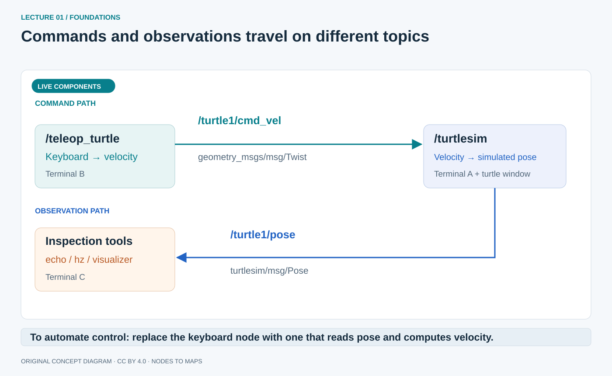

# Your robotics workbench

Install Jazzy, learn the terminal, and prepare your phone as a sensor.

## What you need before starting

Use **ROS 2 Jazzy Jalisco on Ubuntu 24.04 LTS (Noble)** with Bash. Jazzy is a long-term-support release supported until May 2029. This operating-system and ROS pairing is used throughout the guide, so the installation commands and examples fit together.

You need basic Python variables, functions and classes. Robotics knowledge is not assumed. C++ classes and templates help with lecture 3, where a complete scaffold is supplied. A node is a ROS participant, a package is a unit of software, and a workspace is the directory where packages are built. The first lecture explains these ideas through experiments.

Allow 1–2 hours for setup and a separate capstone rehearsal. A laptop with 16 GB RAM and 30 GB free disk is comfortable. The project device is an Android 8.0+ phone with a rear camera and preferably accelerometer/gyroscope sensors. A native APK is supplied. The mapper uses camera images; unsupported motion sensors can be documented without blocking that part of the project.

The website has two reading modes. **Self-study** shows the full guide with exercises and model explanations. **Lecture** shows one section at a time with presentation controls and a timer. Your progress, notes and written answers are saved in this browser; export them from Resources before changing computers. The interactive labs illustrate concepts, while commands marked Ubuntu · Bash run in your Linux terminal. Dark panels with Copy contain commands; blue **EXPECTED OUTPUT · READ ONLY** panels contain results to compare, not commands to paste.

## Linux, Windows and Mac: choose a course environment

**The instructor is using Windows 11 with Ubuntu 24.04 in WSL 2.** Run our ROS commands in an **Ubuntu Bash terminal**. Windows Terminal is the window hosting a shell; its PowerShell and Ubuntu tabs are different environments.

| Computer | Practical course route | What to know |
| --- | --- | --- |
| Ubuntu Linux | Native Ubuntu 24.04 and Jazzy binaries | Direct match for our `apt`, Bash and workspace commands |
| Windows 11 | Ubuntu 24.04 under WSL 2, following lecture 00 | Windows remains available; WSLg presents Linux GUI windows on the desktop |
| Native Windows ROS | Separate official Windows installation | Supported ROS route, but paths, shells and dependencies differ from this course |
| macOS | Prepared Ubuntu 24.04 VM or remote Ubuntu machine | Native Jazzy macOS is Tier 3/source-based in REP 2000; GUI, architecture and packages need separate preparation |

Do not assume an Ubuntu install command works in PowerShell or a macOS terminal. Check CPU architecture when selecting a VM image; Apple Silicon and Intel Macs need different choices. Official tiers cover specific OS/architecture combinations, not every package in the ecosystem. See [REP 2000: Jazzy platforms](https://reps.openrobotics.org/rep-2000/#jazzy-jalisco-may-2024-may-2029) and the [installation overview](https://docs.ros.org/en/jazzy/Installation.html).

## Install Ubuntu on Windows with WSL

Native Ubuntu and Ubuntu 24.04 inside WSL 2 can host the receiver. WSL adds a Windows-to-Ubuntu network boundary. [Annex F](../annexes/wsl-capstone.md) gives a USB route using Windows ADB and two Wi-Fi routes, with explicit checks at each boundary.

For Windows, open **PowerShell as administrator** and install Ubuntu:

```powershell
wsl --install -d Ubuntu-24.04
```

Restart Windows if requested. Open **Ubuntu 24.04 LTS** from Start and complete its first-run Linux username/password prompts. Those credentials belong to Ubuntu. Once setup finishes, **return to Windows PowerShell** (open a new PowerShell tab if needed) for these checks:

```powershell
wsl --update
wsl --version
wsl -l -v
```

**Two different version numbers:** `wsl --version` reports the WSL app version. The latest stable release checked on 30 October 2026 is **3.0.3**; an app version beginning with **2 or 3 is okay** for this guide. `wsl -l -v` shows how Ubuntu runs: its **VERSION column must say 2**. Think of the app version as the tool's update number, and VERSION 2 as the engine Ubuntu uses. **We do not want WSL 1**: this course uses WSL 2's Linux and graphical-app support. There is no need to look for VERSION 3 in that column. See [Microsoft's WSL releases](https://github.com/microsoft/WSL/releases) and [command reference](https://learn.microsoft.com/en-us/windows/wsl/basic-commands).

If Ubuntu's VERSION column says 1, run `wsl --set-version Ubuntu-24.04 2` in PowerShell, wait for conversion, then check `wsl -l -v` again.

**Expected output from `wsl -l -v` (example):**

```output
  NAME             STATE           VERSION
* Ubuntu-24.04     Running         2
```

`Stopped` is also normal when Ubuntu is closed. Check the final column, not the running/stopped state.

### Open Ubuntu again after installation

On later visits, open PowerShell or Windows Terminal and run:

```powershell
wsl -d Ubuntu-24.04
```

The name is **Ubuntu-24.04**, including the hyphen and decimal point. If yours differs, copy the exact name shown by `wsl -l -v`. You do not need to reinstall Ubuntu each time.

Alternatively, open the Windows **Start menu**, search for **Ubuntu 24.04 LTS**, and open it. In Windows Terminal, you can also use the **down-arrow menu beside the + button → Ubuntu-24.04**, if that profile is listed. Each new Ubuntu tab/window is another terminal in the same Linux installation.



From now on, run the course's Bash commands **inside Ubuntu**, not PowerShell. An Ubuntu prompt typically looks like `student@laptop:~$`. Run `cd ~` to reach your Linux home directory. Store the workspace there, where Linux file permissions and build tools work consistently. We will test graphical apps below. Rehearse the WSL connection before class. Keep a reference bag or a prepared teaching laptop available if a student machine needs more setup time.

## Three Windows–Linux boundaries to recognize

Files, USB devices and networking cross different WSL boundaries. Solving one does not solve the others.

| Boundary | Mental model | Course consequence | Detailed guide |
| --- | --- | --- | --- |
| Files | Windows drives appear under `/mnt`; Linux has its own home | Build in `~/ros2_ws`; `explorer.exe .` opens the current Ubuntu folder in Windows Explorer | [Files and editing](../annexes/wsl-files.md) |
| USB | A device attached to Windows is not automatically owned by Linux | Some sensors need `usbipd-win` attachment and a Linux driver; the phone's Windows ADB route is different | [USB sensors](../annexes/wsl-usb.md) |
| Networking | A virtual network boundary can affect incoming traffic; TCP and DDS have different needs | Keep ROS local for the labs; the phone reaches one receiver over WSS | [Networking](../annexes/wsl-networking.md) |

Keep every lab node in the same Ubuntu installation with the settings saved below. The phone does not run ROS or join DDS discovery. It sends WebSocket packets to `phone_bridge`, which turns validated measurements into ROS messages. [Annex F](../annexes/wsl-capstone.md) applies these boundaries to the capstone.

### Access files in both directions

**Open Linux files from Windows:** run `cd ~` followed by `explorer.exe .` in Ubuntu to open your Linux home in Windows File Explorer. You can also enter `\\wsl.localhost\Ubuntu-24.04\home` in Explorer's address bar and open your Linux username folder. Use the exact distribution name shown by `wsl -l -v`.

**Open Windows files from Ubuntu:** your Windows C: drive is mounted at `/mnt/c`. For example, `cd "/mnt/c/Users/YOUR_WINDOWS_NAME/Downloads"` accesses Windows Downloads; replace the username. Copy downloads into Linux home before building. Keep ROS source in `~/ros2_ws/src`, and use Explorer's supported WSL path rather than locating WSL's internal virtual disk. See [Files and editing](../annexes/wsl-files.md) for examples and permissions.

### Forward a USB sensor with usbipd-win

For a Linux ROS driver to read a USB sensor, install **usbipd-win on Windows**, identify the device with `usbipd list`, share its BUSID using `usbipd bind` in administrator PowerShell, then attach it using `usbipd attach --wsl` in normal PowerShell. Keep Ubuntu open and check the device with `lsusb` inside Ubuntu. The selected device is unavailable to Windows while attached; a compatible Linux driver and permissions are still needed. Follow [the USB appendix](../annexes/wsl-usb.md) for installation, exact commands, verification and detaching. This workflow follows [Microsoft's USB guide](https://learn.microsoft.com/en-us/windows/wsl/connect-usb).

The phone project's Windows ADB route forwards a connection instead of attaching the phone to Linux. Use [Annex F](../annexes/wsl-capstone.md) for that route. Networking has its own boundary: copying files or attaching USB does not expose a server to another computer; see [the networking appendix](../annexes/wsl-networking.md).

## Linux file system tree

Linux presents one directory tree rooted at `/`. A folder is also called a directory. Your home is your personal working area; it is different from `/root`, the administrator's home. The tree below is a simplified map, not output to copy.

```output
/
  home/
    student/           ~ for a user named student
      ros2_ws/         course workspace, created later
        src/           package source
  opt/ros/jazzy/       installed ROS files, after installation
  etc/                 system configuration
  usr/                 installed programs and libraries
  var/                 changing system data, including logs
  tmp/                 temporary files
  dev/                 device interfaces
  mnt/c/               Windows C: drive under WSL
```

`/home/student/ros2_ws` is an absolute path; `ros2_ws` is relative to your current directory. `~` means your own home, so commands using it work even if your username is not `student`. Folder names and filenames are case-sensitive. `/opt/ros/jazzy` is managed by the system package installer; edit your own source under home instead. On native Ubuntu, Windows drives are not automatically available at `/mnt/c`.

## Linux terminal crash course

Open an **Ubuntu terminal**. Type one command, press **Enter**, and wait for the prompt to return before typing the next command. A prompt such as `student@laptop:~$` means the terminal is ready. **Do not type the prompt itself.**

A **folder** is also called a **directory**. The terminal always has a current directory: this is the folder your commands are working in. For now, practise moving between folders and reading a small text file.

### Basic commands to keep nearby

| Command | What it does | Example |
| --- | --- | --- |
| `pwd` | Shows the full path of your current folder | `pwd` |
| `ls` | Lists the files and folders here | `ls` |
| `cd FOLDER` | Moves into a folder | `cd terminal_practice` |
| `cd ..` | Moves up one folder | `cd ..` |
| `cd ~` | Returns to your Linux home folder | `cd ~` |
| `mkdir -p FOLDER` | Creates a folder; `-p` also lets you reuse it if it already exists | `mkdir -p terminal_practice` |
| `echo "TEXT"` | Prints a line of text | `echo "Hello ROS"` |
| `cat FILE` | Displays the contents of a text file | `cat notes.txt` |

`FOLDER`, `FILE` and `TEXT` are placeholders in the first column; replace them with actual names, as in the examples. Linux names are case-sensitive: `Notes` and `notes` are different. Use the simple names below without spaces.

**Helpful keys:** Tab completes a partly typed file or folder name; the up arrow recalls your previous command. **Ctrl+C** stops a running program, such as a ROS node, and returns control to the terminal.

### Exercise: make a folder and read a note

Run each line separately. This exercise stays inside your Linux home folder and needs no `sudo`.

**1. Go home and check where you are.**

```bash
cd ~
pwd
```

**Expected output:** your own home path. For a Linux user named `student`, it is:

```output
/home/student
```

Your username may differ. `~` is a shortcut for this home folder.

**2. Create a practice folder and enter it.**

```bash
mkdir -p terminal_practice
cd terminal_practice
pwd
```

**Expected output for that same example user:**

```output
/home/student/terminal_practice
```

`mkdir` creates the folder; `cd` moves into it. A successful command may print nothing. That is normal: look for the prompt returning.

**3. Write and read one short note.**

```bash
echo "Hello ROS" > notes.txt
ls
cat notes.txt
```

The `>` sends the text into `notes.txt` instead of displaying it. It creates the file, or replaces that practice file's contents if you repeat the exercise. `ls` should include `notes.txt`. **Expected output from `cat notes.txt`:**

```output
Hello ROS
```

**4. Move back up to home.**

```bash
cd ..
pwd
```

Expect your home path again, such as `/home/student`. You can keep the practice folder and its note for later.

**Check yourself:** which command shows where you are? Which command lists files? Which command reads the note? The answers are `pwd`, `ls` and `cat notes.txt`.

### Two words you will see during ROS setup

**`sudo`** runs a command with administrator privileges. Use it where the installation instructions show it. When it asks for your Linux password, typing displays no characters; type the password and press Enter.

**`source FILE`** loads a setup file into the current terminal. Later, `source /opt/ros/jazzy/setup.bash` makes ROS commands available there. Follow the sourcing steps below when you reach them.

These are original beginner exercises. Further reading: Zed Shaw's [Command Line Crash Course](https://learnpythonthehardway.org/python3/appendix-a-cli/introduction.html) and the [GNU Bash manual](https://www.gnu.org/software/bash/manual/bash.html).

## Install the correct ROS distribution

Run these commands **inside Ubuntu** in the order shown. First run `lsb_release -cs`; expect `noble` (Ubuntu 24.04). Stop if a different release appears. These steps follow the official [Jazzy Ubuntu installation](https://docs.ros.org/en/jazzy/Installation/Ubuntu-Install-Debs.html).

### Set a UTF-8 locale

The locale tells programs how to display text. Set a UTF-8 locale so ROS can handle text correctly:

```bash
sudo apt update
sudo apt install -y locales
sudo locale-gen en_US en_US.UTF-8
sudo update-locale LC_ALL=en_US.UTF-8 LANG=en_US.UTF-8
export LANG=en_US.UTF-8
locale
```

Check that `LANG` says `en_US.UTF-8`. When `sudo` asks for your Linux password, typing shows no characters; type it and press Enter. The `-y` option automatically answers yes to package-installation prompts; it does not bypass the password.

**Expected checks:** `lsb_release -cs` prints `noble`; `locale` includes `LANG=en_US.UTF-8`. Other locale lines may differ.

### Enable required repositories — before installing ROS

A repository is a software catalogue. Ubuntu needs both its **Universe** catalogue and the **ROS 2** catalogue to find all the packages below. Copy this entire block; the long download command is one line:

```bash
sudo apt update
sudo apt install -y software-properties-common curl
sudo add-apt-repository -y universe
export ROS_APT_SOURCE_VERSION=$(curl -fsSL https://api.github.com/repos/ros-infrastructure/ros-apt-source/releases/latest | grep -F '"tag_name"' | cut -d '"' -f 4)
curl -fL -o /tmp/ros2-apt-source.deb "https://github.com/ros-infrastructure/ros-apt-source/releases/download/${ROS_APT_SOURCE_VERSION}/ros2-apt-source_${ROS_APT_SOURCE_VERSION}.$(. /etc/os-release && echo ${UBUNTU_CODENAME:-${VERSION_CODENAME}})_all.deb"
sudo dpkg -i /tmp/ros2-apt-source.deb
sudo apt update
```

The `ros2-apt-source` package sets up the ROS repository and its signing keys for you. If a download or repository command fails, resolve that error before continuing. Check the official [Enable required repositories section](https://docs.ros.org/en/jazzy/Installation/Ubuntu-Install-Debs.html#enable-required-repositories) if the upstream setup changes.

**Expected progress:** Universe is enabled; `dpkg` reports `Setting up ros2-apt-source`; `apt update` reads a ROS 2 package index for `noble` from `packages.ros.org`. These are checks to look for, not commands to type.

Before installing, update Ubuntu's existing packages:

```bash
sudo apt upgrade -y
```

If Ubuntu requests a restart, restart before continuing and reopen Ubuntu. If installation reports conflicts involving `ros-dev-tools`, follow the official page's development-tools note: check `grep Suites /etc/apt/sources.list.d/ubuntu.sources`. The main Ubuntu entry should include `Suites: noble noble-updates noble-backports`; the security entry remains separate. Correct missing suites before retrying the update and installation.

### Install ROS and the course tools

```bash
sudo apt update
sudo apt install -y ros-jazzy-desktop ros-dev-tools \
  ros-jazzy-turtlesim ros-jazzy-rqt-graph ros-jazzy-tf2-tools \
  ros-jazzy-cv-bridge ros-jazzy-image-view \
  ros-jazzy-camera-calibration python3-aiohttp python3-opencv \
  python3-numpy python3-yaml unzip
source /opt/ros/jazzy/setup.bash
sudo rosdep init
rosdep update
```

Run rosdep init once only; if an existing configuration is reported, continue with update. Use the Ubuntu system Python that matches ROS. The base course does not require Gazebo, RTAB-Map or ORB-SLAM3 to be compiled. ORB-SLAM3 is a separately prepared optional backend for the final live demonstration, not an apt package supplied by this course.

**Expected progress:** package installation finishes without an error, and `rosdep update` reports an updated cache under your home directory. Version numbers, download sizes and package counts vary.

## Use the terminal and source your environment

A terminal running a node is busy; open another terminal for inspection commands. The command table above is your reference for navigation and stopping programs.

The ROS installation is your **underlay**. Your built workspace supplies an **overlay** containing your own packages. Source the underlay in every terminal, then the overlay after a successful build. Keep ROS discovery local while the phone uses a WebSocket connection to just one ROS receiver:

```bash
source /opt/ros/jazzy/setup.bash
unset ROS_LOCALHOST_ONLY
export ROS_AUTOMATIC_DISCOVERY_RANGE=LOCALHOST
export ROS_DOMAIN_ID=42
mkdir -p ~/ros2_ws/src
cd ~/ros2_ws
```

Use the same values in every lab terminal. ROS_DOMAIN_ID separates graphs; it is not authentication. ROS_AUTOMATIC_DISCOVERY_RANGE affects ROS discovery, not the separate HTTPS/WSS server. A phone does not need DDS or ROS installed. For a physical ROS robot on another machine, deliberately reconfigure discovery and networking.

### Save ROS sourcing and DDS settings in .bashrc

Run this **inside Ubuntu as your normal Linux user**. It appends one labelled block only once. The underlay loads first; the overlay loads only when its build exists. Jazzy's default Fast DDS implementation is selected explicitly so all course terminals use the same middleware. No separate DDS XML file is supplied or required for this local lab.

```bash
if ! grep -q '^# BEGIN ROS2 COURSE$' ~/.bashrc; then
  cat >> ~/.bashrc <<'EOF'

# BEGIN ROS2 COURSE
source /opt/ros/jazzy/setup.bash
export RMW_IMPLEMENTATION=rmw_fastrtps_cpp
unset ROS_LOCALHOST_ONLY
unset ROS_STATIC_PEERS
export ROS_AUTOMATIC_DISCOVERY_RANGE=LOCALHOST
export ROS_DOMAIN_ID=42
if [ -f "$HOME/ros2_ws/install/setup.bash" ]; then
  source "$HOME/ros2_ws/install/setup.bash"
fi
# END ROS2 COURSE
EOF
fi
source ~/.bashrc
printenv ROS_DISTRO RMW_IMPLEMENTATION ROS_AUTOMATIC_DISCOVERY_RANGE ROS_DOMAIN_ID
```

Expected, on separate lines: jazzy, rmw_fastrtps_cpp, LOCALHOST, 42. Open a fresh Ubuntu terminal and repeat the printenv check. After the first successful workspace build, source ~/ros2_ws/install/setup.bash in existing terminals; new interactive Bash terminals load it automatically. Keep optional SLAM overlays explicit, after the course overlay. If changing middleware or domain during diagnosis, stop lab nodes and run `ros2 daemon stop`, then reopen terminals with consistent settings. Jazzy warns that ROS_LOCALHOST_ONLY is deprecated. Unset that legacy variable and use ROS_AUTOMATIC_DISCOVERY_RANGE=LOCALHOST consistently; do not combine conflicting discovery profiles or DDS XML settings from another lab.

**Expected output in a fresh Ubuntu terminal:**

```output
jazzy
rmw_fastrtps_cpp
LOCALHOST
42
```

## Verify graphical applications

### Open RViz

In the same Ubuntu terminal, run:

```bash
rviz2
```

A separate **RViz 3D window** should open. For a simple built-in view, expand **Global Options**, set **Fixed Frame** to `map`, and use **Add → By display type → rviz_default_plugins → Grid → OK** if Grid is not already listed. Expect a perspective grid you can rotate by dragging with the left mouse button. This is a display check; no robot or sensor is connected yet. A “Fixed Frame [map] does not exist” warning is expected without a running TF publisher; it does not by itself mean installation failed.



Read the screen left to right: **Displays → Fixed Frame** controls the reference frame; the central grid is the rendered view; **Views → Orbit** controls how you look around. **Add** is at the bottom left. The orange warning in this reference is a missing TF frame, matching this empty-scene check.

Image: [ROS RViz user guide, Jazzy source tree](https://github.com/ros2/rviz/blob/jazzy/rviz2/doc/empty-rviz.png), Willow Garage / RViz contributors, [Clear BSD license](https://github.com/ros2/rviz/blob/jazzy/LICENSE). Unmodified; license retained with the course assets.

Close RViz to get your prompt back. If no window opens on WSL, check `echo "$DISPLAY"` inside Ubuntu. For a missing display or a window that fails to open, run `wsl --update` in PowerShell, then `wsl --shutdown` (this closes running WSL sessions), reopen Ubuntu and retry. Use Microsoft's [WSLg GUI-app guide](https://learn.microsoft.com/en-us/windows/wsl/tutorials/gui-apps) if the problem persists. RViz checks the installed desktop tools and graphics. You will build your own course workspace in [lecture 02](02-lecture2-python-nodes.md).

## Bring a turtle to life

Turtlesim is a small simulator for learning ROS. It lets us inspect commands and state without a motor driver. We already saved the ROS source command in `.bashrc`: new Ubuntu Bash terminals load it automatically. You do not need to repeat it for this test. No course workspace build is required.

Open **Terminal A — a new Ubuntu terminal/tab**:

```bash
ros2 run turtlesim turtlesim_node
```

Read this as `ros2 run PACKAGE EXECUTABLE`. Leave it running; a turtle window should appear.

Open **Terminal B — another Ubuntu terminal/tab**:

```bash
ros2 run turtlesim turtle_teleop_key
```

Keep **Terminal B focused**, then press arrow keys. The turtle moves: the keyboard node publishes commands; the simulator subscribes and updates its state. Clicking the turtle window will not direct input to teleop. Use a normal interactive terminal; a piped/background command without a TTY can fail with `Failed to get old console mode`.

Open **Terminal C — a third Ubuntu terminal/tab**:

```bash
ros2 node list
ros2 node info /turtlesim
ros2 topic list -t
ros2 topic info /turtle1/cmd_vel --verbose
ros2 topic echo /turtle1/pose --once
rqt_graph
```

**Expected core node names from `ros2 node list`:** tool nodes may also appear.

```output
/teleop_turtle
/turtlesim
```

`node info` describes one participant. `topic list -t` shows names/types. `topic info --verbose` shows endpoints/QoS. `echo --once` receives a sample and exits. Pose contains `x`, `y`, `theta`, `linear_velocity` and `angular_velocity`; values depend on your motion. `rqt_graph` opens a graph viewer; close it to regain the prompt. Its filters can hide connections, so compare it with CLI evidence.



**Read both paths:** commands go from teleop to turtlesim; pose goes from turtlesim to inspection tools. Manual teleop does not need pose input. An automatic controller would subscribe to pose and calculate commands, closing a feedback loop. This is a conceptual diagram, not a captured run; compare it with your live graph. [Turtlesim tutorial](https://docs.ros.org/en/jazzy/Tutorials/Beginner-CLI-Tools/Introducing-Turtlesim/Introducing-Turtlesim.html).

Stop the simulator and teleop with **Ctrl+C in Terminals A and B** when finished. Lecture 01 explains the graph you just observed. Reopen them there for the motion and interface experiments.

## Download, build and run a package

A package downloaded into `src` becomes available to ROS after you **build it and source the workspace**. We will use `demo_nodes_py` from the official [ROS 2 demos project, Jazzy branch](https://github.com/ros2/demos/tree/jazzy/demo_nodes_py). It supplies both a publisher (`talker`) and a subscriber (`listener`).

### Download into src and build

Run in **Ubuntu Bash**. The earlier steps installed ROS and initialized rosdep. Install Git/colcon if needed, then download the source:

```bash
sudo apt install -y git python3-colcon-common-extensions
mkdir -p ~/ros2_ws/src
cd ~/ros2_ws/src
git clone -b jazzy https://github.com/ros2/demos.git
```

The downloaded project is `~/ros2_ws/src/demos/`; the package we need is inside `demos/demo_nodes_py/`. Download once; if that folder already exists from this exercise, continue to the build.

Build from the **workspace root**, then load the installed package into this terminal:

```bash
cd ~/ros2_ws
rosdep install --from-paths src/demos/demo_nodes_py --ignore-src -r -y
colcon build --symlink-install --packages-select demo_nodes_py
source install/setup.bash
```

`rosdep` installs the package's dependencies. `--packages-select demo_nodes_py` builds just that package rather than all the demos in the repository. Expect `Summary: 1 package finished` with a duration. If colcon mentions an existing copy in `/opt/ros/jazzy`, we are building the same Jazzy demo into our workspace. Resolve any build error before continuing.

### Run publisher and subscriber in two terminals

In **Terminal A**, run the publisher:

```bash
ros2 run demo_nodes_py talker
```

Leave it running. Open **Terminal B — a separate new Ubuntu Bash terminal**. The `.bashrc` block already loads the built workspace, so run:

```bash
ros2 run demo_nodes_py listener
```

Both commands use **`ros2 run PACKAGE EXECUTABLE`**: `demo_nodes_py` is the package; `talker` and `listener` are its two executables. The first publishes String messages on `/chatter`; the second subscribes to that topic.

**Expected log excerpts:**

```output
Terminal A: [talker] Publishing: "Hello World: 1"
Terminal B: [listener] I heard: [Hello World: 1]
```

Counts and timestamps vary; the listener may join after the first message. Matching messages show the two nodes communicating. Stop both with **Ctrl+C in each terminal**.

**What you have done:** source in `src` → colcon build → source `install/setup.bash` → run the installed package's nodes. Lecture 01 explains the package/executable/node terminology using an annotated file-manager view.

## Setup checkpoint

Before continuing, confirm Ubuntu reports `noble`, `echo "$ROS_DISTRO"` reports `jazzy` in a fresh terminal, RViz opens, and arrow keys in the teleop terminal move the turtle. Explain where your Linux home is and how it differs from Windows Downloads. Confirm that the GitHub example builds and prints messages using the basic `ros2 run` command. The supplied package download and build now happen in [lecture 02](02-lecture2-python-nodes.md).

## Prepare the phone project before lecture five

Read [Phone lab setup](../annexes/dataset-guide.md) first. [Annex A](../annexes/android-development.md) explains the Android app, [Annex B](../annexes/bridge-development.md) traces the ROS receiver and [Annex C](../annexes/calibration.md) walks through calibration. WSL users should complete [Annex F](../annexes/wsl-capstone.md). The [visual guide](../annexes/visual-guide.md) collects expected-output illustrations.

Install the supplied classroom test APK on Android. Pair using the receiver’s endpoint, session token and certificate SHA-256. Test the chosen Wi-Fi or USB route, camera mode, timestamp source, sensor availability and Stop behavior before class. Keep ROS discovery local to the laptop. [Annex E](../annexes/android-connections.md) gives the two connection options: wired USB and wireless over the phone hotspot.

For mapping, prepare the optional ORB-SLAM3 backend, measure camera calibration in the exact transmitted image mode and rehearse initialization. The baseline result is a sparse monocular reconstruction with arbitrary scale. Native inertial streams are available for inspection and further development. Supply a consented, qualified reference bag and matching calibration for learners whose phone cannot complete the live exercise.

Official references: [Jazzy installation](https://docs.ros.org/en/jazzy/Installation/Ubuntu-Install-Debs.html), [Android Camera2](https://developer.android.com/media/camera/camera2), [WSL networking](https://learn.microsoft.com/en-us/windows/wsl/networking), and [WSLg](https://learn.microsoft.com/en-us/windows/wsl/tutorials/gui-apps). Content reorganized and setup checkpoints reviewed 1 November 2026.
