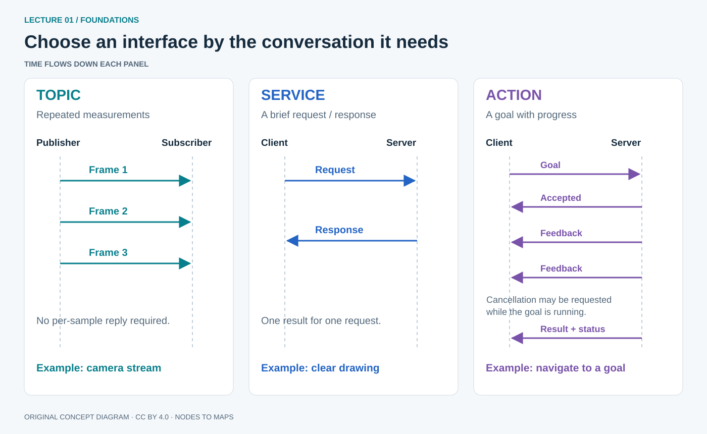
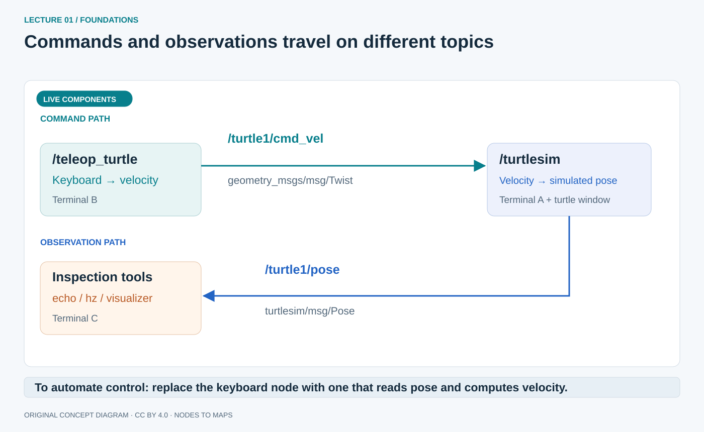

# From a moving robot to nodes and messages

Understand what ROS connects before learning how to run its commands.

## Start with a robot, not a terminal

Imagine a delivery robot approaching a wall. A distance sensor reports an obstacle 0.8 metres away. A program compares that measurement with the desired clearance and requests a lower wheel speed. The motor driver changes the electrical power delivered to the motors. The robot slows down, and the next measurement reports the changed situation.

That interaction gives us three useful building blocks:

| Part | What it does | Examples | In the delivery robot |
| --- | --- | --- | --- |
| **Sensor** | Measures the robot or its surroundings | Camera, encoder, lidar, IMU, force sensor | Measures distance to the wall and actual wheel speed |
| **Processing / control** | Estimates what is happening, chooses a goal and computes a command | Perception, localization, planning, speed controller | Decides whether to brake and computes a wheel command |
| **Actuator** | Turns energy into a physical effect | Motor, gripper, valve, steering servo | Applies wheel torque and changes motion |

An IMU measures acceleration and angular velocity; it does not directly report a perfect position. A camera supplies pixels; recognizing a wall is a processing task. A motor needs electrical power and a driver; sending the word “forward” alone cannot power it. Each component needs appropriate units, timing and hardware support.


**Read the diagram:** start at the world, follow a measurement to the computer, then follow a command back to the physical robot. The return arrow closes the loop: the program observes the effect of its previous command. A goal enters the controller separately from the measurement. If desired speed is 0.4 m/s and measured speed is 0.3 m/s, a controller may increase drive effort. This is a simplified explanation of feedback, not a motor-control algorithm.

Robotics also involves mechanics, power, uncertainty and safety. The sensor–processing–actuator loop is our organizing model. The phone project concentrates on **sensing and processing**: it reconstructs motion and a sparse map without driving a physical actuator. Turtlesim gives us a simulated motion system first.

**Learning route:** the 90-minute class uses 15 minutes for robotics and the computer stack, 10 for ROS/platform choices, 15 for graph vocabulary, 10 for terminal practice, 30 for turtlesim and 10 for diagnosis/checkpoints. The interface sampler, extended shell drill and ecosystem survey are self-study material, revisited in later lectures. Finish [lecture 00](00-setup-guide.md) before running the lab.

## Why a robotics framework helps

Without shared conventions, each component needs custom glue. A camera, detector, planner and motor controller must agree on data layouts, units, connection discovery, configuration and logging. Adding a recorder or replacing the camera can create more integration work before the robot does anything useful.

**ROS 2 is a robotics software framework: libraries, communication tools, reusable packages and conventions.** It lets components exchange structured data and gives us tools to inspect the exchanges. It does not supply every algorithm or automatically make arbitrary devices compatible.

For example, a camera driver publishes the standard `sensor_msgs/msg/Image` type. A viewer displays it, a recorder saves it and a vision node processes it. The driver does not need a custom connection for each subscriber. A simulated camera or recorded bag can later provide the same interface. Consumers still need correct encoding, timestamps and calibration: sharing a type is the start of the contract.

One teammate can write perception in Python while another writes a controller in C++. They test against agreed interfaces. ROS makes these boundaries visible. See Open Robotics' explanation of reusable interfaces and broader deployment needs in [Why ROS 2?](https://design.ros2.org/articles/why_ros2.html).

## Where ROS sits in a computer

The name expands to **Robot Operating System**, but **ROS is not an operating system**. ROS programs run as user-space processes using the operating system's facilities.


Read the stack from bottom to top:

1. **Hardware:** CPU, RAM, storage, USB controller, network card and attached sensors.
2. **Firmware:** usually UEFI on modern PCs, BIOS on older machines. It initializes hardware and starts the boot process, handing control through a bootloader to the kernel. This is a boot path: normal ROS messages do not pass through BIOS as another communication layer.
3. **Kernel:** manages processes, memory and hardware access through drivers. Linux is a kernel; Windows uses its own kernel. A USB sensor needs operating-system support before its ROS driver can read it.
4. **The rest of the operating system:** libraries, system services, shell and optionally a desktop. Ubuntu combines these with the Linux kernel. The kernel is part of the OS, not a separate competing OS.
5. **User applications:** editors, browsers, ROS tools and robot programs. A ROS node uses a client library such as `rclpy` for Python or `rclcpp` for C++. Communication passes through ROS's middleware interface, `rmw`, to a middleware implementation and operating-system facilities. These are software dependencies in user space, not additional operating systems.

The useful comparison with familiar software is placement: **VS Code and a browser also run above an OS**. VS Code edits programs; a browser runs web applications; ROS provides robotics libraries and communication tools. The comparison stops there. ROS is not an editor with a robotics theme, and none of these replaces the kernel. In WSL 2, Ubuntu applications use a Linux kernel in a Windows-managed virtual machine; Windows remains the host OS. [Microsoft's WSL overview](https://learn.microsoft.com/en-us/windows/wsl/about).

## ROS 1 and ROS 2: related ideas, different systems

Older tutorials may say `roscore`, `rosrun`, `rospy` or `catkin_make`: these belong to ROS 1. We use **ROS 2 Jazzy**, with `ros2`, `rclpy`/`rclcpp`, ament packages and `colcon build`. Jazzy names a coordinated ROS 2 release, not another operating system.

| Question | ROS 1 | ROS 2 in this course |
| --- | --- | --- |
| How do participants find one another? | A ROS master coordinates registration/discovery; it does not relay every topic message | Distributed middleware discovery; no `roscore` |
| How is communication configured? | Primarily ROS-specific transports such as TCPROS | Middleware interface with DDS implementations and explicit QoS policies |
| Who owns parameters? | Commonly a central parameter server | Individual nodes own their parameters |
| Can the source run unchanged? | ROS 1 APIs/build conventions | Similar concepts, different APIs/build conventions; migration work is needed |

ROS 2 addresses broader deployment needs, including unreliable networks, multiple robots and controlled startup. ROS 1 also supported distributed robots; these are architectural improvements, not a claim that such tasks were impossible before. The two systems do not automatically communicate. A separately configured bridge can support migration; it is not needed here. [Design motivation](https://design.ros2.org/articles/why_ros2.html), [Jazzy concepts](https://docs.ros.org/en/jazzy/Concepts.html).

## Features become useful when you have a concrete problem

| Need | ROS 2 capability | Example and limit |
| --- | --- | --- |
| Add a consumer without editing the driver | Typed publish/subscribe topics | A camera feeds a viewer and detector; both must understand its encoding |
| Use a lossy wireless link | Quality of Service, or QoS | Prefer fresh frames over retrying old frames; choose policies deliberately |
| Inspect somebody else's system | Graph/interface introspection | `ros2 node info` reveals a running node's connections |
| Configure without recompiling | Parameters, launch and remapping | Reuse one driver with another device path/topic |
| Control component startup | Managed lifecycle nodes | Configure before activation; the node must implement lifecycle support |
| Investigate yesterday's failure | `rosbag2` recording/playback | Replay selected inputs while the physical robot is offline |
| Combine several sensors | `tf2` coordinate transforms | Express a camera measurement relative to the body |
| Distribute computation | Client libraries and middleware | Python perception exchanges data with a C++ planner on another reachable machine |

Composition, security tooling and real-time-oriented designs extend this toolbox. They require system engineering: installing ROS does not automatically enable authentication, meet hard deadlines or make motion safe. The survey at the end shows where to go next.

## Linux, Windows and Mac: choose a course environment

**The instructor is using Windows 11 with Ubuntu 24.04 in WSL 2.** Run our ROS commands in an **Ubuntu Bash terminal**. Windows Terminal is the window hosting a shell; its PowerShell and Ubuntu tabs are different environments.

| Computer | Practical course route | What to know |
| --- | --- | --- |
| Ubuntu Linux | Native Ubuntu 24.04 and Jazzy binaries | Direct match for our `apt`, Bash and workspace commands |
| Windows 11 | Ubuntu 24.04 under WSL 2, following lecture 00 | Windows remains available; WSLg presents Linux GUI windows on the desktop |
| Native Windows ROS | Separate official Windows installation | Supported ROS route, but paths, shells and dependencies differ from this course |
| macOS | Prepared Ubuntu 24.04 VM or remote Ubuntu machine | Native Jazzy macOS is Tier 3/source-based in REP 2000; GUI, architecture and packages need separate preparation |

Do not assume an Ubuntu install command works in PowerShell or a macOS terminal. Check CPU architecture when selecting a VM image; Apple Silicon and Intel Macs need different choices. Official tiers cover specific OS/architecture combinations, not every package in the ecosystem. See [REP 2000: Jazzy platforms](https://reps.openrobotics.org/rep-2000/#jazzy-jalisco-may-2024-may-2029) and the [installation overview](https://docs.ros.org/en/jazzy/Installation.html).

## Three Windows–Linux boundaries to recognize

Files, USB devices and networking cross different WSL boundaries. Solving one does not solve the others.

| Boundary | Mental model | Course consequence | Detailed guide |
| --- | --- | --- | --- |
| Files | Windows drives appear under `/mnt`; Linux has its own home | Build in `~/ros2_ws`; `explorer.exe .` opens the current Ubuntu folder in Windows Explorer | [Files and editing](../annexes/wsl-files.md) |
| USB | A device attached to Windows is not automatically owned by Linux | Some sensors need `usbipd-win` attachment and a Linux driver; the phone's Windows ADB route is different | [USB sensors](../annexes/wsl-usb.md) |
| Networking | A virtual network boundary can affect incoming traffic; TCP and DDS have different needs | Keep ROS local for the labs; the phone reaches one receiver over WSS | [Networking](../annexes/wsl-networking.md) |

Keep every lab node in the same Ubuntu installation with lecture 00's settings. The phone does not run ROS or join DDS discovery. It sends WebSocket packets to `phone_bridge`, which turns validated measurements into ROS messages. [Annex F](../annexes/wsl-capstone.md) applies these boundaries to the capstone.

## A small vocabulary for a large system

An **executable** is a program you can start; a running program is an OS **process**. A ROS **node** is a named participant with a focused responsibility. One process can host one or several nodes. A **package** groups code, interfaces or configuration files. A **workspace** is where related packages are built. These are different things: package `turtlesim` supplies executable `turtlesim_node`, which normally creates node `/turtlesim`.

The **ROS graph** contains the running nodes and their communication connections. It changes as programs start and stop; it is not a source-folder diagram. Nodes can run in the same process, different processes or different computers. One node can publish measurements, subscribe to commands and provide a service simultaneously. [Official node concept](https://docs.ros.org/en/jazzy/Concepts/Basic/About-Nodes.html).

### Topics carry streams

A **publisher** sends a typed **message** on a named **topic**. A **subscription** receives samples and lets a callback process them. For example, `/camera/image_raw` can carry `sensor_msgs/msg/Image`; `/cmd_vel` carries velocity commands. A topic can have several publishers/subscribers, although competing motion publishers need an arbitration design.

A topic is not a file or permanent database. A late subscriber does not normally receive all earlier data. The name identifies a stream; its type defines fields; units, timestamps, frame IDs and QoS complete the meaning and delivery contract. [Topic concept](https://docs.ros.org/en/jazzy/Concepts/Basic/About-Topics.html).

### Services request a short operation

A **service client** sends a request to a **service server**, which returns a response: for example, “clear the drawing” or “calculate this rectangle's area.” Use services for operations that complete promptly, not an endless image stream. One service name should have one server. [Service concept](https://docs.ros.org/en/jazzy/Concepts/Basic/About-Services.html).

### Actions track a goal over time

An **action client** sends a goal, such as “navigate to this location.” The **action server** accepts/rejects it, reports feedback, handles cancellation requests and eventually returns a result/status. Actions suit work with progress and a lifecycle. Cancellation is a request that the server must handle; it is not an independent emergency stop. Actions use topics and services underneath. [Action concept](https://docs.ros.org/en/jazzy/Concepts/Basic/About-Actions.html).



**Read the arrows:** time runs downward. Topics send samples without a per-sample response. Services return one response to a request. Actions acknowledge a goal, report progress and return a result; cancellation can be requested during execution. The patterns explain why a camera stream and a long navigation task should not use the same interface design.

### Parameters configure a node

A **parameter** is a named, typed setting owned by a node: turtlesim's `background_r`, for example. A node declares supported settings and can reject invalid changes. Some take effect at runtime; others need restart/reconfiguration. Parameters configure behaviour; they do not replace high-rate sensor topics. Runtime values are not automatically permanent; YAML/launch configuration makes them repeatable. [Parameter concept](https://docs.ros.org/en/jazzy/Concepts/Basic/About-Parameters.html).

## DDS: the communication machinery underneath

**DDS means Data Distribution Service.** It is a middleware standard with implementations providing discovery and data exchange. We use `rmw_fastrtps_cpp`, backed by Fast DDS. Python/C++ nodes normally use ROS client-library APIs rather than raw DDS APIs. ROS's `rmw` interface separates these from the implementation; ROS 2 is not synonymous with one DDS vendor.


**Discovery** answers “which participants are present?” **Data delivery** answers “did a usable sample reach the subscriber?” Finding a topic does not prove delivery. Common prerequisites are reachable networking, a matching domain, resolved topic name/type agreement and compatible QoS. Domain IDs group discovery traffic; they are not passwords.

Our `.bashrc` limits discovery to `LOCALHOST` and uses `ROS_DOMAIN_ID=42`: all course nodes are on the laptop. A robot on another computer needs a deliberate discovery/network change. The phone's WebSocket path is separate. Background: [ROS on DDS](https://design.ros2.org/articles/ros_on_dds.html), [current middleware implementations](https://docs.ros.org/en/jazzy/Concepts/Intermediate/About-Different-Middleware-Vendors.html).

### QoS is a contract, not a quality score

**Quality of Service** describes delivery policies. A live camera may tolerate a missing frame because a newer one is available. A configuration exchange has different needs. `BEST_EFFORT` permits loss; `RELIABLE` uses delivery/retry mechanisms. History/depth controls queue retention; durability influences whether suitable late subscribers receive retained data. Reliability alone does not guarantee bounded latency or correct timestamps.

A best-effort publisher cannot satisfy a subscription requiring reliable delivery. A reliable publisher can satisfy a best-effort subscription if other policies match. A topic can therefore be visible but silent. Lecture 3 tests this; for now, inspect endpoints using `ros2 topic info TOPIC --verbose`. [Jazzy QoS guide](https://docs.ros.org/en/jazzy/Concepts/Intermediate/About-Quality-of-Service-Settings.html).

## Linux terminal crash course

The **terminal** displays input/output; the **shell**, Bash here, interprets commands. A prompt such as `student@laptop:~$` indicates readiness; do not type it. Commands below run in Ubuntu. Expected-output blocks are labelled separately and are not commands to paste.

These original drills use the practice-and-explain approach of Zed Shaw's [Command Line Crash Course](https://learnpythonthehardway.org/python3/appendix-a-cli/introduction.html): type a short exercise, record questions, and repeat until you can explain each part. They are not copied exercises. The [GNU Bash manual](https://www.gnu.org/software/bash/manual/bash.html) is the shell-syntax reference.

| Command/key | Meaning | ROS use |
| --- | --- | --- |
| `pwd`, `ls`, `ls -la` | Current directory; files; hidden files/details | Find the workspace and `.bashrc` |
| `cd ~`, `cd ..`, `cd DIRECTORY` | Home; parent; named directory | Navigate |
| `mkdir -p PATH` | Create directories and missing parents | Prepare `~/ros2_ws/src` |
| `cat FILE`, `less FILE` | Print a file; browse it (`q` quits less) | Read manifests/logs |
| `cp -i A B`, `mv -i A B` | Copy; move/rename, asking before overwrite | Keep configuration backups |
| `grep PATTERN FILE`, `find DIR -name NAME` | Search contents; locate files | Find a package/error |
| `COMMAND --help`, `man COMMAND` | Read help (`q` exits man) | Discover flags |
| Tab, ↑, Ctrl+C | Complete, recall, interrupt foreground program | Avoid spelling errors; stop nodes |
| `echo "$NAME"`, `source FILE` | Inspect a variable; run a file in this shell | Check/load the ROS environment |

An **absolute path** starts at `/`, the filesystem root. A **relative path** starts at your current directory. `~` expands to home, `.` means here and `..` means the parent. Linux names are case-sensitive. Quote paths containing spaces. `/turtle1/pose` looks like a file path, but it is a ROS graph name; listing files will not reveal it.

### Ten-minute drill: a lab notebook

Run one line at a time. `mktemp -d` makes a fresh practice directory so rerunning the drill does not replace an old notebook.

```bash
practice_dir=$(mktemp -d "$HOME/ros-cli-practice.XXXXXX")
cd "$practice_dir"
pwd
mkdir notes
printf 'camera\nmotor\ncamera\n' > notes/components.txt
cat notes/components.txt
grep -n camera notes/components.txt
cp -i notes/components.txt notes/components-backup.txt
ls notes
```

**Expected output from `grep -n camera notes/components.txt`:**

```output
1:camera
3:camera
```

The numbers identify lines. `>` writes output to a file, replacing previous contents; `>>` appends. Here the file is in a new practice directory. A pipe, `|`, sends one program's output to the next:

```bash
grep camera notes/components.txt | wc -l
```

**Expected output:**

```output
2
```

Explain the two matches before continuing. `sudo` runs a command with elevated privileges: use it for installation steps, not ordinary `colcon build`. `rm` deletes without using desktop Trash; practice only with a named expendable file and `rm -i`. You do not need to delete this practice directory.

**Extended self-study, 15 minutes:** rename the backup with `mv -i`, locate it with `find . -name '*backup*'`, and browse `ls --help` with `less`. Quotes let `find`, rather than the shell, interpret `*backup*`. Check `echo "$ROS_DISTRO"`: expect `jazzy` after lecture 00. Return with `cd ~/ros2_ws`.

## Bring a turtle to life

Turtlesim is a small simulator for learning ROS. It lets us inspect commands and state without a motor driver. New Ubuntu Bash terminals load lecture 00's `.bashrc`, so there is no need to repeat the source commands.

Open **Terminal A — a new Ubuntu terminal/tab**:

```bash
ros2 run turtlesim turtlesim_node
```

Read this as `ros2 run PACKAGE EXECUTABLE`. Leave it running; a turtle window should appear.

Open **Terminal B — another Ubuntu terminal/tab**:

```bash
ros2 run turtlesim turtle_teleop_key
```

Keep **Terminal B focused**, then press arrow keys. The turtle moves: the keyboard node publishes commands; the simulator subscribes and updates its state. Clicking the turtle window will not direct input to teleop. Use a normal interactive terminal; a piped/background command without a TTY can fail with `Failed to get old console mode`.

Open **Terminal C — a third Ubuntu terminal/tab**:

```bash
ros2 node list
ros2 node info /turtlesim
ros2 topic list -t
ros2 topic info /turtle1/cmd_vel --verbose
ros2 topic echo /turtle1/pose --once
rqt_graph
```

**Expected core node names from `ros2 node list`:** tool nodes may also appear.

```output
/teleop_turtle
/turtlesim
```

`node info` describes one participant. `topic list -t` shows names/types. `topic info --verbose` shows endpoints/QoS. `echo --once` receives a sample and exits. Pose contains `x`, `y`, `theta`, `linear_velocity` and `angular_velocity`; values depend on your motion. `rqt_graph` opens a graph viewer; close it to regain the prompt. Its filters can hide connections, so compare it with CLI evidence.



**Read both paths:** commands go from teleop to turtlesim; pose goes from turtlesim to inspection tools. Manual teleop does not need pose input. An automatic controller would subscribe to pose and calculate commands, closing the opening feedback loop. This is a conceptual diagram, not a captured run; compare it with your live graph. [Turtlesim tutorial](https://docs.ros.org/en/jazzy/Tutorials/Beginner-CLI-Tools/Introducing-Turtlesim/Introducing-Turtlesim.html).

## Read a message, then command a motion

Inspect types before choosing values:

```bash
ros2 interface show geometry_msgs/msg/Twist
ros2 interface show turtlesim/msg/Pose
ros2 topic hz /turtle1/pose
```

`Twist` contains `linear` and `angular` vectors with `x`, `y`, `z` fields. For the turtle, `linear.x` drives forward and `angular.z` turns. Forward speed plus turn rate produces a circle. Physical robots conventionally use m/s and rad/s; turtlesim position uses its simulated-world scale. `topic hz` measures the samples received by that tool, not exact hardware frequency or end-to-end latency. Press Ctrl+C to finish it.

Stop teleop in **Terminal B** with Ctrl+C before introducing another command publisher. In **Terminal C**:

```bash
ros2 topic pub --rate 2 /turtle1/cmd_vel geometry_msgs/msg/Twist \
  "{linear: {x: 1.0}, angular: {z: 0.5}}"
```

The quoted YAML supplies message fields; omitted vector components are zero. `--rate 2` means two command samples per second, not 2 m/s. Expect a circle. Stop with Ctrl+C, then send zero velocity:

```bash
ros2 topic pub --once /turtle1/cmd_vel geometry_msgs/msg/Twist \
  "{linear: {x: 0.0}, angular: {z: 0.0}}"
```

A zero command is a software request. A physical base also needs motion limits, a command watchdog and an independent stop. Stopping a publisher alone need not stop its consumer. [Topic/interface tutorial](https://docs.ros.org/en/jazzy/Tutorials/Beginner-CLI-Tools/Understanding-ROS2-Topics/Understanding-ROS2-Topics.html).

## Try the other interfaces on the same node

**Self-study sampler, 15 minutes; taught in depth in lecture 4.** Keep turtlesim in Terminal A running and stop motion publishers. Run these in Terminal C.

Inspect and call a short service:

```bash
ros2 service list -t
ros2 interface show std_srvs/srv/Empty
ros2 service call /clear std_srvs/srv/Empty "{}"
```

Expect the drawn trail to disappear while the turtle stays in place. `Empty` has no request/response fields, but there is still a request/response exchange. `{}` supplies the empty request. [Services tutorial](https://docs.ros.org/en/jazzy/Tutorials/Beginner-CLI-Tools/Understanding-ROS2-Services/Understanding-ROS2-Services.html).

Inspect a node-owned setting:

```bash
ros2 param list /turtlesim
ros2 param get /turtlesim background_r
```

Expect an integer red-background component; the value depends on current settings. This is configuration, not continuously changing pose data. [Parameters tutorial](https://docs.ros.org/en/jazzy/Tutorials/Beginner-CLI-Tools/Understanding-ROS2-Parameters/Understanding-ROS2-Parameters.html).

Send a rotation goal:

```bash
ros2 action list -t
ros2 interface show turtlesim/action/RotateAbsolute
ros2 action send_goal /turtle1/rotate_absolute turtlesim/action/RotateAbsolute \
  "{theta: 1.57}" --feedback
```

Expect goal acceptance and feedback about remaining rotation. The final turtle pose `theta` should be near 1.57 radians; the result's `delta` is the angular displacement from the starting heading, so it depends on where the turtle started. If already aligned, the goal may finish immediately. To demonstrate cancellation, restart teleop in Terminal B, use one of its displayed letter keys to start a rotation, then press lowercase `f` without Shift before it completes. Teleop cancels the goal it started, not the earlier CLI goal. [Actions tutorial](https://docs.ros.org/en/jazzy/Tutorials/Beginner-CLI-Tools/Understanding-ROS2-Actions/Understanding-ROS2-Actions.html).

## Names let us reconnect components

`chatter` is relative to a namespace; `/chatter` is absolute. **Namespaces** group names; **remapping** changes a name when a node starts. Neither changes message contents.

Start a second simulator in a **fourth Ubuntu terminal**:

```bash
ros2 run turtlesim turtlesim_node --ros-args -r __ns:=/robot2
```

Expect node `/robot2/turtlesim`, command topic `/robot2/turtle1/cmd_vel` and pose topic `/robot2/turtle1/pose`. The original `/turtle1/cmd_vel` controls the first turtle. A namespace does not automatically alter coordinate-frame IDs or securely isolate network traffic.

Deliberately break a connection: stop the original keyboard node, then restart it in Terminal B with:

```bash
ros2 run turtlesim turtle_teleop_key --ros-args \
  -r /turtle1/cmd_vel:=/wrong_cmd_vel
```

Press arrows. Predict the result, then inspect `/wrong_cmd_vel` with `ros2 topic info /wrong_cmd_vel --verbose`: the publisher now sends elsewhere while turtlesim still listens to its original command topic. Stop this teleop and restart without the remap to repair it. Camera remapping works the same way; renaming a stream does not rectify pixels or repair calibration.

## Diagnose a connection with evidence

1. **Process:** is the intended node running, without an error in its terminal?
2. **Environment:** are terminals using Jazzy, the same domain and intended discovery settings?
3. **Names/types:** do endpoints agree after namespace/remapping resolution?
4. **QoS:** what does `ros2 topic info TOPIC --verbose` report? Can the offer meet the request?
5. **Data:** does `ros2 topic echo TOPIC --once` receive a sample? Use `--qos-reliability best_effort` for a suitable best-effort sensor.
6. **Meaning:** are units, frames, timestamps and rates sensible?

Across computers, also check reachability/discovery transport using the networking appendix. Change one thing at a time so the result explains the failure. Topic discovery or arrival of bytes alone is not proof of useful data.

## The wider ROS toolbox

This is a map of possibilities, not a requirement to install everything today.

| Tool/concept | Question it answers | Course connection / next reference |
| --- | --- | --- |
| Client libraries and executors | How do callbacks run when data/timers are ready? | Python in lecture 2; C++ in lecture 3 |
| Interfaces and builds | How do languages agree on custom data? | `.msg`, `.srv`, `.action`, ament and colcon in lectures 2–4 |
| Launch and YAML | How do I start a repeatable multi-node system? | Lecture 4; [launch guide](https://docs.ros.org/en/jazzy/Concepts/Basic/About-Launch.html) |
| `tf2` and URDF | Where is a sensor, and how is a robot assembled? | Lecture 4; [URDF tutorials](https://docs.ros.org/en/jazzy/Tutorials/Intermediate/URDF/URDF-Main.html) |
| RViz and rqt | What does data look like and which nodes connect? | RViz displays data; it does not simulate physics |
| `rosbag2` | Can I replay inputs for a repeatable test? | Capstone; [bag tutorial](https://docs.ros.org/en/jazzy/Tutorials/Beginner-CLI-Tools/Recording-And-Playing-Back-Data/Recording-And-Playing-Back-Data.html) |
| Gazebo | Can I simulate physics and sensors? | [ROS–Gazebo integration](https://gazebosim.org/docs/harmonic/ros2_integration/) |
| Nav2 | How can a mobile robot plan/follow paths? | Requires sensors, transforms and a robot interface; [Nav2 concepts](https://docs.nav2.org/concepts/index.html) |
| MoveIt 2 | How can an arm plan collision-aware motion? | Requires a model/controller integration; [MoveIt tutorials](https://moveit.picknik.ai/main/index.html) |
| `ros2_control` | How do controllers interact with hardware? | [Controller/hardware framework](https://control.ros.org/jazzy/doc/ros2_control/doc/index.html) |
| Lifecycle, composition, security, real-time design | How do prototypes become controlled deployments? | [Intermediate concepts](https://docs.ros.org/en/jazzy/Concepts/Intermediate.html) |

Tools share interfaces but are not interchangeable. A visualization window does not prove navigation works; a graph does not prove a controller is safe. Choose a tool because it solves a defined problem in the sensor–processing–actuator loop.

## Practice, explain and carry forward

**Core lab evidence:** save the node list, command-topic type, one pose sample and an explanation of the broken remap. Draw the command and pose arrows; identify the connection needed to close an automatic feedback loop. Stop lab nodes with Ctrl+C in their terminals when finished.

**Before lecture 2, explain:**

1. A USB sensor appears in Windows but not Ubuntu. Why is a topic remap not the first fix?
2. Why does a topic suit a camera feeding a viewer, detector and recorder?
3. Which interfaces suit “clear the drawing” and “drive to a distant waypoint”?
4. Why might a listed topic have a silent subscriber?
5. Where do Ubuntu, its kernel, ROS libraries and your node sit in the stack?

**Model reasoning:** first make the sensor available to Linux. Topics distribute repeated samples to independent consumers. A service fits a brief operation; an action fits a goal with progress. Discovery and delivery compatibility are separate checks. The kernel is part of Ubuntu's OS; ROS libraries and nodes run above it in user space.

**Homework, 30–45 minutes:** complete the shell drill/interface sampler, drive a straight segment and turn, send zero velocity and explain your commands. Keep the ecosystem survey as a reference. Readiness for lecture 2 means explaining the graph you observed and inspecting its interfaces without guessing command meanings.

Concept diagrams are original course artwork, licensed with the course under CC BY 4.0. They explain relationships rather than reproduce captured application output. Primary references were reviewed on 30 October 2026.
