# From a robot to the ROS graph

Understand how robot components communicate, then build and run a small ROS 2 publisher from source.

## How a robot senses, decides and acts

Imagine a delivery robot approaching a wall. A distance sensor reports an obstacle 0.8 metres away. A program compares that measurement with the desired clearance and requests a lower wheel speed. The motor driver changes the electrical power delivered to the motors. The robot slows down, and the next measurement reports the changed situation.

That interaction gives us three useful building blocks:

| Part | What it does | Examples | In the delivery robot |
| --- | --- | --- | --- |
| **Sensor** | Measures the robot or its surroundings | Camera, microphone, temperature sensor, encoder, lidar, IMU | Measures distance to the wall and actual wheel speed |
| **Processing / control** | Estimates what is happening, chooses a goal and computes a command | Logic, computer vision, machine learning, mapping, localization, control | Decides whether to brake and computes a wheel command |
| **Actuator** | Turns energy into a physical effect | Motor, gripper, valve, light, heater | Applies wheel torque and changes motion |

An IMU measures acceleration and angular velocity; it does not directly report a perfect position. A camera supplies pixels; recognizing a wall is a processing task. A motor needs electrical power and a driver; sending the word “forward” alone cannot power it. Each component needs appropriate units, timing and hardware support.

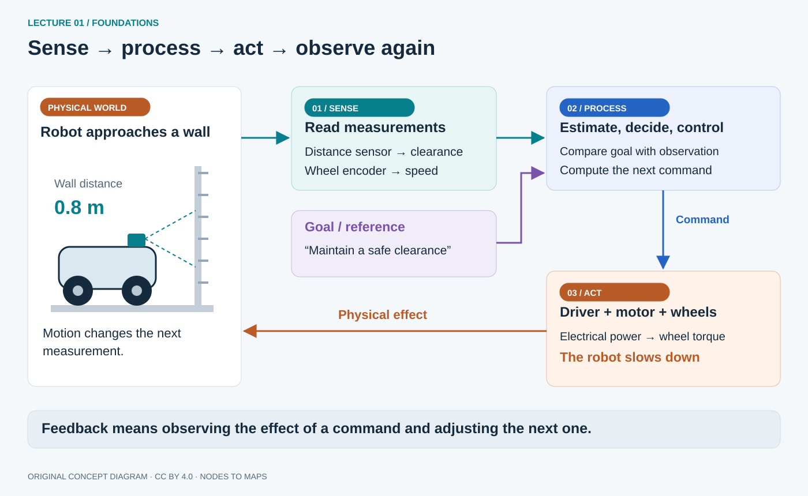

**Read the diagram:** start at the world, follow a measurement to the computer, then follow a command back to the physical robot. The return arrow closes the loop: the program observes the effect of its previous command. A goal enters the controller separately from the measurement. If desired speed is 0.4 m/s and measured speed is 0.3 m/s, a controller may increase drive effort. This is a simplified explanation of feedback, not a motor-control algorithm.

Robotics also involves mechanics, power, uncertainty and safety. The sensor–processing–actuator loop is our organizing model. The phone project concentrates on **sensing and processing**: it reconstructs motion and a sparse map without driving a physical actuator. Turtlesim gives us a simulated motion system first.

Complete [Your robotics workbench](00-setup-guide.md) first: Ubuntu 24.04, Jazzy in fresh Bash terminals, file navigation and the turtle GUI test. Here we explain the graph behind that test, then use Git and colcon to run an existing package. [Write your first Python nodes](02-lecture2-python-nodes.md) follows with your own code and the four supplied course packages.

## Why a robotics framework helps

Without shared conventions, each component needs custom glue. A camera, detector, planner and motor controller must agree on data layouts, units, connection discovery, configuration and logging. Adding a recorder or replacing the camera can create more integration work before the robot does anything useful.

**ROS 2 is a robotics software framework: libraries, communication tools, reusable packages and conventions.** It lets components exchange structured data and gives us tools to inspect the exchanges. It does not supply every algorithm or automatically make arbitrary devices compatible.

For example, a camera driver publishes the standard `sensor_msgs/msg/Image` type. A viewer displays it, a recorder saves it and a vision node processes it. The driver does not need a custom connection for each subscriber. A simulated camera or recorded bag can later provide the same interface. Consumers still need correct encoding, timestamps and calibration: sharing a type is the start of the contract.

One teammate can write perception in Python while another writes a controller in C++. They test against agreed interfaces. ROS makes these boundaries visible. See Open Robotics' explanation of reusable interfaces and broader deployment needs in [Why ROS 2?](https://design.ros2.org/articles/why_ros2.html).

### Reuse the plumbing and concentrate on the robot

Mechanical design and electronics give a robot a body, power and connections. Software turns measurements into estimates, plans and commands. ROS helps organize that software and provides an ecosystem of reusable components: Nav2 for mobile navigation, MoveIt for manipulation, drivers for supported hardware, RViz for inspection and rosbag2 for recordings. A package still needs to match your ROS distribution and application requirements.

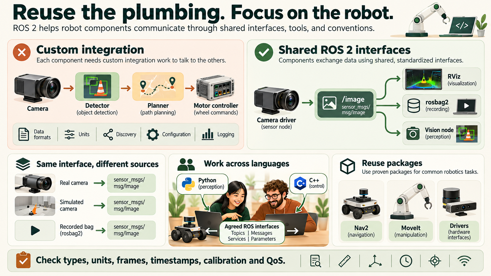

**Read the comparison:** the copper chain shows components that need integration agreements. The green branch shows one camera topic serving independent consumers. The lower panels show three sources using `sensor_msgs/msg/Image`, Python/C++ collaboration and reusable packages. The `/image` topic name in the illustration is an example; the message type defines its structure. A matching type still needs matching units, timestamps, frames, calibration and QoS.

**Hardware abstraction in practice:** replace a lidar driver while continuing to publish `sensor_msgs/msg/LaserScan`, and a downstream obstacle detector may be reusable. Check angular coverage, units, frame, timestamps, rate and QoS before calling the replacement compatible. Standard interfaces reduce integration work; they do not remove it.

A small robot may run every node on one computer. A larger system can distribute perception, planning and operator tools across reachable computers. A shared interface makes this possible; network configuration, synchronization and failure handling remain engineering tasks. Python and C++ peers can collaborate without sharing their source language. Gazebo simulates physics and sensors; RViz visualizes published data. They are complementary tools, not interchangeable simulators.

ROS has an international open-source community and is used in research and commercial robotics. Core ROS 2 licensing is permissive, but individual packages, drivers and middleware products have their own licenses: check the components you distribute. See [ROS 2 project](https://docs.ros.org/en/jazzy/The-ROS2-Project.html), [Nav2](https://docs.nav2.org/) and [MoveIt](https://moveit.picknik.ai/main/index.html).

## Where ROS sits in a computer

The name expands to **Robot Operating System**, but **ROS is not an operating system**. ROS programs run as user-space processes using the operating system's facilities.

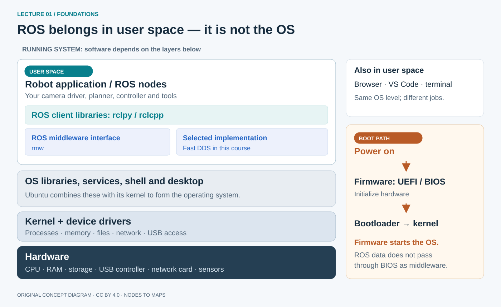

Read the stack from bottom to top:

1. **Hardware:** CPU, RAM, storage, USB controller, network card and attached sensors.
2. **Firmware:** usually UEFI on modern PCs, BIOS on older machines. It initializes hardware and starts the boot process, handing control through a bootloader to the kernel. This is a boot path: normal ROS messages do not pass through BIOS as another communication layer.
3. **Kernel:** manages processes, memory and hardware access through drivers. Linux is a kernel; Windows uses its own kernel. A USB sensor needs operating-system support before its ROS driver can read it.
4. **The rest of the operating system:** libraries, system services, shell and optionally a desktop. Ubuntu combines these with the Linux kernel. The kernel is part of the OS, not a separate competing OS.
5. **User applications:** editors, browsers, ROS tools and robot programs. A ROS node uses a client library such as `rclpy` for Python or `rclcpp` for C++. Communication passes through ROS's middleware interface, `rmw`, to a middleware implementation and operating-system facilities. These are software dependencies in user space, not additional operating systems.

**Why the name “Operating System”?** ROS supplies robot-oriented services such as standard hardware interfaces, communication between programs and package/build conventions. The host OS still schedules CPU threads, manages RAM and virtual memory, provides IPC and networking, operates devices, and manages files/storage. These are overlapping OS responsibilities, not a universal seven-layer ladder; ROS is not a formal “Layer 8.” ROS driver nodes use host drivers and vendor libraries, while colcon builds packages and system package managers install dependencies.

The useful comparison with familiar software is placement: **VS Code and a browser also run above an OS**. VS Code edits programs; a browser runs web applications; ROS provides robotics libraries and communication tools. The comparison stops there. ROS is not an editor with a robotics theme, and none of these replaces the kernel. In WSL 2, Ubuntu applications use a Linux kernel in a Windows-managed virtual machine; Windows remains the host OS. [Microsoft's WSL overview](https://learn.microsoft.com/en-us/windows/wsl/about).

## ROS 1 and ROS 2: related ideas, different systems

Older tutorials may say `roscore`, `rosrun`, `rospy` or `catkin_make`: these belong to ROS 1. We use **ROS 2 Jazzy**, with `ros2`, `rclpy`/`rclcpp`, ament packages and `colcon build`. Jazzy names a coordinated ROS 2 release, not another operating system.

| Question | ROS 1 | ROS 2 in this course |
| --- | --- | --- |
| How do participants find one another? | A ROS master coordinates registration/discovery; it does not relay every topic message | Distributed middleware discovery; no `roscore` |
| How is communication configured? | Primarily ROS-specific transports such as TCPROS | Middleware interface with DDS implementations and explicit QoS policies |
| Who owns parameters? | Commonly a central parameter server | Individual nodes own their parameters |
| Can the source run unchanged? | ROS 1 APIs/build conventions | Similar concepts, different APIs/build conventions; migration work is needed |

ROS 2 addresses broader deployment needs, including unreliable networks, multiple robots and controlled startup. ROS 1 also supported distributed robots; these are architectural improvements, not a claim that such tasks were impossible before. The two systems do not automatically communicate. A separately configured bridge can support migration; it is not needed here. [Design motivation](https://design.ros2.org/articles/why_ros2.html), [Jazzy concepts](https://docs.ros.org/en/jazzy/Concepts.html).

## A small vocabulary for a large system

**Reference for this lecture:** the bold communication terms below are the interfaces you will compare. The file/build terms explain where a runnable node comes from.

| Group | Term | Beginner meaning | Example to recognize |
| --- | --- | --- | --- |
| Files and builds | Workspace | A folder of source plus colcon build results | `~/ros2_ws/` |
| Files and builds | Repository | A Git project; it can contain several ROS packages | `src/examples/` from GitHub |
| Files and builds | Package | Installable ROS software identified by `package.xml` | `examples_rclpy_minimal_publisher` |
| Programs | Executable | An installed program selected by `ros2 run` | `publisher_member_function` |
| Programs | Process | An operating-system instance of a running executable | The program occupying Terminal A |
| Programs | **Node** | A named ROS participant inside a process | `/minimal_publisher` or renamed `/demo_talker` |
| Communication | **Topic** and **message** | A named stream and one typed sample on it | `/hello` carrying `std_msgs/msg/String` |
| Communication | **Publisher / subscriber** | Sends samples / receives samples on a topic | Talker / echo inspection tool |
| Communication | **Service** and **client / server** | Request an operation / return its response | `/clear` clears a drawing |
| Communication | **Action** and **client / server** | Request a goal with feedback, result and cancellation | Rotate the turtle toward a heading |
| Configuration | **Parameter** | A setting owned by a node | `use_sim_time: false` |
| Startup | `run` / `launch` | Start an executable / execute a launch description | One talker / a configured group of programs |

### Workspaces, packages, executables and nodes

The annotated file-manager and terminal view in **Build and run a small GitHub example** below follows one real package through these stages. Use this table as a reference while tracing that image.

An **executable** is a program you can start; a running program is an OS **process**. A ROS **node** is a named participant with a focused responsibility. One process can host one or several nodes. A **package** groups code, interfaces or configuration files. A **workspace** is where related packages are built. These are different things: package `turtlesim` supplies executable `turtlesim_node`, which normally creates node `/turtlesim`.

The **ROS graph** contains the running nodes and their communication connections. It changes as programs start and stop; it is not a source-folder diagram. Nodes can run in the same process, different processes or different computers. One node can publish measurements, subscribe to commands and provide a service simultaneously. [Official node concept](https://docs.ros.org/en/jazzy/Concepts/Basic/About-Nodes.html).

### Topics carry streams

A **publisher** sends a typed **message** on a named **topic**. A **subscription** receives samples and lets a callback process them. For example, `/camera/image_raw` can carry `sensor_msgs/msg/Image`; `/cmd_vel` carries velocity commands. A topic can have several publishers/subscribers, although competing motion publishers need an arbitration design.

A topic is not a file or permanent database. A late subscriber does not normally receive all earlier data. The name identifies a stream; its type defines fields; units, timestamps, frame IDs and QoS complete the meaning and delivery contract. [Topic concept](https://docs.ros.org/en/jazzy/Concepts/Basic/About-Topics.html).

### Services request a short operation

A **service client** sends a request to a **service server**, which returns a response: for example, “clear the drawing” or “calculate this rectangle's area.” Use services for operations that complete promptly, not an endless image stream. A service client can wait synchronously or use an asynchronous Future; request/response does not mean the entire node must block. Services do not provide the action goal/feedback/cancellation protocol. One service name should have one server. [Service concept](https://docs.ros.org/en/jazzy/Concepts/Basic/About-Services.html).

### Actions track a goal over time

An **action client** sends a goal, such as “navigate to this location.” The **action server** accepts/rejects it, reports feedback, handles cancellation requests and eventually returns a result/status. Actions suit work with progress and a lifecycle. Cancellation is a request that the server must handle; it is not an independent emergency stop. Actions use topics and services underneath. [Action concept](https://docs.ros.org/en/jazzy/Concepts/Basic/About-Actions.html).


**Read the animation:** each dot represents a message, not a robot. Topic samples continue; a service request is followed by its response; an action goal is accepted, produces feedback and ends with a result. The dashed cancellation route is an alternative to normal completion. Use Pause animation for the labelled static view. Timing is illustrative, not a ROS timing guarantee.

**Read the arrows:** Topics send samples without a per-sample response. Services return one response to a request. Actions acknowledge a goal, report progress and return a result; cancellation can be requested during execution. The patterns explain why a camera stream and a long navigation task should not use the same interface design.

### Parameters configure a node

A **parameter** is a named, typed setting owned by a node: turtlesim's `background_r`, for example. A node declares supported settings and can reject invalid changes. Some take effect at runtime; others need restart/reconfiguration. Parameters configure behaviour; they do not replace high-rate sensor topics. Runtime values are not automatically permanent; YAML/launch configuration makes them repeatable. [Parameter concept](https://docs.ros.org/en/jazzy/Concepts/Basic/About-Parameters.html).

## ROS 2 capabilities at a glance

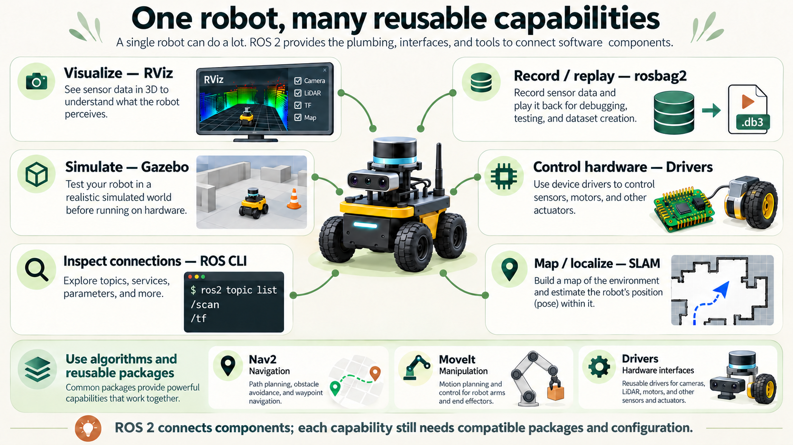

**Read the capability map:** the connections associate tools with the robot; they are not message-flow arrows. RViz displays data, rosbag2 records and replays it, Gazebo supplies a simulated world, and drivers connect supported hardware. Nav2 and MoveIt solve different motion-planning problems. These are packages you select and configure, rather than features every ROS node automatically runs. The illustrated screens are conceptual views.

Focus first on **communication**, **configuration** and **inspection**. The other groups show where the same ideas lead; you do not need to install or memorize every tool now.

| Category | Important features | A concrete use | Where you use them |
| --- | --- | --- | --- |
| **Communicate** | Nodes; typed messages; **topics, services, actions** | Stream camera frames; reset a tool; track a navigation goal | This lecture; deeper practice in lecture 04 |
| **Configure and start** | **Parameters**; remapping; `run`; `launch` | Name a node, choose a setting, start a repeatable group | Run and remap here; launch in lecture 04 |
| **Inspect and replay** | ROS CLI; RViz; `rosbag2` | Inspect connections, see sensor data, replay an input | CLI here; recording in the capstone |
| **Deliver data** | DDS discovery; QoS | Find peers and choose suitable delivery for a camera | DDS here; QoS experiments in lecture 03 |
| **Describe geometry** | `tf2`; robot models such as URDF | Relate a camera measurement to the robot body | Lecture 04 |
| **Reuse robot software** | Drivers; Gazebo; Nav2; MoveIt | Connect hardware, simulate, navigate or plan arm motion | Optional applications; not required for this lab |

Lifecycle nodes, composition, security, real-time design, micro-ROS and ROS 1 migration are later deployment topics. [The advanced feature reference](../annexes/ros-workflows.md) explains their purpose and requirements. For now, follow the bold communication/configuration terms into the vocabulary and hands-on examples. [Official ROS concepts](https://docs.ros.org/en/jazzy/Concepts.html).

## From packages to a running graph


Trace the startup arrows first, then the moving data. A **package** contains installable code and configuration. `ros2 run PACKAGE EXECUTABLE` starts one installed executable; that executable can create one or more nodes. `ros2 launch PACKAGE FILE` executes a launch description, which can coordinate several processes, arguments, parameters and remappings. Launch files can use Python, XML or YAML; launch does not automatically guarantee that every sensor is ready.

Once running, a **node** owns its communication endpoints and settings. The **topic** is the named stream; a **message** is one typed sample travelling on it. A **parameter** such as a camera's exposure configures the owner node; it is not a stream of images. The animation uses illustrative camera nodes, not an additional installation command.

| Operation | Concrete example | Meaning |
| --- | --- | --- |
| Run | `ros2 run turtlesim turtlesim_node` | Start the simulator executable |
| Launch | `ros2 launch ros2_course_bringup pubsub_demo.launch.py` | Start the supplied talker/listener system after the lecture 02 build; explored in lecture 4 |
| Inspect nodes | `ros2 node list` | Discover named running participants |
| Inspect a stream | `ros2 topic info /turtle1/pose` | Inspect the topic type and endpoint counts |
| Inspect one setting | `ros2 param get /turtlesim background_r` | Read a parameter owned by the simulator |

A launch argument belongs to a launch description; a node parameter belongs to a node. A launch file can pass an argument's value into a parameter, but those two names are not automatically linked. [Launch concepts](https://docs.ros.org/en/jazzy/Concepts/Basic/About-Launch.html).

## DDS: the communication machinery underneath

**DDS means Data Distribution Service.** It is a middleware standard with implementations providing discovery and data exchange. We use `rmw_fastrtps_cpp`, backed by Fast DDS. Python/C++ nodes normally use ROS client-library APIs rather than raw DDS APIs. ROS's `rmw` interface separates these from the implementation; ROS 2 is not synonymous with one DDS vendor.

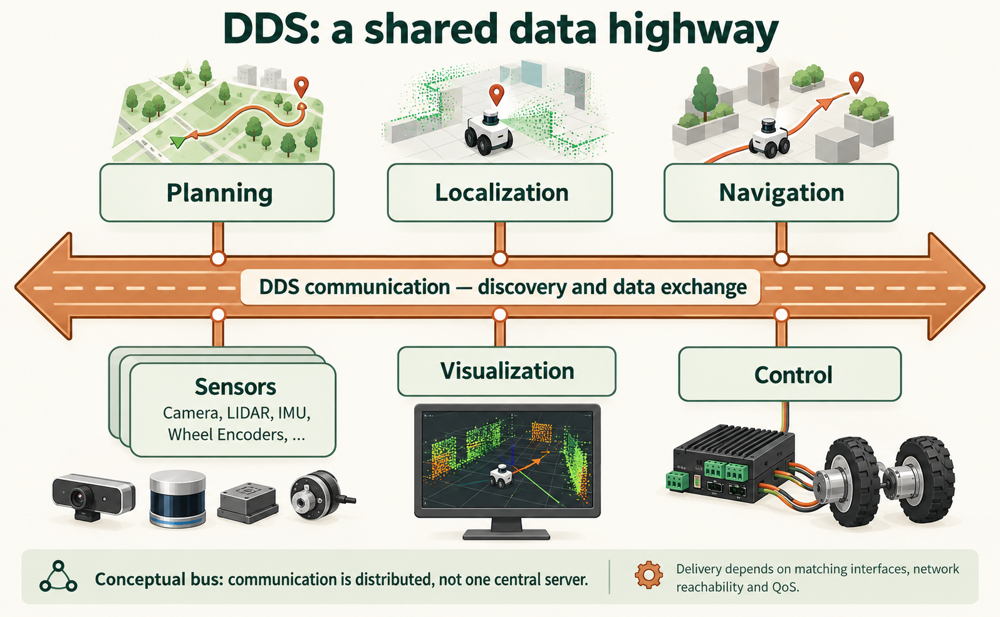

**Read the highway:** measurements can serve localization and planning, while computed commands reach control components and inspection tools see the data. The branches represent software endpoints. Physical sensors and motors still need drivers; they do not connect directly to DDS. The highway is a communication metaphor: DDS participants discover and exchange data through distributed middleware, with no single central bus process relaying every sample. Separate named topics carry different typed streams; network reachability and compatible QoS still matter.

The next diagram follows the software dependencies inside the participants: ROS client libraries use RMW and the selected middleware implementation. It explains how the highway metaphor is implemented on this course laptop.

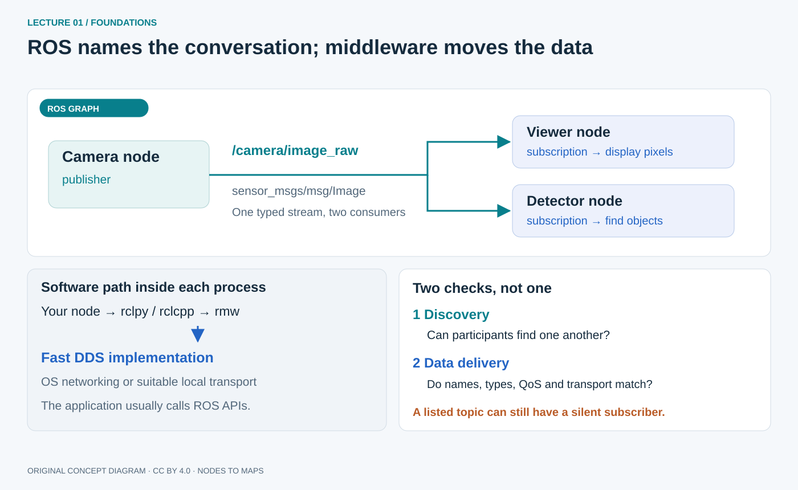

**Discovery** answers “which participants are present?” **Data delivery** answers “did a usable sample reach the subscriber?” Finding a topic does not prove delivery. Common prerequisites are reachable networking, a matching domain, resolved topic name/type agreement and compatible QoS. Domain IDs group discovery traffic; they are not passwords.

Our `.bashrc` limits discovery to `LOCALHOST` and uses `ROS_DOMAIN_ID=42`: all course nodes are on the laptop. A robot on another computer needs a deliberate discovery/network change. The phone's WebSocket path is separate. Background: [ROS on DDS](https://design.ros2.org/articles/ros_on_dds.html), [current middleware implementations](https://docs.ros.org/en/jazzy/Concepts/Intermediate/About-Different-Middleware-Vendors.html).

### QoS is a contract, not a quality score

**Quality of Service** describes delivery policies. A live camera may tolerate a missing frame because a newer one is available. A configuration exchange has different needs. `BEST_EFFORT` permits loss; `RELIABLE` uses delivery/retry mechanisms. History/depth controls queue retention; durability influences whether suitable late subscribers receive retained data. Reliability alone does not guarantee bounded latency or correct timestamps.

A best-effort publisher cannot satisfy a subscription requiring reliable delivery. A reliable publisher can satisfy a best-effort subscription if other policies match. A topic can therefore be visible but silent. Lecture 3 tests this; for now, inspect endpoints using `ros2 topic info TOPIC --verbose`. [Jazzy QoS guide](https://docs.ros.org/en/jazzy/Concepts/Intermediate/About-Quality-of-Service-Settings.html).

## Build and run a small GitHub example

Use the official [ROS 2 examples repository, Jazzy branch](https://github.com/ros2/examples/tree/jazzy). It contains several small learning packages. We will build **only its minimal Python publisher**, which needs no robot or camera. You are running existing open-source code here; lecture 02 explains how to write and package your own node.

### 1. Prepare the colcon workspace

Run these in **Ubuntu Bash**, as your normal user. Lecture 00 installed Jazzy and development tools; install Git and colcon if needed:

```bash
sudo apt update
sudo apt install -y git python3-colcon-common-extensions
mkdir -p ~/ros2_ws/src
cd ~/ros2_ws
source /opt/ros/jazzy/setup.bash
```

`ros2_ws` is the workspace root; `src` holds source repositories/packages. **colcon** discovers ROS packages and builds/installs them. It creates `build`, `install` and `log` beside `src`. Run build commands from `~/ros2_ws`, rather than inside the source file's folder. These steps reuse the empty workspace prepared in lecture 00.

### 2. Clone the source; pull later updates

For the **first download**:

```bash
cd ~/ros2_ws/src
git clone --branch jazzy --single-branch --depth 1 https://github.com/ros2/examples.git
```

This creates `~/ros2_ws/src/examples/`. `jazzy` selects the source intended for our ROS release. A repository folder is not necessarily one ROS package: this repository contains many.

**On later visits**, when `examples/` already exists, update that checkout instead of cloning again:

```bash
cd ~/ros2_ws/src/examples
git status --short
git pull --ff-only
git rev-parse --short HEAD
```

`git clone` downloads a new checkout; `git pull --ff-only` fetches updates and advances an existing branch without creating a merge commit. `git status --short` is blank for an unchanged checkout. If it shows your edits, preserve them before updating. If Git reports a conflict or divergent history, resolve that message before continuing. Record the printed commit ID when you need to reproduce a run. A Git pull changes source files; it does not build them or load them into your shell.

### 3. Resolve dependencies and build one package

```bash
cd ~/ros2_ws
rosdep install --from-paths src/examples/rclpy/topics/minimal_publisher --ignore-src -r -y
colcon build --symlink-install --packages-select examples_rclpy_minimal_publisher
source install/setup.bash
ros2 pkg executables examples_rclpy_minimal_publisher
ros2 pkg prefix examples_rclpy_minimal_publisher
```

`rosdep` installs dependencies declared by this package; it uses the configuration initialized in lecture 00. `--packages-select` limits the build to the named package, even though the Git repository contains other examples. `--symlink-install` links supported source files into the installation, which helps during development. **Source the resulting overlay after the build** in this already-open terminal. A fresh Ubuntu Bash terminal loads it automatically through the `.bashrc` block from lecture 00.

**Expected result:** a successful build summary for this package and an executable-list line containing:

```output
examples_rclpy_minimal_publisher publisher_member_function
```

The prefix check should point into `~/ros2_ws/install/examples_rclpy_minimal_publisher`, confirming you selected the workspace copy. If colcon warns that this example already exists in `/opt/ros/jazzy`, the system has a binary copy too: this exercise intentionally overlays it with the same Jazzy example from source. Other executable names can appear. If the build fails, resolve the first error before running the node. After a later Git update, repeat the build and source steps so the installed programs match the source.

### 4. Connect source, package, executable and node

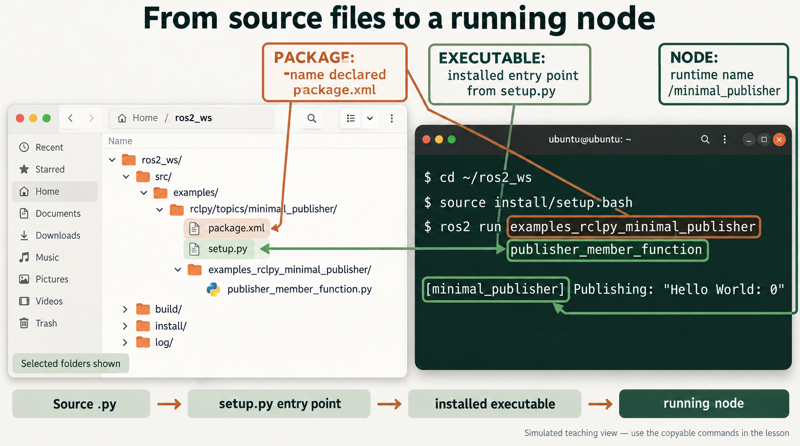

**Follow the mapping:** the package folder is `~/ros2_ws/src/examples/rclpy/topics/minimal_publisher/`. Its `package.xml` declares the ROS package name `examples_rclpy_minimal_publisher`. Its `setup.py` registers the executable name `publisher_member_function`, pointing to `main` in the Python module `examples_rclpy_minimal_publisher/publisher_member_function.py`. The source folder's short name `minimal_publisher` and the declared package name are different; ROS uses the declared name.

After building, the executable entry point is under `~/ros2_ws/install/examples_rclpy_minimal_publisher/lib/examples_rclpy_minimal_publisher/`. `ros2 run` locates that installed entry point using the sourced environment. It does not directly search `src` for a similarly named `.py` file. The running program creates the default node `/minimal_publisher`; a remapping below changes its runtime name without renaming any source file. [Upstream entry points](https://github.com/ros2/examples/blob/jazzy/rclpy/topics/minimal_publisher/setup.py), [publisher source](https://github.com/ros2/examples/blob/jazzy/rclpy/topics/minimal_publisher/examples_rclpy_minimal_publisher/publisher_member_function.py).

### 5. Start and inspect the node

In **Terminal A**, start the installed executable with an explicit node name, a topic remapping and one parameter:

```bash
ros2 run examples_rclpy_minimal_publisher \
  publisher_member_function --ros-args \
  -r __node:=demo_talker -r topic:=/hello \
  -p use_sim_time:=false
```

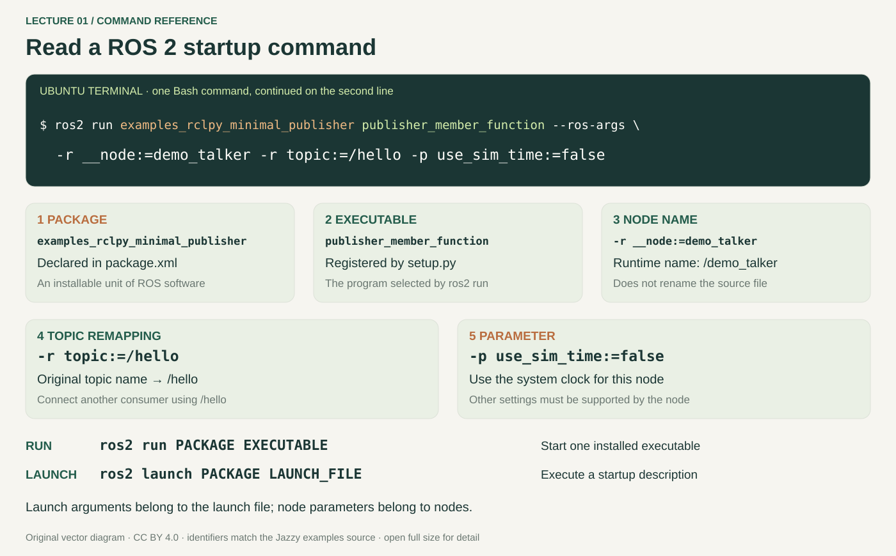

| Part | What it means here |
| --- | --- |
| `ros2 run` | Start one installed executable |
| `examples_rclpy_minimal_publisher` | Package to look in; declared in `package.xml` |
| `publisher_member_function` | Installed executable; registered in `setup.py` |
| `--ros-args` | The following arguments configure ROS behavior |
| `-r __node:=demo_talker` | Rename the runtime node to `/demo_talker` |
| `-r topic:=/hello` | Change the example's original `topic` stream to `/hello` |
| `-p use_sim_time:=false` | Use the normal system clock instead of ROS simulated time |

The upstream example publishes a String about twice per second. The `use_sim_time` parameter is a standard node clock setting; it does not change the text or timer period. Custom settings work only if a node supports them. A backslash at the end of a Bash line continues the same command; do not add a space after it.

**Terminal A — expected log excerpt:**

```output
[demo_talker] Publishing: "Hello World: 0"
[demo_talker] Publishing: "Hello World: 1"
```

Timestamps and the starting count vary. Leave it running. In **Terminal B — a separate new Ubuntu Bash terminal**, inspect it:

```bash
ros2 node list
ros2 node info /demo_talker
ros2 param get /demo_talker use_sim_time
ros2 topic info /hello
ros2 topic echo /hello --once
```

Expect `/demo_talker` among the nodes, `Boolean value is: False` for the clock setting, topic type `std_msgs/msg/String`, and a sample such as:

```output
data: 'Hello World: 7'
---
```

The echo command creates a subscriber and exits after one sample. The number may differ. Stop the publisher with **Ctrl+C in Terminal A** before returning to turtlesim.

**Run versus launch:** `ros2 run PACKAGE EXECUTABLE` selects a program. `ros2 launch PACKAGE LAUNCH_FILE` selects a launch description that can start and configure several programs. A launch-file argument such as `name:=value` is defined by that file; it is not automatically a node parameter. Lecture 04 applies this to the course bringup package, after lecture 02 builds it. [Colcon workflow](https://docs.ros.org/en/jazzy/Tutorials/Beginner-Client-Libraries/Colcon-Tutorial.html), [ROS arguments](https://docs.ros.org/en/jazzy/How-To-Guides/Node-arguments.html).


## Read a message, then command a motion

Reopen the simulator in **Terminal A**, keyboard teleop in **Terminal B**, and an inspection shell in **Terminal C**, following [Bring a turtle to life in lecture 00](00-setup-guide.md). Keep the simulator running for the experiments below; these are fresh terminals in the same Ubuntu installation.

Inspect types before choosing values:

```bash
ros2 interface show geometry_msgs/msg/Twist
ros2 interface show turtlesim/msg/Pose
ros2 topic hz /turtle1/pose
```

`Twist` contains `linear` and `angular` vectors with `x`, `y`, `z` fields. For the turtle, `linear.x` drives forward and `angular.z` turns. Forward speed plus turn rate produces a circle. Physical robots conventionally use m/s and rad/s; turtlesim position uses its simulated-world scale. `topic hz` measures the samples received by that tool, not exact hardware frequency or end-to-end latency. Press Ctrl+C to finish it.

Stop teleop in **Terminal B** with Ctrl+C before introducing another command publisher. In **Terminal C**:

```bash
ros2 topic pub --rate 2 /turtle1/cmd_vel geometry_msgs/msg/Twist \
  "{linear: {x: 1.0}, angular: {z: 0.5}}"
```

The quoted YAML supplies message fields; omitted vector components are zero. `--rate 2` means two command samples per second, not 2 m/s. Expect a circle. Stop with Ctrl+C, then send zero velocity:

```bash
ros2 topic pub --once /turtle1/cmd_vel geometry_msgs/msg/Twist \
  "{linear: {x: 0.0}, angular: {z: 0.0}}"
```

A zero command is a software request. A physical base also needs motion limits, a command watchdog and an independent stop. Stopping a publisher alone need not stop its consumer. [Topic/interface tutorial](https://docs.ros.org/en/jazzy/Tutorials/Beginner-CLI-Tools/Understanding-ROS2-Topics/Understanding-ROS2-Topics.html).

## Try the other interfaces on the same node

Lecture 4 explores these interfaces in depth. Keep turtlesim in Terminal A running and stop motion publishers. Run these in Terminal C.

Inspect and call a short service:

```bash
ros2 service list -t
ros2 interface show std_srvs/srv/Empty
ros2 service call /clear std_srvs/srv/Empty "{}"
```

Expect the drawn trail to disappear while the turtle stays in place. `Empty` has no request/response fields, but there is still a request/response exchange. `{}` supplies the empty request. [Services tutorial](https://docs.ros.org/en/jazzy/Tutorials/Beginner-CLI-Tools/Understanding-ROS2-Services/Understanding-ROS2-Services.html).

Inspect a node-owned setting:

```bash
ros2 param list /turtlesim
ros2 param get /turtlesim background_r
```

Expect an integer red-background component; the value depends on current settings. This is configuration, not continuously changing pose data. [Parameters tutorial](https://docs.ros.org/en/jazzy/Tutorials/Beginner-CLI-Tools/Understanding-ROS2-Parameters/Understanding-ROS2-Parameters.html).

Send a rotation goal:

```bash
ros2 action list -t
ros2 interface show turtlesim/action/RotateAbsolute
ros2 action send_goal /turtle1/rotate_absolute turtlesim/action/RotateAbsolute \
  "{theta: 1.57}" --feedback
```

Expect goal acceptance and feedback about remaining rotation. The final turtle pose `theta` should be near 1.57 radians; the result's `delta` is the angular displacement from the starting heading, so it depends on where the turtle started. If already aligned, the goal may finish immediately. To demonstrate cancellation, restart teleop in Terminal B, use one of its displayed letter keys to start a rotation, then press lowercase `f` without Shift before it completes. Teleop cancels the goal it started, not the earlier CLI goal. [Actions tutorial](https://docs.ros.org/en/jazzy/Tutorials/Beginner-CLI-Tools/Understanding-ROS2-Actions/Understanding-ROS2-Actions.html).

## Names let us reconnect components

`chatter` is relative to a namespace; `/chatter` is absolute. **Namespaces** group names; **remapping** changes a name when a node starts. Neither changes message contents.

Start a second simulator in a **fourth Ubuntu terminal**:

```bash
ros2 run turtlesim turtlesim_node --ros-args -r __ns:=/robot2
```

Expect node `/robot2/turtlesim`, command topic `/robot2/turtle1/cmd_vel` and pose topic `/robot2/turtle1/pose`. The original `/turtle1/cmd_vel` controls the first turtle. A namespace does not automatically alter coordinate-frame IDs or securely isolate network traffic.

Deliberately break a connection: stop the original keyboard node, then restart it in Terminal B with:

```bash
ros2 run turtlesim turtle_teleop_key --ros-args \
  -r /turtle1/cmd_vel:=/wrong_cmd_vel
```

Press arrows. Predict the result, then inspect `/wrong_cmd_vel` with `ros2 topic info /wrong_cmd_vel --verbose`: the publisher now sends elsewhere while turtlesim still listens to its original command topic. Stop this teleop and restart without the remap to repair it. Camera remapping works the same way; renaming a stream does not rectify pixels or repair calibration.

## Diagnose a connection with evidence

1. **Process:** is the intended node running, without an error in its terminal?
2. **Environment:** are terminals using Jazzy, the same domain and intended discovery settings?
3. **Names/types:** do endpoints agree after namespace/remapping resolution?
4. **QoS:** what does `ros2 topic info TOPIC --verbose` report? Can the offer meet the request?
5. **Data:** does `ros2 topic echo TOPIC --once` receive a sample? Use `--qos-reliability best_effort` for a suitable best-effort sensor.
6. **Meaning:** are units, frames, timestamps and rates sensible?

Across computers, also check reachability/discovery transport using the networking appendix. Change one thing at a time so the result explains the failure. Topic discovery or arrival of bytes alone is not proof of useful data.

## Where these ideas lead: the phone capstone

Your Android phone supplies camera images and independent motion measurements. The laptop receiver checks and decodes packets, then publishes ROS messages. A viewer displays the camera, a bag recorder saves samples, and an optional separately prepared mapper uses images and measured camera calibration to estimate motion and sparse landmarks. These consumers reuse the same measurements for different purposes.

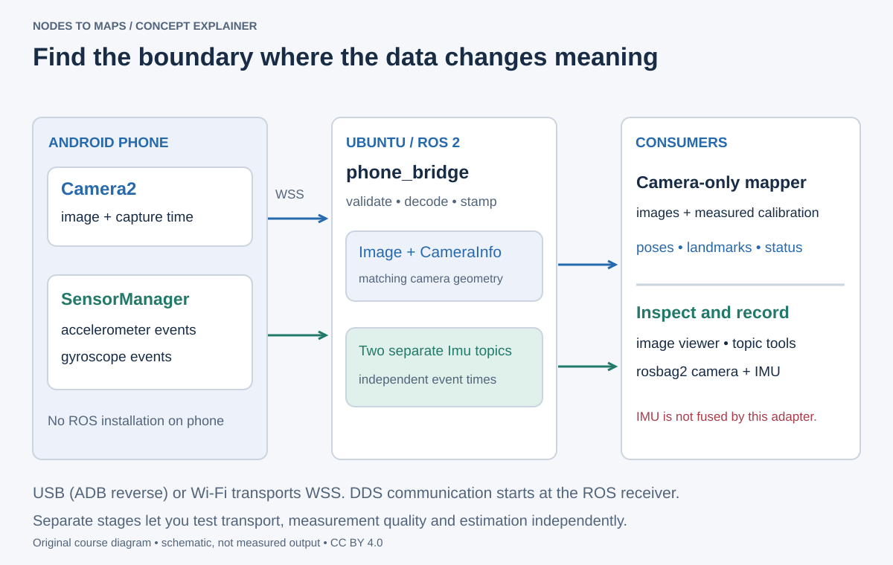

Follow the boundary in the picture: the phone uses authenticated WebSocket transport; ROS communication begins in `phone_bridge`. Our supplied mapper uses the camera stream, not fused camera–IMU data. Its monocular map has arbitrary scale. This course first teaches how to build and inspect that pipeline, then how to recognize when transport, calibration or estimation has failed. [Phone lab preparation](../annexes/dataset-guide.md) explains the prerequisites.

## Practice, explain and carry forward

**Core lab evidence:** save the upstream Git commit, installed package prefix, one `/hello` sample, the turtle command-topic type, one pose sample and an explanation of the broken remap. Explain how `package.xml`, `setup.py`, the executable and the runtime node name are related. Draw the command and pose arrows; identify the connection needed to close an automatic feedback loop. Stop lab nodes with Ctrl+C in their terminals when finished.

**Before lecture 2, explain:**

1. A USB sensor appears in Windows but not Ubuntu. Why is a topic remap not the first fix?
2. Why does a topic suit a camera feeding a viewer, detector and recorder?
3. Which interfaces suit “clear the drawing” and “drive to a distant waypoint”?
4. Why might a listed topic have a silent subscriber?
5. Where do Ubuntu, its kernel, ROS libraries and your node sit in the stack?

**Model reasoning:** first make the sensor available to Linux. Topics distribute repeated samples to independent consumers. A service fits a brief operation; an action fits a goal with progress. Discovery and delivery compatibility are separate checks. The kernel is part of Ubuntu's OS; ROS libraries and nodes run above it in user space.

**Further practice:** complete the interface sampler and revisit the shell drill in [lecture 00](00-setup-guide.md), drive a straight segment and turn, send zero velocity and explain your commands. Keep the categorized feature table and advanced workflow appendix as references. Readiness for lecture 2 means explaining the graph you observed and inspecting its interfaces without guessing command meanings.

The highway, shared-interface comparison and robot-capability illustrations are AI-assisted redraws of author-supplied references. Other concept diagrams are original course artwork, licensed with the course under CC BY 4.0. See [visual sources](../annexes/visual-sources.md) for provenance. They explain relationships rather than reproduce captured application output. Primary references and the source-package workflow were reviewed on 1 November 2026.
