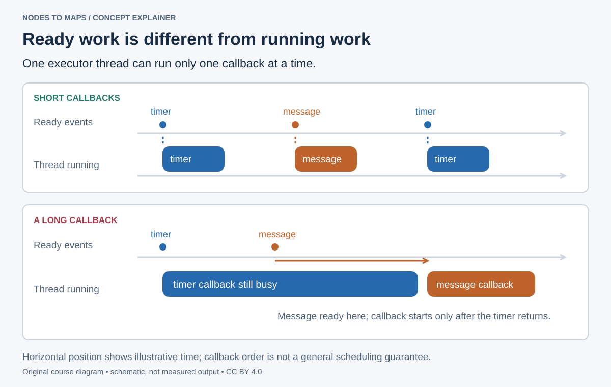

# Write your first Python nodes

Turn the graph into code, one callback at a time.

## Start from the robot's job

In lecture 1 you connected existing programs. Now imagine replacing the keyboard with a distance sensor: one program reads measurements, another decides what to do. Each needs a clear input or output and a repeatable way to run. We start with text messages so packaging and callback behavior are visible before adding camera data.

You need Python functions, classes, imports and indentation. A class bundles state and functions: here `self.count` remembers the count between calls, and `tick` is a method operating on that state. `Hello(Node)` inherits ROS behavior; `super().__init__('hello')` initializes the ROS node with its graph name. You do not need to implement networking yourself.

**90-minute route:** workspace 10 min; publisher 20; matching subscriber 15; packaging 15; custom-interface inspection 10; practice 20. The interface-edit homework is a second pass, not a prerequisite for the first working pair. Open fresh Ubuntu Bash terminals after lecture 00; its `.bashrc` block loads the environment. After a build, source the updated overlay in terminals that were already open.

## Understand the workspace

A **workspace** contains source packages and generated build, install and log directories. A **package** groups code, interfaces and metadata. An **executable** is a runnable entry point; a **node** participates in the graph. These are related concepts, not synonyms.

The reference workspace contains ros2_course_py, ros2_course_cpp, ros2_course_interfaces and ros2_course_bringup. Use it to catch up, but type this first experiment yourself. **By the end:** write timer and subscription callbacks, build a package and explain interface generation.

| Location or concept | What belongs there | What to edit |
| --- | --- | --- |
| `~/ros2_ws/src/` | Your package source directories | Python, C++, interface and launch source |
| `build/` | Compiler and generator work | Let colcon manage it |
| `install/` | Files exposed to ROS after a build | Source its setup file; edit the source instead |
| `log/` | Build diagnostics | Read the first failing package's error |
| Package → executable → node | Distribution unit → command to run → graph participant | One executable can create several nodes |

The import `std_msgs.msg.String` names a generated Python type. The topic name `chatter` identifies a connection. The node name `hello` identifies this participant. None of these has to equal the source filename.

## Write a complete publisher

Save this as `~/ros2_ws/hello.py`. With Jazzy sourced, run `python3 ~/ros2_ws/hello.py`:

```python
import rclpy
from rclpy.node import Node
from std_msgs.msg import String

class Hello(Node):
    def __init__(self):
        super().__init__('hello')
        self.publisher = self.create_publisher(String, 'chatter', 10)
        self.count = 0
        self.timer = self.create_timer(0.5, self.tick)

    def tick(self):
        msg = String()
        msg.data = f'frame {self.count}'
        self.publisher.publish(msg)
        self.count += 1

def main():
    rclpy.init()
    node = Hello()
    try:
        rclpy.spin(node)
    except KeyboardInterrupt:
        pass
    finally:
        node.destroy_node()
        if rclpy.ok():
            rclpy.shutdown()

if __name__ == '__main__':
    main()
```

Node gives the object a graph identity. A **callback** is a function ROS invokes when work is ready, such as a timer expiring or a message arriving. The **executor** chooses and runs ready callbacks while `spin` is active. The publisher specifies String and keep-last depth 10 using the default profile. The timer requests a callback roughly twice per second; scheduling can vary on an ordinary laptop.

The publishing terminal stays quiet because this minimal program has no logging call. In **another Ubuntu terminal**, run:

```bash
ros2 topic echo /chatter
```

Example received output (your starting count will usually be higher because the publisher started first):

```output
data: frame 12
---
data: frame 13
---
```

Press Ctrl+C in the echo terminal when finished; the publisher continues in its own terminal. No output means you should check that the publisher is still running and that both terminals use the same ROS domain.



Read the diagram from left to right. Ready work is not the same as running work: with one executor thread, a subscription cannot run while that thread is inside a long timer callback. Keep callbacks short. Multiple threads need deliberate callback-group and shared-state design; they are not an automatic cure for slow processing. See the [executor explanation](https://docs.ros.org/en/jazzy/Concepts/Intermediate/About-Executors.html).

## Install a package entry point

Create a scratch package. The package name comes before --dependencies so it cannot be consumed as a dependency:

```bash
cd ~/ros2_ws/src
ros2 pkg create my_camera_lab --build-type ament_python \
  --license Apache-2.0 --dependencies rclpy std_msgs
```

Stop the scratch publisher with Ctrl+C. Copy your file into the generated Python module directory:

```bash
cp ~/ros2_ws/hello.py ~/ros2_ws/src/my_camera_lab/my_camera_lab/hello.py
```

Open `~/ros2_ws/src/my_camera_lab/setup.py` in your editor and put the following inside its existing `setup(...)` call, replacing the empty `entry_points` dictionary. This is **Python file content**, not a terminal command:

```python
entry_points={
    'console_scripts': [
        'hello = my_camera_lab.hello:main',
    ],
},
```

Left of `=` is the executable name for `ros2 run`; right of it is the module and function to call. Keep the other generated setup fields. `package.xml` declares dependencies and `setup.cfg` places scripts where `ros2 run` expects them. The two `my_camera_lab` directory names are normal: the outer one is the ROS package and the inner one is the Python module.

```bash
cd ~/ros2_ws
colcon build --symlink-install --packages-select my_camera_lab
source install/setup.bash
ros2 run my_camera_lab hello
```

Expected: the same /hello node and /chatter stream. If the executable is absent, check the entry point, rebuild and source the overlay in a fresh terminal. Stop the scratch publisher before starting the reference talker.

## Receive messages

Run the supplied reference pair in separate sourced terminals:

```bash
ros2 run ros2_course_py talker
```

```bash
ros2 run ros2_course_py listener
```

The listener should log the talker's strings. Resources includes both complete source files. `create_subscription(String, 'chatter', callback, 10)` connects incoming messages to a function accepting a message argument. Store the subscription on the node object so its ownership is clear.

Change the listener to log `len(msg.data)`. Then remap both nodes using `--ros-args -r chatter:=camera_events`. Remapping only one node disconnects them. Stop duplicate publishers when measuring rates.

Large image processing needs deliberate design. Copying every frame through many callbacks can consume CPU and bandwidth. Measure your pipeline before choosing an optimization or a language.

## Write the matching minimal subscriber

Save as ~/ros2_ws/hear.py and run with Jazzy sourced while hello.py is publishing. This complete scaffold uses the same type, relative name and QoS depth as the publisher:

```python
import rclpy
from rclpy.node import Node
from std_msgs.msg import String

class Hear(Node):
    def __init__(self):
        super().__init__('hear')
        self.sub = self.create_subscription(String, 'chatter', self.receive, 10)

    def receive(self, msg):
        self.get_logger().info(f'Received {len(msg.data)} characters: {msg.data}')

def main():
    rclpy.init()
    node = Hear()
    try:
        rclpy.spin(node)
    except KeyboardInterrupt:
        pass
    finally:
        node.destroy_node()
        if rclpy.ok():
            rclpy.shutdown()

if __name__ == '__main__':
    main()
```

Expected: a line for each received frame string. The callback handles one message; spin lets the executor invoke it. Stop the scratch pair before starting another talker. In the package version, install Hear through a console_scripts entry point just as you did for Hello.

## Give data a meaningful type

String is convenient for a first lesson. Real interfaces should describe their data: Image for pixels, CameraInfo for calibration and Imu for inertial measurements. Our custom RobotStatus demonstrates generation:

```text
string robot_name
float32 battery_percent
bool is_moving
uint8 fault_code
```

ros2_course_interfaces lists files in rosidl_generate_interfaces in CMakeLists.txt and declares generator/runtime dependencies in package.xml. Interfaces live in an ament_cmake package even when consumers are Python. Build before importing generated types:

```bash
cd ~/ros2_ws
colcon build --symlink-install --packages-up-to ros2_course_py
source install/setup.bash
ros2 interface show ros2_course_interfaces/msg/RobotStatus
ros2 run ros2_course_py robot_status_publisher
```

In another terminal, `ros2 topic echo /robot_status --once` should show the fields. This example simulates battery state; it does not measure a real battery. Document units, valid ranges and unavailable values. Use a Header when timestamp and coordinate frame matter.

An early sample could look like this; battery_percent decreases by 2.5 each publication:

```output
robot_name: tb3_01
battery_percent: 97.5
is_moving: true
fault_code: 0
```

## Diagnose the layer that failed

| Observation | Likely layer | First useful check |
| --- | --- | --- |
| `ModuleNotFoundError: rclpy` | Python/environment | Use Ubuntu's system Python and check the Jazzy environment |
| `Package ... not found` | Installation discovery | Build, then source `~/ros2_ws/install/setup.bash` |
| Package found but no `hello` executable | Entry-point installation | Check `console_scripts`, rebuild, run `ros2 pkg executables my_camera_lab` |
| Node exists but no data reaches the listener | ROS connection | Inspect the resolved topic, type and QoS with `ros2 topic info /chatter --verbose` |
| Callbacks pause when computation starts | Scheduling | Time the callback before changing queue depth or language |

Building discovers and installs your package; sourcing makes that installation visible to a terminal; running starts a process. Treat these as three separate checks.

## Practice and prove it

**In class, 25 minutes:** write a subscriber that counts received messages and reports once per second. Increment a counter in its subscription callback and report it in a timer callback. At a 2 Hz input the count usually grows by about two per report after startup. Asynchronous interval boundaries mean it need not be exactly two every time.

**Homework, 45 minutes:** add float32 temperature_c to RobotStatus, regenerate the interface, rebuild consumers and publish a simulated value. Submit the interface, changed publisher and one echoed message.

**Checkpoint:** editing a .msg file does not generate an importable type. Build the interface package and dependent consumers, then source the overlay.

Sources: [Python publisher/subscriber](https://docs.ros.org/en/jazzy/Tutorials/Beginner-Client-Libraries/Writing-A-Simple-Py-Publisher-And-Subscriber.html), [custom interfaces](https://docs.ros.org/en/jazzy/Tutorials/Beginner-Client-Libraries/Custom-ROS2-Interfaces.html). Next: connect Python and C++ and diagnose QoS.
