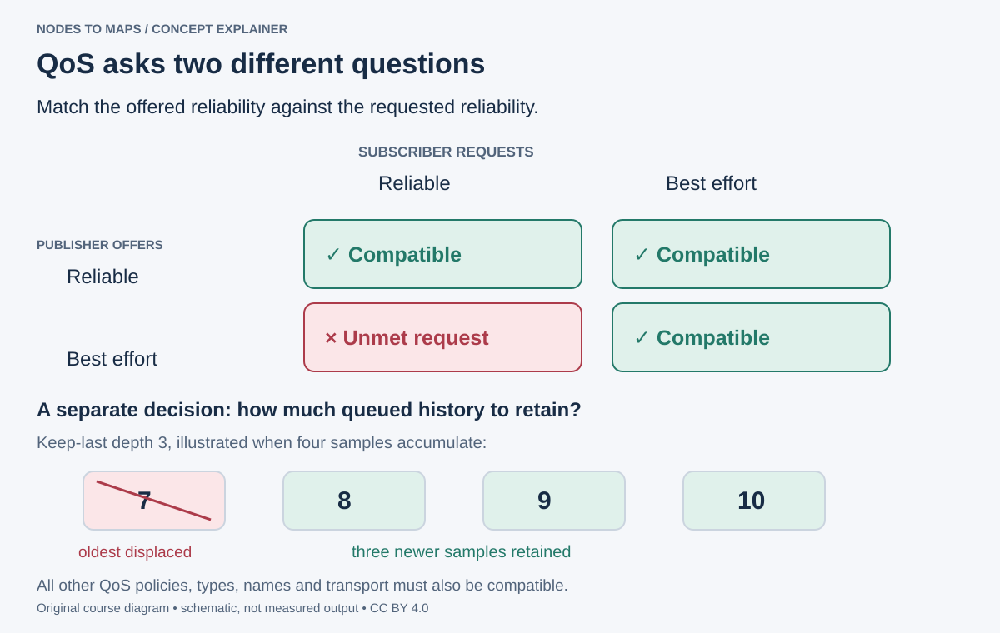

# The same graph, in C++

Change the language. Keep the communication contract.

## Why add a second language?

Imagine a camera driver already supplied as a C++ library and an experiment you want to write in Python. ROS lets the two exchange standard messages, so you can reuse the driver and develop the experiment independently. This lecture changes the implementation while preserving the topic contract you tested in lecture 2.

C++ source is compiled and linked into an executable before it runs. A Python edit is usually interpreted at runtime; a C++ edit needs a new build. Neither choice fixes a wrong topic name, a missing transform or incompatible QoS. Measure CPU use and latency before deciding that a rewrite is necessary.

**90-minute route:** vocabulary and code 20 min; build and cross-language pair 20; QoS 20; fault experiment 20; explanation 10. Beginners can read and modify the supplied C++ scaffold without learning all of modern C++ in this session.

## Translate the concepts

rclpy and rclcpp are client libraries for the same ROS graph. A Python subscriber can receive a C++ publisher's messages when name, type and QoS agree. C++ is useful for native libraries and demanding computation; Python is convenient for orchestration and experiments. Language choice alone does not make a system fast or real time.

Review classes, templates and smart pointers before class. If C++ is new, focus on mapping the familiar publisher, timer and callback concepts and use the complete reference scaffold. **By the end:** build a C++ node, connect it to Python and diagnose a QoS mismatch.

| C++ notation here | Meaning | Familiar Python idea |
| --- | --- | --- |
| `#include` | Bring declarations into this source file | Similar purpose to finding an API to use; linking is a separate C++ build step |
| `class Talker : public rclcpp::Node` | A class derived from the ROS Node class | `class Hello(Node)` |
| `std_msgs::msg::String` | Namespaces identify the generated message type | `std_msgs.msg.String` |
| `<std_msgs::msg::String>` | A template parameter selects the type at compile time | Passing `String` to the Python publisher factory |
| `[this]()` | A small callback that can access this object's members | A method using `self` |
| `SharedPtr` | An owning reference shared with other holders | Keep an object alive while it is in use |

The code is an example to read, not a block to paste into Bash. The supplied source uses a named callback instead of the compact lambda below; both illustrate the same publisher/timer structure.

## Read a complete publisher

The supplied talker.cpp is the annotated version of this example:

```cpp
#include <chrono>
#include <functional>
#include <memory>
#include <string>
#include "rclcpp/rclcpp.hpp"
#include "std_msgs/msg/string.hpp"
using namespace std::chrono_literals;

class Talker : public rclcpp::Node {
public:
  Talker() : Node("cpp_talker") {
    pub_ = create_publisher<std_msgs::msg::String>("chatter", 10);
    timer_ = create_wall_timer(500ms, [this]() {
      std_msgs::msg::String msg;
      msg.data = "frame " + std::to_string(count_++);
      pub_->publish(msg);
    });
  }
private:
  int count_ = 0;
  rclcpp::Publisher<std_msgs::msg::String>::SharedPtr pub_;
  rclcpp::TimerBase::SharedPtr timer_;
};

int main(int argc, char **argv) {
  rclcpp::init(argc, argv);
  rclcpp::spin(std::make_shared<Talker>());
  rclcpp::shutdown();
  return 0;
}
```

The template argument sets the message type at compile time. SharedPtr members retain the publisher and timer. The lambda captures this to access members. `create_wall_timer` runs on steady time, independently of the ROS replay clock. During bag replay, use the node’s ROS clock when comparing sensor timestamps; this keeps measurements and time queries on the same timeline.

## Build and connect

For a talker, the essential CMake operations are:

```cmake
find_package(ament_cmake REQUIRED)
find_package(rclcpp REQUIRED)
find_package(std_msgs REQUIRED)
add_executable(talker src/talker.cpp)
ament_target_dependencies(talker rclcpp std_msgs)
install(TARGETS talker DESTINATION lib/${PROJECT_NAME})
ament_package()
```

This is an excerpt: the complete supplied CMakeLists.txt also defines the project, CMake version and other executables. package.xml declares dependencies for package discovery and dependency installation; CMake configures and links targets.

```bash
cd ~/ros2_ws
colcon build --packages-up-to ros2_course_cpp
source install/setup.bash
ros2 run ros2_course_cpp talker
```

In another terminal run `ros2 run ros2_course_py listener`. Expected: Python receives C++ strings. Reverse the pairing with the Python talker and C++ listener. Rebuild after a C++ edit; the old installed binary does not change automatically.

You should see increasing `Hello ROS 2 from C++! count = ...` values in the supplied pair. Stop each pair with Ctrl+C before reversing languages, so one source owns the stream during each measurement.

If compilation fails, fix the first compiler error before later cascading errors. If compilation succeeds but `ros2 run` cannot find the program, check the `install(TARGETS ...)` rule and the sourced overlay. A successful build and a working graph connection establish different things.

## Make QoS compatible

Quality of Service describes delivery and storage policies. **Reliable** requests retransmission when needed; it does not promise zero latency or delivery through every failure. **Best effort** permits loss, often favoring fresh sensor data over retries.

| Publisher offers | Subscriber requests | Compatible? |
| --- | --- | --- |
| Reliable | Reliable | Yes |
| Reliable | Best effort | Yes |
| Best effort | Reliable | No |
| Best effort | Best effort | Yes |

Compatibility is directional. Other policies matter too. Keep-last **depth** sets how many samples can be retained. When a consumer falls behind that finite history, older samples can be lost. **Durability** distinguishes volatile data from transient-local retained history. Late subscribers to retained map data or static transforms need suitable durability.



Use the upper matrix to decide whether reliability permits a match. Use the lower strip to reason about what a slow consumer keeps: with keep-last depth 3, a fourth queued sample can displace an old one. Those are separate decisions. More buffering can retain more history but also let processing fall behind the live scene.

| Application question | Policy to consider | Example |
| --- | --- | --- |
| Can I tolerate missing a sample? | Reliability | A live camera viewer may prefer the next fresh frame |
| Must a late joiner receive retained state? | Durability and history | A static transform should still be available after the publisher's first send |
| How much old work can accumulate? | History/depth | A slow image consumer should not silently process seconds-old images |
| How old is too old? | Lifespan plus application age checks | A motion decision needs a timestamp threshold |
| Is a producer failing to update? | Deadline/liveliness and monitoring | A controller should detect stale measurements |

QoS events inform software; they do not themselves cut motor power or repair an overloaded algorithm. A robot's safe stopping behavior needs a separate, tested design.

For sensors, inspect the publisher and often start with qos_profile_sensor_data in Python or rclcpp::SensorDataQoS() in C++. Inspect each driver’s offered policies before choosing the subscription profile.

## Break delivery, then repair it

Terminal A:

```bash
ros2 topic pub /qos_demo std_msgs/msg/String "{data: hello}" \
  --rate 2 --qos-reliability best_effort
```

Terminal B:

```bash
ros2 topic echo /qos_demo --qos-reliability reliable
```

Expected: no samples arrive; an incompatibility warning may appear. Stop echo, inspect the endpoints, then request best effort:

```bash
ros2 topic info /qos_demo --verbose
ros2 topic echo /qos_demo --qos-reliability best_effort
```

Expected: samples arrive. A subscriber policy fixed this pair; renaming the topic would not help. Predict all four reliability combinations in the interactive matrix.


After selecting a compatible subscriber, example output is:

```output
data: hello
---
data: hello
---
```

While the reliable subscriber is still running, `ros2 topic info /qos_demo --verbose` should show the publisher offering BEST_EFFORT and that subscription requesting RELIABLE. This is the evidence for the mismatch. After changing echo, its subscription should report BEST_EFFORT. Stop the publisher and echo when finished.

## Practice and prove it

**In class, 20 minutes:** connect C++ to Python, remap both endpoints and demonstrate the QoS failure. Submit verbose endpoint output and a one-sentence diagnosis.

**Homework, 45 minutes:** change the C++ talker to 5 Hz, rebuild and compare ros2 topic hz for Python and C++ talkers one at a time. This tiny example is not a valid language benchmark. Explain confounders such as logging, scheduling and subscriber overhead.

**Checkpoint:** reliable publisher to best-effort subscriber works. The reverse pair is incompatible. A queue depth is not a reliability policy.

Sources: [C++ tutorial](https://docs.ros.org/en/jazzy/Tutorials/Beginner-Client-Libraries/Writing-A-Simple-Cpp-Publisher-And-Subscriber.html), [QoS compatibility](https://docs.ros.org/en/jazzy/Concepts/Intermediate/About-Quality-of-Service-Settings.html). Next: services, actions, launch and TF.
