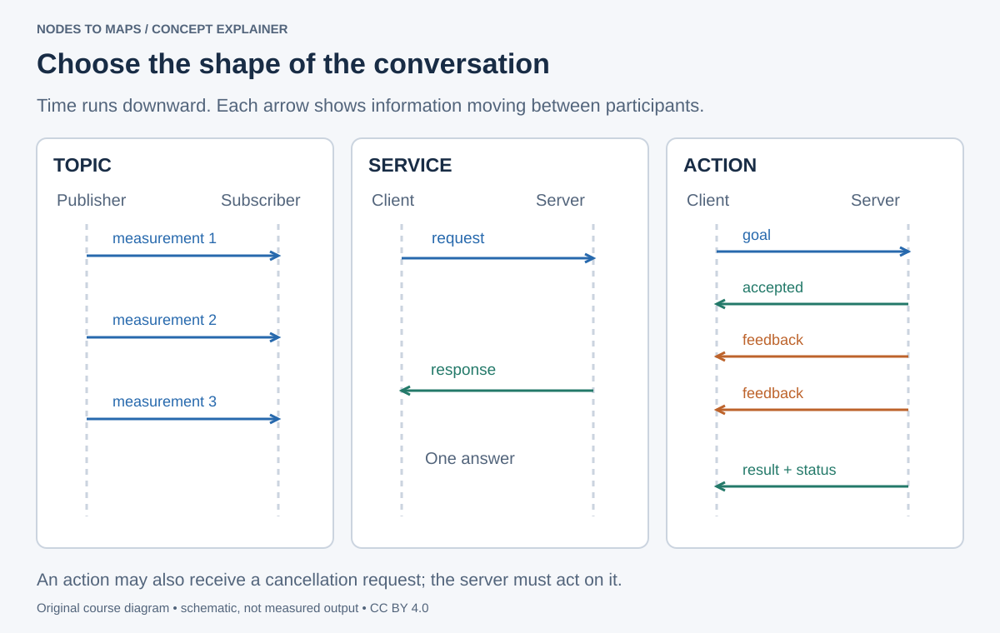
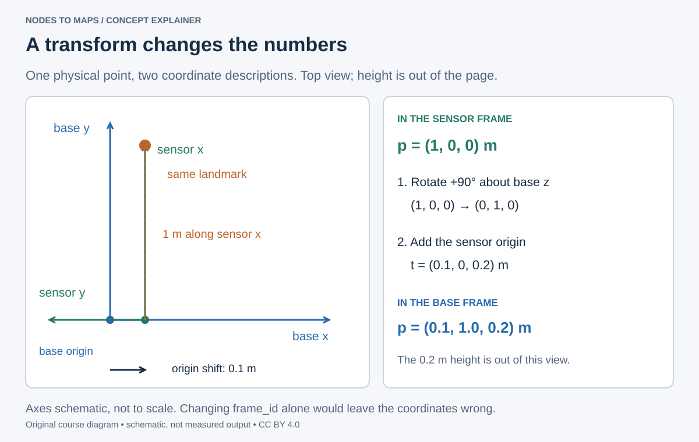

# Connect a complete system

Choose the right interaction. Give every measurement a place and a time.

## From individual nodes to a system

The first three lectures established how to publish, receive and diagnose streams. A working robot also needs to ask for an operation, monitor a job, load a repeatable configuration and relate measurements from different locations. Those are the four problems in this lecture. A camera image can arrive perfectly over ROS and still be unusable if its coordinate frame or timestamp is wrong.

Think of a mobile inspection robot: images arrive continuously; a service requests one calibration status; a navigation action travels to the next inspection point; parameters set camera exposure; launch starts the programs; TF relates camera observations to the robot body. Each tool answers a different question.

**90-minute core:** communication patterns 10 min; service/action experiments 20; parameters/launch 15; frames and one point transform 20; integrated practice 25. Read implementation details and the full frame mathematics in the annexes after class. All node commands below run in Ubuntu terminals prepared in lecture 00.

## Choose topics, services or actions

Use a **topic** for a continuing stream, such as camera frames. Use a **service** for a short request and response, such as reading a setting or computing an area. Use an **action** for a longer goal that needs feedback and cancellation, such as navigating to a pose.

A service client sends a request and waits for a response from a server. If a connection fails, retrying may repeat work, so operations such as saving a file need an application-level retry policy. Keep service callbacks short so other work can be processed. An action adds goal acceptance, feedback and a final status; its server also needs to check and respond to cancellation requests.

**By the end:** call a custom service, send an action goal, configure nodes through parameters and launch, and explain a TF chain. This lecture is dense: the core path is CLI use plus the supplied files; implementing a new action server is an extension.



Read each arrow as one transfer, not a physical cable. A topic has no built-in “job complete” response. A service gives a response for a request. An action gives a goal an identity and lifecycle, allowing feedback and cancellation while work proceeds. A client disappearing does not prove a remote action stopped. [ROS action concepts](https://docs.ros.org/en/jazzy/Concepts/Basic/About-Actions.html) describe that lifecycle.

Before coding, say the sentence your interface represents: “Here is another measurement” suggests a topic; “Please compute this answer” suggests a service; “Please do this job and tell me its progress” suggests an action.

## Call a service

The supplied ComputeRectangleArea.srv has request fields above the separator and response fields below:

```text
float64 width
float64 height
---
float64 area
bool valid
string message
```

Start the Python server:

```bash
ros2 run ros2_course_py area_server
```

In a second terminal:

```bash
ros2 service list -t
ros2 service call /compute_area \
  ros2_course_interfaces/srv/ComputeRectangleArea \
  "{width: 3.0, height: 4.0}"
ros2 run ros2_course_py area_client --ros-args -p width:=5.0 -p height:=2.5
```

Expected: valid true with area 12.0 for the CLI call and 12.5 for the client. Negative or non-finite dimensions should be rejected by the application. Run one server at a time: two servers advertising the same service make it unclear which implementation handled a request.

The important fields in the first response are:

```output
area: 12.0
valid: true
message: ok
```

The CLI may print these in a Python-style response representation. The service schema only specifies numbers; our classroom interpretation uses widths and heights in metres and area in square metres. Document those units in a production interface. The supplied server accepts zero dimensions and rejects negative or non-finite values.

Read area_client.py: call_async returns a Future, and an executor must keep processing work for the response to arrive. The standalone client can spin while waiting. Inside an already-spinning node callback, use an asynchronous continuation and suitable callback groups instead: blocking that callback can prevent its own response from being processed.

## Follow a goal over time

CountUntil.action separates goal, result and feedback with two separators:

```text
int32 target
float64 period
---
int32 reached_number
---
int32 current_number
```

Run the server, then send a goal in another terminal:

```bash
ros2 run ros2_course_py count_until_server
```

```bash
ros2 action list -t
ros2 action send_goal /count_until \
  ros2_course_interfaces/action/CountUntil \
  "{target: 8, period: 0.5}" --feedback
```

Expected: feedback counts upward and the result reports reached_number 8. The server rejects nonpositive targets and invalid periods. Its teaching implementation uses a multithreaded executor and a reentrant callback group, so cancellation can be serviced while execution waits. It is not a real-time job scheduler.

To demonstrate cancellation, run `ros2 run ros2_course_py count_until_client --ros-args -p target:=20 -p period:=0.5 -p cancel_after:=2.0`. The client requests cancellation after two seconds and logs the terminal status. Cancellation is a protocol: Ctrl+C on an arbitrary CLI client does not by itself guarantee that the server cancels the goal.


For the successful goal, look for acceptance, successive `current_number` values, then `reached_number: 8` and SUCCEEDED. For the cancellation experiment, look for CANCELED and the number reached so far; the precise count depends on scheduling. The supplied server checks cancellation between iterations, so cancellation response can be delayed by the current sleep period. Run only one server for `/count_until`.

For a deeper source walkthrough, try [Annex D’s service and action experiments](../annexes/ros-workflows.md).

## Configure and launch

Parameters configure a node. Declare them with defaults, validate values and make the runtime behavior match accepted updates. A parameter changing in the graph does not automatically rebuild a timer or reconfigure a sensor.

```bash
ros2 run ros2_course_py params_demo --ros-args -p rate_hz:=2.0
```

In another terminal:

```bash
ros2 param list /params_demo
ros2 param set /params_demo message "changed live"
ros2 param set /params_demo rate_hz 5.0
ros2 topic hz /chatter
```

Expected: new messages use the new text and the output rate changes to about 5 Hz. The reference implementation accepts a finite floating-point `rate_hz` in **[0.1, 100]**; use `5.0` rather than integer `5`. It reads committed parameters and replaces its timer at the next existing timer tick. Stop this node before the next demonstration.

Parameters belong to individual nodes and normally disappear when the process ends. Changing a parameter is configuration, not a way to publish a high-rate sensor stream. Save settings in YAML or a launch description when a later run should reproduce them. See [parameter concepts](https://docs.ros.org/en/jazzy/Concepts/Basic/About-Parameters.html).

Launch files are repeatable system recipes. They configure nodes, remappings and parameters, but textual order alone does not guarantee a dependency is ready. For more complex systems use lifecycle management or explicit readiness checks.

```bash
ros2 launch ros2_course_py pubsub_demo.launch.py \
  message:="camera pipeline ready" rate:=5.0
```

Expected: my_talker and my_listener exchange messages on /lecture_chatter. A launch argument is an input to the launch description; a parameter belongs to a node. The launch file explicitly passes one into the other.

Trace this particular command through the supplied launch file: `rate:=5.0` sets the launch argument `rate`; the file converts it to the talker's `rate_hz` parameter; the talker uses it to choose its timer period. The remapping independently connects `chatter` to `/lecture_chatter`. Configuration values and connection names are different controls.

## Give data a coordinate frame

An image has a timestamp and frame_id in its Header. TF2 answers how coordinate frames relate at a requested time. The standard mobile-robot chain is `map → odom → base_link → camera_link → camera_optical_frame`.

**map → odom:** a mapping/localization estimate corrects global drift and can jump after loop closure. **odom → base_link:** local odometry is continuous but can drift. **base_link → sensor:** a calibrated rigid mount is static. Exactly one authority should publish each child frame's parent transform.

REP 103 uses x forward, y left and z up for a body frame. Optical frames use x right, y down and z forward. A frame name alone does not rotate the data. Use measured geometry for physical sensors. A static transform describes a rigid mount; a moving sensor’s pose needs a changing estimate.

Try a deliberately simple fixed-frame exercise. These values describe a teaching mount, not your hardware calibration:

```bash
ros2 run tf2_ros static_transform_publisher \
  --x 0.1 --y 0.0 --z 0.2 --yaw 0 --pitch 0 --roll 0 \
  --frame-id base_link --child-frame-id camera_link
```

In another terminal:

```bash
ros2 run tf2_ros tf2_echo base_link camera_link
ros2 run tf2_tools view_frames
```

Expected: the translation is 0.1, 0, 0.2 metres. view_frames writes a graph file in the working directory. A lookup outside the buffer's time range can fail even when every frame name exists. Inspect timestamps, clock and transform availability together.




## Work through one point transform

Suppose demo_sensor is translated by (0.1, 0, 0.2) m in demo_base and yawed +90° around z. Its point (1, 0, 0) m becomes (0, 1, 0) after rotation, then (0.1, 1.0, 0.2) after translation. This is different from changing frame_id: the numbers must change too.

The diagram is a **top view** of that second example; the 0.2 m height is stated separately because it is out of the page. This example includes rotation, unlike the parallel-axis `base_link → camera_link` CLI exercise above. Use the [Frames appendix](../annexes/frames.md) for its separate `demo_base → demo_sensor` command. Keeping these names separate prevents two demonstrations from claiming the same transform.

For a point `p` measured in the sensor frame, compute `p_base = R × p_sensor + t`. Rotate the point's coordinates first, then add the sensor origin expressed in base coordinates. TF supplies the transform; the consumer or a TF helper must still apply it to the measurement.

Use the interactive transform lab, then read the Frames appendix. A lookup_transform(target, source, time) returns the transform mapping source coordinates into target coordinates at that time. Optical axes, body axes and phone-device axes use separate conventions. The phone camera–IMU mounting becomes an edge in this tree only after its geometry and axis conventions have been measured.

## Practice and prove it

**In class, 25 minutes:** launch the pub/sub pair, update a validated parameter and produce the fixed TF above. Submit the launch command, measured rate and frame graph. Stop the teaching static transform before starting a real sensor driver that publishes the same child frame.

**Homework, 60 minutes:** sketch the future camera system. Label topic types, clock source and the node responsible for each TF edge. Explain why a static odom → base_link would claim a moving rig is stationary.

**Checkpoint:** a map correction may jump, while local odometry should remain continuous. That is why the global and local transforms are split.

Sources: [services](https://docs.ros.org/en/jazzy/Tutorials/Beginner-CLI-Tools/Understanding-ROS2-Services/Understanding-ROS2-Services.html), [actions](https://docs.ros.org/en/jazzy/Tutorials/Intermediate/Writing-an-Action-Server-Client/Py.html), [REP 103](https://www.ros.org/reps/rep-0103.html), [REP 105](https://www.ros.org/reps/rep-0105.html). Read the Frames, transforms & time appendix for worked point transforms, composition, quaternions and lookup direction. Next: connect phone sensors and qualified monocular SLAM.
