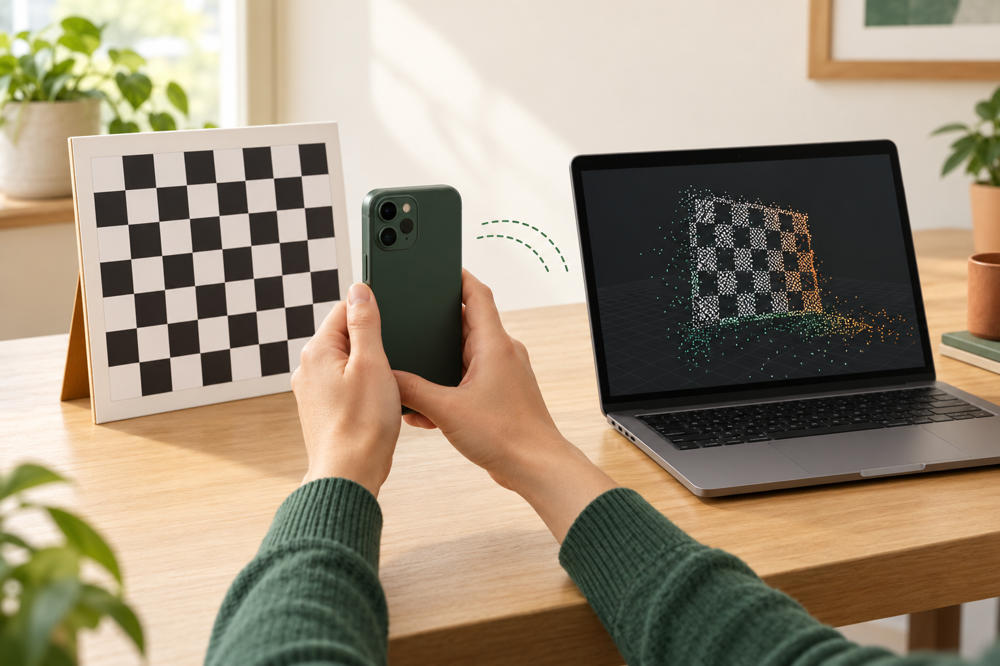
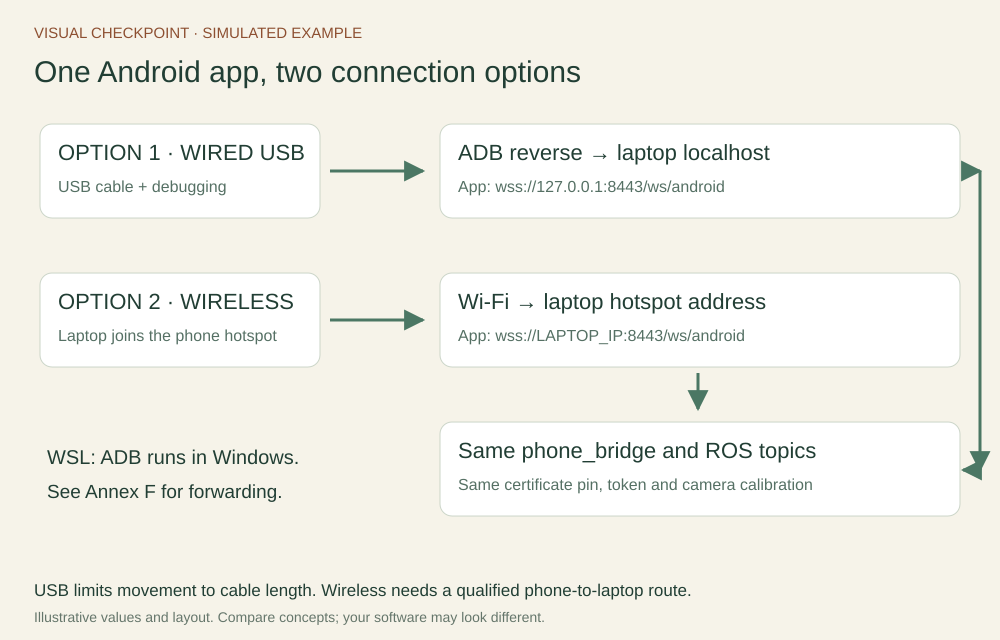
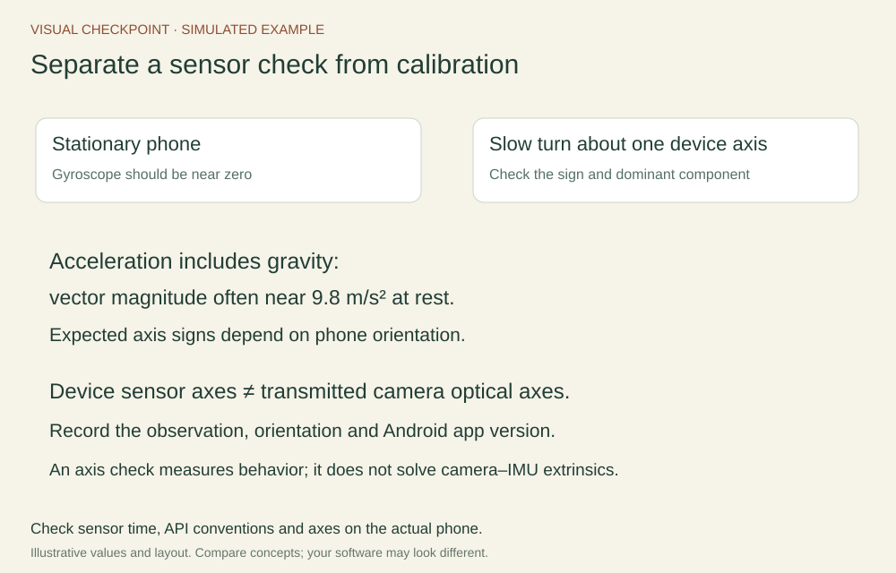
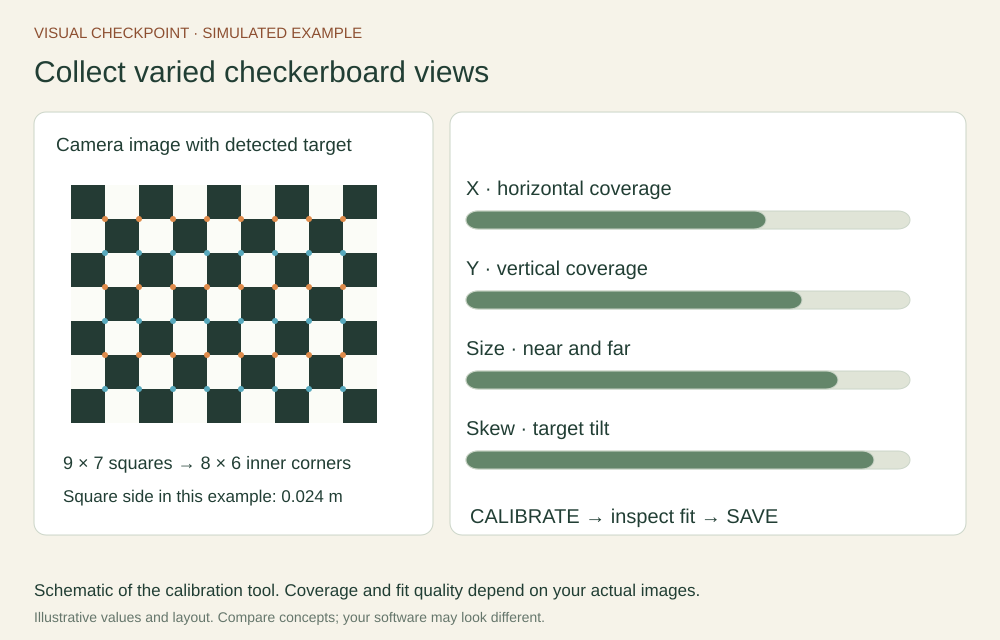
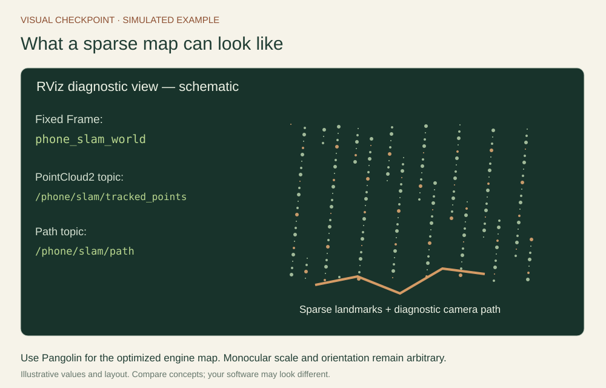

# A phone that helps build a map

Turn a phone into a sensor, inspect its measurements in ROS and watch a sparse reconstruction grow.

## Understand the project and its result

Install the small native **Android sensor app** supplied in Resources. It reads a rear camera through Camera2 and motion sensors through SensorManager, sends packets over a secure WebSocket, and shows its capture mode. The laptop’s phone_bridge turns those packets into standard ROS messages. A separately prepared adapter passes calibrated images into **ORB-SLAM3**, whose viewer displays sparse 3D landmarks and camera keyframes.

**SLAM** means simultaneous localization and mapping: estimate camera motion while building a representation of the scene. **Visual odometry** estimates motion locally. A SLAM system also maintains a map and may correct drift after recognizing a place it has visited before; this is called **loop closure**. A feature is a recognizable image location. Parallax is the change in its viewing direction as the camera moves sideways or forward.

The core mapper uses one camera. Correspondences between images and parallax support triangulation of scene points. The result has **arbitrary scale**: its relative structure can be useful even though its size in metres is unknown. The output is a sparse set of landmarks and keyframes. A dense mesh would describe surfaces much more completely; a navigation occupancy map would classify free and occupied space. Those are further processing goals.

An **IMU** measures acceleration and angular rate. The Android app preserves the individual accelerometer and gyroscope timestamps for inspection. The supplied mapper uses images; a camera–IMU fusion extension additionally needs measured intrinsics, extrinsics, timing, noise and a compatible integration pipeline. Annex C explains that path.

By the end, you should be able to pair a phone, display its image, inspect native motion topics, record a bag and explain a calibrated monocular mapping run. TLS setup, per-mode camera calibration and backend compilation are pre-class preparation. Use the native Android app for both connection options: wired USB or wireless over the phone hotspot. [Annex E](../annexes/android-connections.md) gives the complete setup for each.



## Follow a measurement through the system


The Android app uses Camera2 image timestamps when its camera reports **REALTIME**. Android motion events use SensorEvent timestamps. With that camera capability, both use the phone’s elapsed-realtime clock domain. Cameras reporting UNKNOWN use an explicitly labelled image callback estimate in this app. Check the source displayed on your actual phone; device support varies.

The app converts native unrotated YUV pixels into JPEG without rotating, mirroring or resizing them. The receiver decodes the JPEG to a bgr8 Image and publishes matching CameraInfo. The image Header gives time and frame; CameraInfo describes pixel projection and calibration. Zero camera intrinsics indicate that a measured calibration has not yet been loaded.

The phone is a sensor client. The **bridge** is the ROS node. Keep ROS discovery local to Ubuntu while one secure WebSocket carries the sensor data. Choose one connection option:

| Connection | How it reaches the receiver | App endpoint |
| --- | --- | --- |
| **Option 1: wired USB** | ADB reverse forwards the phone port over a data cable | wss://127.0.0.1:8443/ws/android |
| **Option 2: wireless** | Laptop joins this phone's Wi-Fi hotspot | wss://LAPTOP_HOTSPOT_IP:8443/ws/android |

Follow [Annex E](../annexes/android-connections.md) to set up your choice on native Ubuntu. [Annex F](../annexes/wsl-capstone.md) adds Windows/WSL forwarding. Both options use the same Android app, receiver, ROS topics and calibration. USB movement is limited by the cable. Wireless allows freer movement; nearby hotspots still share radio airtime.



## Pair the Android app and see real images

In a sourced Ubuntu terminal, run the updated receiver with the certificate and key prepared in Phone lab setup:

```bash
source /opt/ros/jazzy/setup.bash
source ~/ros2_ws/install/setup.bash
unset ROS_LOCALHOST_ONLY
export ROS_AUTOMATIC_DISCOVERY_RANGE=LOCALHOST
export ROS_DOMAIN_ID=42
ros2 run ros2_course_py phone_bridge \
  --cert ~/phone-lab/laptop.pem --key ~/phone-lab/laptop-key.pem
```

The terminal prints a fresh token and **ANDROID SERVER CERTIFICATE SHA-256**. In the app, enter wss://LAPTOP_IP:8443/ws/android, that token and the certificate fingerprint. Use your laptop’s actual hotspot address. With the USB reverse route established, use wss://127.0.0.1:8443/ws/android instead. Start capture, grant camera access if requested and tap Start again. Keep the app visible.


The certificate fingerprint identifies the intended TLS server. The token authorizes the session. The native app checks the exact certificate pin in its own connection, so it needs no phone-wide development CA installation. A renewed certificate requires its new fingerprint. Both USB and wireless use this same certificate pin and session token.

In a second sourced Ubuntu terminal:

```bash
ros2 node list
ros2 topic list -t
ros2 topic info /phone/camera/image_raw --verbose
ros2 topic hz /phone/camera/image_raw
ros2 topic echo /phone/diagnostics
ros2 run image_view image_view --ros-args -r image:=/phone/camera/image_raw
```

Run the long-lived inspection commands one at a time or in separate terminals. Expect /phone_bridge, your camera scene in image_view and a rate near the 10 fps send target under suitable conditions. The app preview uses the same native pixel orientation, so a portrait phone may show a landscape-oriented image. Record the actual dimensions and clock source. Missing motion sensors are reported; the camera exercise can still proceed.


## Inspect inertial samples and time

The app publishes accelerometer and gyroscope events independently. The receiver retains their separate timestamps in two topics:

```bash
ros2 topic echo /phone/imu/accelerometer --once --qos-reliability best_effort
ros2 topic echo /phone/imu/gyroscope --once --qos-reliability best_effort
ros2 topic hz /phone/imu/accelerometer
```

Accelerometer values use m/s² and include the gravity-related response. Gyroscope values use rad/s. The frame phone_android_device uses Android device axes. Each ROS Imu message marks orientation and the other sensor component unavailable using covariance[0] = -1. Each available component retains its own event time. A future estimator that expects combined IMU samples needs an explicit alignment/interpolation stage.

Hold the phone still, then turn it about one axis. Observe the angular component that responds and document the sign. A stationary accelerometer magnitude is often near 9.8 m/s². These checks establish units and basic behavior. Camera–IMU extrinsics measure the physical relationship between camera and device axes; obtain them before adding that edge to TF.



Seven request/reply exchanges estimate an offset from phone elapsed time to laptop ROS wall time. The app keeps the lowest-RTT estimate. Network asymmetry, drift and camera exposure/readout remain sources of error. REALTIME camera metadata establishes a shared phone timebase; validate the actual data before claiming suitability for inertial estimation. For live capture, use_sim_time stays false.


## Calibrate the transmitted camera mode

Camera intrinsics describe focal lengths and principal point in pixels. Distortion coefficients describe the lens model. Calibrate the **Android app’s actual transmitted pixels** using the checkerboard workflow in Annex C. Record camera ID, image dimensions, orientation, focus mode and app version. Changing the acquisition app, camera ID, crop or geometry requires fresh calibration or an independently justified conversion.

The app requests video and optical stabilization off and uses continuous-video focus when available. Check that your chosen device behaves consistently; focus and vendor processing can still change the effective model. Hold one phone orientation throughout the calibrated run.

Save the measured ROS YAML, then restart the bridge with it:

```bash
ros2 run ros2_course_py phone_bridge \
  --cert ~/phone-lab/laptop.pem --key ~/phone-lab/laptop-key.pem \
  --calibration ~/phone-lab/camera.yaml
```

The bridge checks dimensions and publishes matching CameraInfo. The supplied calibration_to_orb.py converts supported measured pinhole plumb_bob values into the optional mapper’s settings file. It changes file format; the calibration tool supplies the measurements.



## Watch a sparse reconstruction grow

Use the instructor-prepared optional phone_orb_slam3 workspace and the measured settings from Phone lab setup. Its engine, vocabulary and tested dependency versions are prepared separately from the beginner packages. With that workspace sourced, run:

```bash
ros2 run phone_orb_slam3 phone_mono --ros-args \
  -p vocabulary:=$HOME/ORB_SLAM3/Vocabulary/ORBvoc.txt \
  -p settings:=$HOME/phone-lab/phone-orb.yaml \
  -p keyframe_output:=$HOME/phone-lab/keyframes.txt
```

Choose a well-lit, textured, mostly static scene. Translate gently sideways to provide parallax for initialization. Once tracking starts, move slowly with overlapping views and attempt a small loop. The Pangolin viewer shows landmarks and keyframes. Record tracking state and the motion that helped initialization; motion blur, a blank wall or moving people can make tracking fail.

The adapter publishes camera_pose, tracked_points, path and status under /phone/slam. In RViz set Fixed Frame to phone_slam_world and add PointCloud2 and Path displays for the corresponding topics. The ROS cloud contains currently tracked landmarks. The bounded ROS path is a diagnostic history whose old poses are not revised after loop closure. Inspect the engine viewer for its optimized sparse map.



The reconstruction’s scale and gravity direction need an additional alignment step before its coordinates can be attached to a metric robot’s TF tree. The supplied adapter publishes visualization poses in its own world frame. Lecture 4’s map/odom/base_link chain explains how a metric robot organizes its geometry.

## Record, replay and diagnose

Record a short, consented run with native component topics:

```bash
mkdir -p ~/phone-lab
ros2 bag record -o ~/phone-lab/walk01 \
  /phone/camera/image_raw /phone/camera/camera_info \
  /phone/imu/accelerometer /phone/imu/gyroscope /phone/diagnostics
```

Stop the recorder cleanly with Ctrl+C. Stop live capture and the mapper. Start a fresh mapper with the same measured settings and append -p use_sim_time:=true to its --ros-args parameters. In another terminal:

```bash
ros2 bag info ~/phone-lab/walk01
ros2 bag play ~/phone-lab/walk01 --clock --rate 0.5
```

The replay clock aligns timestamp consumers with the recording. Half-speed playback reduces processing pressure while preserving recorded sample times. Save a real viewer screenshot and inspect the keyframe trajectory written on normal shutdown. A trajectory is a list of camera poses; it is a different artifact from a complete serialized SLAM map.

| Symptom | First check | Useful evidence |
| --- | --- | --- |
| APK cannot pair | Endpoint, exact certificate fingerprint and token | App error and receiver session state |
| WSL localhost test fails | Running receiver, port ownership and localhost forwarding | Windows port test and Ubuntu server terminal |
| App reports UNKNOWN camera clock | This device’s Camera2 timestamp capability | App display and diagnostics; keep camera-only scope |
| Native motion topic is silent | Sensor availability and app state | Per-sensor counter and received rate |
| Images arrive but initialization fails | Calibration, texture, translation and blur | Feature view and tracking state |
| Lag grows during movement | Transport/processing throughput | Received rate, queue behavior and RTT |
| TF query has no camera–IMU edge | Extrinsics have not been measured/published | Frame graph and sensor frame IDs |

## Explain your result and choose an extension

Suggested 180-minute session: pipeline/time 25 min; pairing/topics 30 min; frame/calibration review 20 min; break 10 min; mapping/recording 50 min; diagnosis 25 min; discussion 20 min. For five 90-minute meetings, assign the full mapping run as a follow-up lab. Use a qualified reference phone bag when a student device lacks the required capabilities.

Submit phone/OS/app checksum, camera ID/size/clock source, measured calibration, exact commands/backend versions, received-rate evidence, a bag checksum and one diagnosed fault. Include a real sparse-map screenshot and keyframe trajectory where mapping succeeds. Rubric: transport 25%; timing/frames/calibration reasoning 30%; reproducible recording/mapping evidence 25%; diagnosis and remaining limits 20%.

For a visual-inertial extension, qualify sensor timing, measure camera–IMU extrinsics and inertial noise/bias, define how independent sensor events feed the estimator and follow its initialization procedure. ORB-SLAM3 offers inertial modes, while this course adapter selects MONOCULAR. Read [Annex A](../annexes/android-development.md), [Annex C](../annexes/calibration.md) and the [WSL guide](../annexes/wsl-capstone.md) for the development and preparation details.

Official references: [Camera2](https://developer.android.com/media/camera/camera2), [SensorEvent](https://developer.android.com/reference/android/hardware/SensorEvent), [ORB-SLAM3](https://github.com/UZ-SLAMLab/ORB_SLAM3), [OpenVINS calibration](https://docs.openvins.com/gs-calibration.html), and [WSL networking](https://learn.microsoft.com/en-us/windows/wsl/networking).
